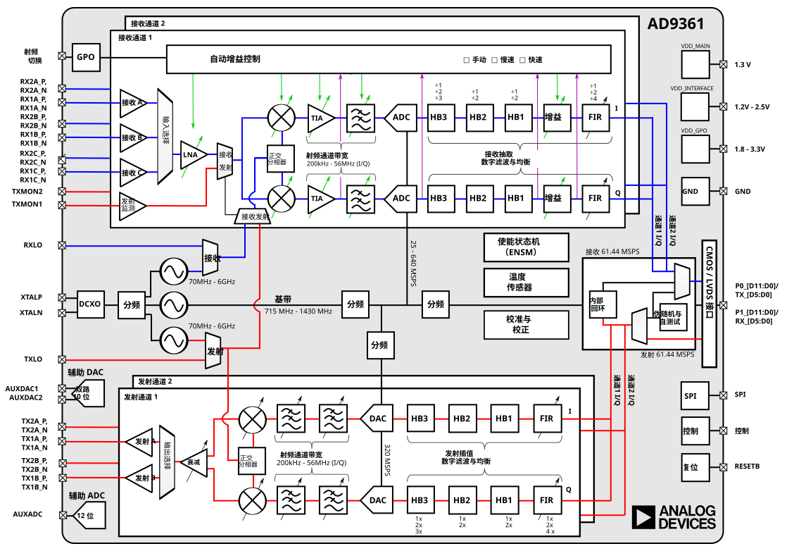

# AD9361、AD9364 和 AD9363：官方介绍中文翻译

根据用户提供的 ADI 网页存档逐段翻译，正文顺序对应原文。来源：[Analog Devices Wiki](https://wiki.analog.com/resources/eval/user-guides/ad9361)。存档标示的批准版本为 2018 年 9 月 4 日，最后修改于 2018 年 2 月 15 日。本页为非官方中文翻译，译注单独标明；不包含导航、登录与 Cookie 界面。

## 1. AD9361、AD9364 和 AD9363

[AD9361](https://www.analog.com/AD9361)、[AD9364](https://www.analog.com/AD9364) 和 [AD9363](https://www.analog.com/AD9363) 是高性能、高集成度的捷变射频收发器（RF Agile Transceiver™）。它们具有可编程性和宽带能力，适合广泛的收发应用。这些器件将射频前端、灵活的混合信号基带部分以及集成频率合成器结合在一起，并通过可配置的数字接口连接处理器，从而简化系统设计。

AD9361 和 AD9364 的工作频率为 70 MHz 至 6.0 GHz，AD9363 为 380 MHz 至 3.8 GHz，覆盖大多数授权和非授权频段。AD9361 和 AD9364 的通道带宽为 200 kHz 至 56 MHz，AD9363 为 200 kHz 至 20 MHz。AD9361 和 AD9363 都是双接收、双发射器件，AD9364 则为单接收、单发射器件。

三种器件均采用相同的 10 mm × 10 mm、144 球芯片级球栅阵列封装（CSP_BGA），具有通用封装占位，因此很容易从单收单发过渡到双收双发。

!!! note "译注"
    这里保留原文的 AD9363 下限 380 MHz。这是存档对芯片的描述，不应直接作为 PlutoSDR 成品板的保证规格；板卡接口、固件和驱动还需分别核对。

## 2. 框图（Block Diagram）

图源为用户提供网页所附的 ADI SVG。中文图保留原图的连线、位置、引脚名称和数值，翻译功能文字；标准缩写保留以便对照手册。点击图片可放大。

[英文原图](assets/ad936x/ad9361-original.svg) · [单独查看中文图](assets/ad936x/ad9361-zh.svg)

| 缩写 | 中文含义 |
| --- | --- |
| LNA / TIA | 低噪声放大器／跨阻放大器 |
| ADC / DAC | 模数／数模转换器 |
| HB1、HB2、HB3 | 第 1、2、3 级半带滤波器 |
| FIR | 有限冲激响应滤波器 |
| GPO | 通用输出 |
| AUX ADC / AUX DAC | 辅助模数／数模转换器 |
| DCXO | 数字控制晶体振荡器 |
| PN / BIST | 伪随机序列／内建自测试 |
| ENSM | 使能状态机 |

!!! note "译注：图与正文的差异"
    原图标有 Rx/Tx 61.44 MSPS，原文滤波章节却写数字基带最高 64.11 MSPS。本页分别保留原始写法，不擅自统一；实际可用速率请按器件手册与板卡配置确认。

## 3. 总体说明（General Description）

AD9361 和 AD9364 是高度集成的射频（RF）收发器，可配置用于广泛的应用。它们在单个器件内集成了实现全部收发功能所需的射频、混合信号和数字模块。可编程特性使这种宽带收发器能够适配多种通信标准，包括频分双工（FDD）和时分双工（TDD）系统。

这种可编程性也使器件能够通过单个 12 位并行数据端口、双 12 位并行数据端口，或 12 位低电压差分信号（LVDS）接口，连接不同的基带处理器（BBP）。AD-FMCOMMS2-EBZ、AD-FMCOMMS3-EBZ、AD-FMCOMMS4-EBZ 和 AD-FMCOMMS5-EBZ 使用 LVDS 接口，因为 CMOS 的驱动能力太弱，不足以通过连接器进行传输。

AD9361 和 AD9364 还提供自校准和自动增益控制（AGC）系统，以便在温度和输入信号条件变化时维持高性能。此外，器件提供多种测试模式，允许系统设计者注入测试音，并建立内部回环。设计者可以在原型开发过程中使用这些功能调试设计，并针对具体应用优化射频配置。

## 4. 接收链路（Receive Chain）

接收器部分包含接收射频信号并将其转换为基带处理器可用数字数据所需的全部模块。它具有两个独立控制的通道，可以接收来自不同来源的信号，因此可在共享同一个频率合成器的情况下用于多输入多输出（MIMO）系统。

每个通道具有三个输入，可以通过多路选择接入信号链，使 AD9361 适用于具有多个天线输入的分集系统。接收器采用直接变频结构，包含低噪声放大器（LNA），以及位于其后的匹配同相（I）与正交（Q）放大器、混频器和频带整形滤波器。这些模块将接收信号下变频到基带，以便数字化。器件还可以连接外部 LNA，使设计者能够灵活地针对具体应用定制接收前端。

AD9361 的 RX 信号路径将下变频后的 I 和 Q 信号送入基带接收部分。基带 RX 信号路径由两个可编程模拟低通滤波器、一个 12 位 ADC 和四级数字抽取滤波器组成。四级抽取滤波器中的每一级都可以旁路。各个低通滤波器的截止频率均可编程。需要注意，I 和 Q 路径在原理结构上相同。

!!! note "译注：I、Q 各有 ADC 路径"
    上段按原文描述路径组成。不能理解为一个 ADC 只采 I、不采 Q；框图中 I 和 Q 分别绘有 ADC。

增益控制依据预先编程的增益索引映射表实现。该表将增益分配到各个模块，使不同增益档位都获得优化的性能。可以启用内部 AGC 的快速或慢速模式，也可以使用手动增益控制，由基带处理器按需调整增益。此外，每个通道都具有独立的接收信号强度指示（RSSI）测量能力、直流偏移跟踪能力，以及自校准所需的全部电路。

接收器包含 12 位 Σ-Δ（sigma-delta）ADC，其采样率可调，用于将接收信号转换为数据流。数字化后的信号可以通过一系列抽取滤波器，以及一个完全可编程、带有附加抽取设置的 128 抽头 FIR 滤波器，进一步调理。通过改变抽取因子，可以调整各数字滤波模块的采样率，从而得到所需的输出数据率。

## 5. 发射链路（Transmit Chain）

发射器部分由两个相同、独立控制的通道组成。它们包含实现直接变频系统所需的全部数字处理、混合信号和射频模块，并共享一个频率合成器。

TX 信号路径从数字接口接收 I/Q 格式的 12 位二进制补码数据。I 和 Q 每一路的数据都通过一个完全可编程、支持插值选项的 128 抽头 FIR 滤波器。FIR 输出随后送入额外的一系列插值滤波器，在到达 12 位 DAC 之前完成进一步滤波和数据率插值。FIR 滤波器和三个插值滤波器都可以根据需要独立控制和旁路。每个 12 位 DAC 的采样率都可调整。

DAC 的模拟输出在进入射频混频器之前，先通过两个低通滤波器，以去除采样产生的杂散成分。每个低通滤波器的截止频率均可编程。此时，I 和 Q 信号重新合成，并调制到载波频率上，送往输出级。合成后的信号还会通过模拟滤波器进行进一步的频带整形，然后送到输出放大器。每个发射通道均提供范围较宽、步进精细的衰减调节，帮助设计者优化信噪比（SNR）。

需要注意，I 和 Q 路径在原理结构上相同。

每个发射通道内置自校准电路，可进行自动实时调整。发射器还为每个通道提供 TX 监测模块。该模块监测发射器输出，并通过一个未使用的接收通道将信号送回基带处理器，实现信号监测。TX 监测模块仅在 TDD 工作模式、且接收器空闲时可用。

## 6. 收发滤波（Rx and Tx Filtering）

接收和发射链路中均包含以下滤波器：

- 模拟低通滤波器：在发射端去除采样产生的杂散成分；在接收端进行频带整形，以减小邻道干扰。
- 数字插值／抽取滤波器：在数字基带速率（最高 64.11 MSPS）与实际 ADC（640 MSPS）或 DAC（320 MSPS）速率之间进行数据率的升降转换。

无论采用模拟还是数字实现，这些滤波器都会影响通带内的幅度和相位，系统必须在某处予以补偿。这种补偿很容易在 128 抽头 FIR 滤波器内实现，因此通常也在这里完成。FIR 不仅用于实现低通滤波，还用于补偿模拟滤波器和数字半带滤波器在所关注基带范围内引入的幅度与相位影响。

这些滤波器取决于采样率、时钟、数据率以及射频带宽：数据率决定数字半带滤波器的设置，射频带宽决定模拟滤波器的设置。加载滤波器后再改变系统中的相关配置，会对整体基带性能产生不利影响。

因此，ADI 提供了 [AD9361/AD9364 滤波器工具](https://wiki.analog.com/resources/eval/user-guides/ad-fmcomms2-ebz/software/filters)。它可以设计低通滤波器，并确保模拟滤波器或数字半带滤波器引入的幅度和相位影响，能够通过 FIR 系数得到恰当补偿。

## 7. 时钟选项（Clock Options）

AD9361 使用分数 N 锁相环（PLL）产生发射和接收本振（LO）频率，以及供数据转换器、数字滤波器和 I/O 端口使用的时钟（基带 PLL）。这些 PLL 都需要参考时钟输入。器件具有数字控制晶体振荡器（DCXO）功能，其中包含片上可编程／可变电容。该电容可用于校正晶体频率偏差，从而获得更准确的参考时钟，其他频率信号均由此产生。

DCXO 的输入可以来自两种不同的来源：

1. 将外部振荡器或时钟分配器件，例如 AD9548，连接到 XTALN 引脚，XTALP 引脚保持不连接。使用外部振荡器时，频率范围为 10 MHz 至 80 MHz。这适用于无线基站等要求参考时钟锁定到系统主时钟的应用。
2. 将频率为 19 MHz 至 50 MHz 的专用晶体连接在 XTALP 和 XTALN 引脚之间。此方式通常用于无线用户设备（UE）。这类设备一般不需要锁定到主时钟，但需要定期调整本振频率，以维持与基站（BTS）的连接。基站会不时将用户设备相对基站的频率误差告知设备，基带处理器便可按需调整参考时钟频率，进而调整本振频率。

DCXO 调谐功能还可以与片上温度传感器配合，在正常工作期间对振荡器频率进行温度补偿。

原文脚注：专用晶体采用 AT 切、基频振动模式，负载电容为 10 pF。

## 8. 返回教程

- [增益与收发链路](gain-link.md)
- [信息波接收与逐步解析](receiver.md)

原文与配图版权归各自权利人所有。正文与图源均为用户提供的 ADI 网页存档；译注为教程补充，不属于 ADI 原文。
