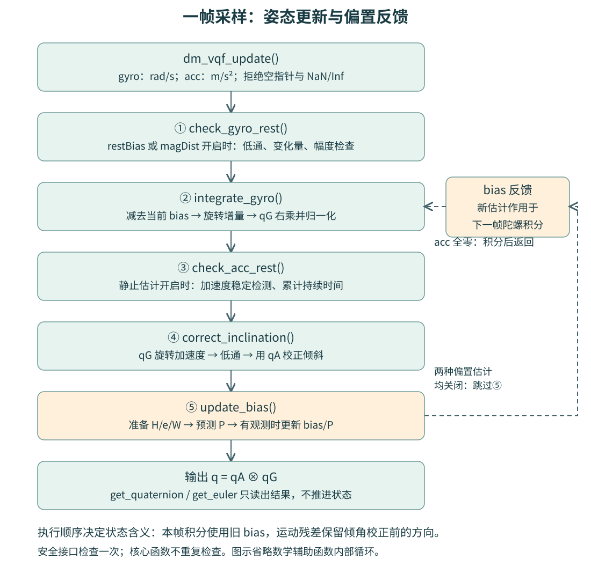
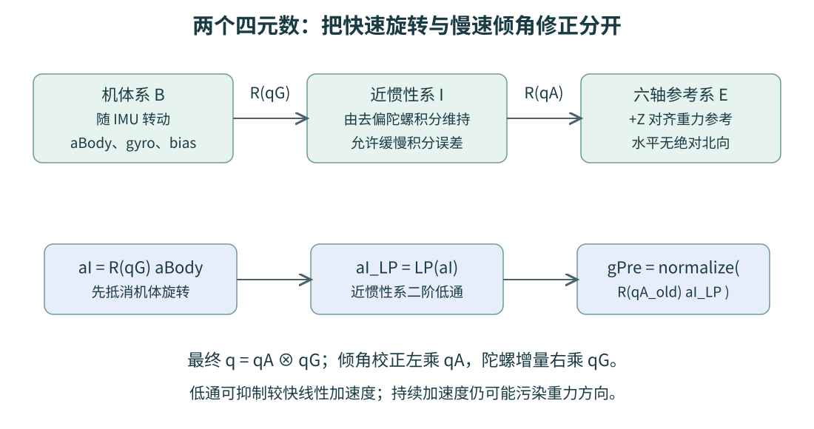
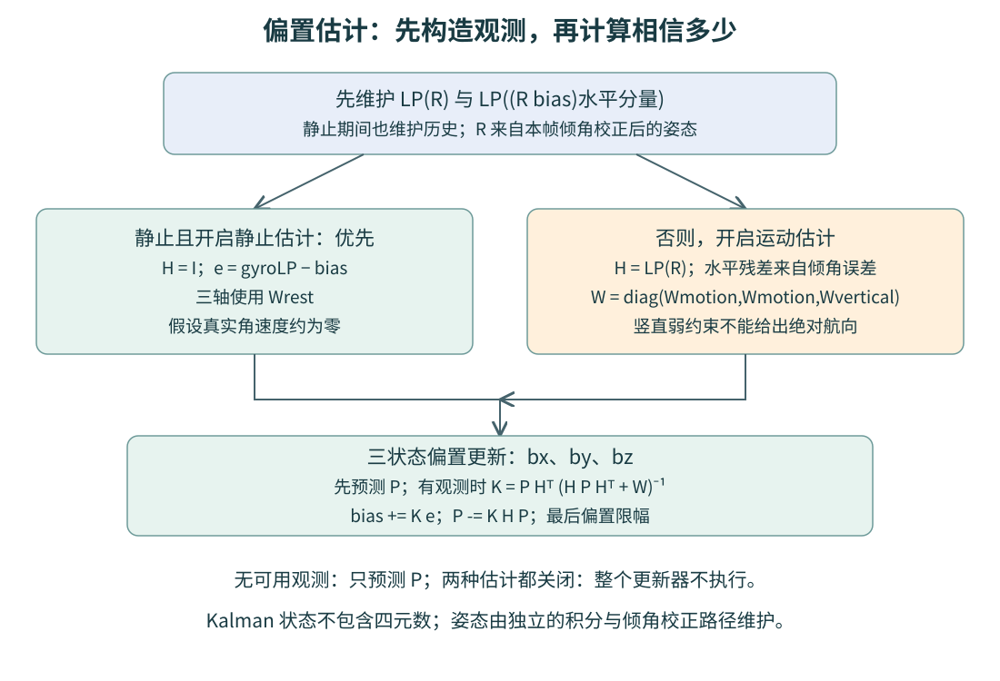
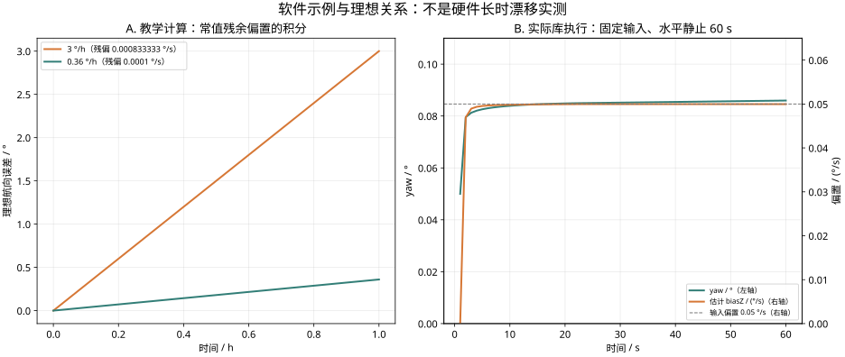

# DM IMU 六轴解算：沿 C 代码理解 VQF、静止检测与零偏估计

这篇教程从 `dm_vqf_init_from_saved_calibration()` 的初始化开始，沿 `dm_vqf_update_core()` 的实际执行顺序，解释一帧陀螺和加速度怎样变成姿态，再解释零偏估计为什么能减小长期漂移。可以同时下载 [中文注释 C 解算库](assets/dm-imu-vqf/dm_vqf_library.zip)，对照函数阅读。

本文针对 **DM v2.0.3.0 的已审计六轴核心**。库是依据公开 VQF 与固件指令证据整理的可读 C 实现，不是厂商原始源码；不包含传感器驱动、温度补偿、Flash 驱动和全部固件调度。[VQF 官方文档](https://vqf.readthedocs.io/en/latest/)区分了完整、基础及离线版本；这里保留六轴姿态、静止与运动零偏估计，不实现磁力计航向融合。

## 1. 先把整套算法看成两条相互配合的路径

第一条路径估计姿态：**陀螺负责快速跟随旋转，加速度负责纠正倾斜**。第二条路径估计陀螺零偏：**静止时直接观察偏置，运动时利用倾角校正提供的间接信息**。估计出的偏置会在下一次积分前从角速度中减掉。



图中返回位置属于真实代码流程。加速度三个分量全为零时，本帧陀螺积分已经执行，后面的加速度处理和偏置更新则跳过。偏置更新位于积分之后，因此新偏置从下一帧开始影响积分。

对应的调用层次如下。公开安全接口只检查一次输入，数学细节集中在独立模块，不需要一开始就钻进矩阵乘法。

```text
dm_vqf_update(gyro, acc)               检查指针和 NaN/Inf
└─ dm_vqf_update_core()
   ├─ check_gyro_rest()               必要时检查陀螺稳定性
   ├─ integrate_gyro()                减 bias，更新 qG
   ├─ acc == [0,0,0] ? return
   ├─ check_acc_rest()                启用静止估计时累计静止时间
   ├─ correct_inclination()           先旋转、再低通，更新 qA
   └─ update_bias()                  至少启用一种偏置估计时执行
      ├─ prepare_bias_measurement()  维护历史，选择观测
      ├─ 预测协方差 P
      ├─ 没有观测 ? return
      └─ 计算增益 K，更新 bias 和 P

dm_vqf_get_quaternion()               输出 qA ⊗ qG
dm_vqf_get_euler_deg()                转换为 roll、pitch、yaw
```

## 2. 输入、坐标系与状态分别是什么

### 2.1 每帧输入与输出

| 对象 | 本实现的约定 | 接入时容易混淆的地方 |
|---|---|---|
| `gyro_rad_s[3]` | 三轴角速度，rad/s，右手系 | 不能直接把 deg/s 数值传进来 |
| `acc_mps2[3]` | 三轴加速度计输出，m/s² | 标准水平静止输入为 `[0,0,+g]`，不是扣除重力后的零向量 |
| `sample_period_s` | 初始化时指定的固定周期 | 标定入口固定为 0.0005 s，即 2 kHz |
| 输出四元数 | `[w,x,y,z]`，body → 六轴参考系 | 不要当成反向旋转或 `[x,y,z,w]` |
| 欧拉角 | ZYX 对应的 roll、pitch、yaw，单位 ° | 它是输出表示，不是内部积分状态 |
| `bias_rad_s[3]` | 机体系陀螺偏置，rad/s | 参数表的阈值与标准差却多用 deg/s |

加速度计测的是比力。本文把用于倾角校正的归一化加速度称为“重力参考方向”，这是静止或线性加速度经滤波后足够小时的解释，并不表示任意运动时加速度计都只测到重力。安装坐标变换应同时作用于陀螺和加速度，并保持右手系。

### 2.2 为什么保存两个四元数

代码中的两个姿态状态分工不同：

- `gyro_quat`，记为 **qG**：仅由去偏后的陀螺积分得到，将机体系 B 的向量旋转到近惯性系 I。
- `tilt_quat`，记为 **qA**：补偿近惯性系的倾角误差，将 I 系向量旋转到六轴参考系 E。

因此最终姿态为 `q = qA ⊗ qG`。这里 `⊗` 表示 Hamilton 四元数乘法；乘法次序不能交换。



“近惯性”指的是这个坐标系短时间内相对稳定，允许有陀螺积分误差；它不是一个经过外部真值保证的完美惯性系。E 系的竖直方向由加速度约束，水平方向没有磁北、真北或外部航向参考。重启后的 yaw 原点也不等于绝对北向。

### 2.3 Kalman 滤波的状态只有三维

`bias_covariance[9]` 是偏置的 3×3 协方差矩阵 P，描述三轴偏置估计的不确定度及轴间相关性。**本实现没有把四元数和偏置拼成一个统一的大状态 EKF**。姿态四元数由专门的积分和倾角校正更新；Kalman 部分只估计 `bx、by、bz`。

## 3. 初始化：参数怎样变成系数和初始状态

### 3.1 默认参数

`dm_vqf_default_params()` 给出以下值。它们分别控制滤波、静止检测、偏置变化速度和观测信任程度，不能都理解成姿态融合的一个“Kp”。

| 字段 | 默认值 | 作用 |
|---|---:|---|
| `acc_filter_tau_s` | 3 s | 近惯性系加速度、旋转矩阵及旋转后偏置的主低通时间常数 |
| `estimate_bias_during_motion` | true | 开启运动零偏估计 |
| `estimate_bias_at_rest` | true | 开启静止零偏估计及加速度静止检测 |
| `mag_dist_rejection_enabled` | true | 此六轴核心中仍影响是否维护陀螺静止监测，不意味着已经融合磁力计 |
| `initial_bias_sigma_dps` | 0.5 °/s | 无保存标定时的初始偏置标准差 |
| `bias_forgetting_time_s` | 100 s | 构造偏置过程方差 V |
| `bias_clip_dps` | 2 °/s | 偏置及残差限幅，也作为低通陀螺各轴的静止幅度门限 |
| `motion_bias_sigma_dps` | 0.1 °/s | 构造运动观测权重 |
| `vertical_bias_forgetting_factor` | 0.0001 | 令竖直方向观测远弱于水平方向 |
| `rest_bias_sigma_dps` | 0.03 °/s | 构造静止观测权重 |
| `rest_min_time_s` | 1.5 s | 稳定条件持续时间 |
| `rest_filter_tau_s` | 0.5 s | 陀螺和加速度静止检测低通 |
| `rest_gyro_threshold_dps` | 3 °/s | 陀螺相对低通结果的变化门限 |
| `rest_acc_threshold_mps2` | 0.5 m/s² | 加速度相对低通结果的变化门限 |

### 3.2 `dm_vqf_init()`：先算系数，再提交完整实例

初始化先检查采样周期和参数，在局部 `DmVqf` 中设计两组二阶低通，计算偏置权重，调用 `dm_vqf_reset()`，最后一次性写入调用方实例。失败不会留下半初始化状态。

偏置权重使用 VQF 的缩放坐标。P 和 W 的数值按 `(0.01 °/s)²` 表示，而实际偏置和残差用 rad/s。P 与 W 共同采用相同缩放，所以增益计算中的比例保持一致；不要单独改其中一项的单位。

```text
P0       = (sigmaInit × 100)²
V        = 10² × Ts / forgettingTime
pMotion  = (sigmaMotion × 100)²
Wmotion  = pMotion² / V + pMotion
Wvertical= Wmotion / max(verticalFactor, 1e-10)
pRest    = (sigmaRest × 100)²
Wrest    = pRest² / V + pRest
```

默认 Ts = 0.0005 s 时，概念数值为：`P0=2500`、`V=0.0005`、`Wmotion≈20000100`、`Wvertical≈2.00001×10¹¹`、`Wrest≈162009`。实际 float32 的逐步舍入会使最后几位不同，例如审计得到 `Wvertical=200001011712`；这些不是额外的调参值。

W 越大，代表这一路观测越不可信，产生的修正通常越弱。它是观测权重，不能直接称作“本帧实际测到的噪声方差”。

### 3.3 `dm_vqf_reset()`：恢复哪些状态

复位令 `qG=qA=[1,0,0,0]`，bias 归零，P 设为 `P0×I`；清除静止标志、计时和诊断量。它保留采样周期、参数和已经设计的系数。

所有低通延迟状态设为 **NaN**。这里 NaN 是启动标记，下一帧会进入累计平均模式，不是让算法持续输出 NaN。直接改成全零会改变启动瞬态；开启假定不存在 NaN 的 `-ffast-math` 也可能破坏这条逻辑。

### 3.4 保存标定入口有一处必须保留的特殊倍率

`dm_vqf_init_from_saved_calibration()` 的顺序是：

1. 没有有效保存记录时，以默认参数和 0.5 ms 周期初始化。
2. 有保存记录时，把陀螺静止阈值限制到 `[0.5,20] °/s`，把保存的 sigma 下限设为 0.05。
3. 用这个 sigma 先计算 `P0=(sigma×100)²` 和全部派生系数，再复位状态。
4. 载入三轴偏置：`bias = savedBiasDps × π/180`。
5. 用另一倍率覆盖 P：`P = (sigma×5729.578125)² × I`。

第 5 步来自已审计固件，**与 P0 的 100 倍率不同**。这里只能确认固件行为，不能凭这个数推断保存 sigma 的设计意图。`dm_vqf_set_bias()` 使用的是通用 `(sigmaDps×100)²`，所以不能用它替换保存标定入口并声称启动行为相同。之后调用 reset 也会丢掉已加载 bias，并把 P 恢复为 P0。

## 4. 第一步：`check_gyro_rest()` 检查陀螺是否足够稳定

仅当 `estimate_bias_at_rest || mag_dist_rejection_enabled` 为真时执行。函数拿到的是尚未减 bias 的陀螺输入，先用 0.5 s 低通得到 `ωLP`，再算：

```text
dω² = (ωx−ωLPx)² + (ωy−ωLPy)² + (ωz−ωLPz)²
```

出现以下任一条件，就清零 `rest_time_s` 并清除 `rest_detected`：

- `dω² >= (restGyroThreshold × π/180)²`。
- `ωLP` 任一轴的绝对值 `> biasClip × π/180`。

第一项检查“变化是否太大”，第二项阻止明显持续旋转被当作静止。这里变化量等于门限就失败，幅度等于门限仍允许。配置中的 3 °/s 与 2 °/s 属于不同指标，因此不矛盾。

这个函数只会**否定静止**，不会独自确认静止。慢速匀转且各项都处于门限内时，系统可能误判；没有外部真值时，静止检测本身就是假设，不能把低通后的稳定读数必然解释为偏置。

## 5. 第二步：`integrate_gyro()` 用四元数积分旋转

先使用进入本帧时已有的偏置：

```text
ωc = ωmeasured − bias
s  = ||ωc||
θ  = s × Ts
δq = [cos(θ/2), (sin(θ/2)/s) × ωcx,
                 (sin(θ/2)/s) × ωcy,
                 (sin(θ/2)/s) × ωcz]
qG ← normalize(qG ⊗ δq)
```

这就是“本采样间隔绕 ωc 方向旋转 θ”。四元数用旋转轴和半角表达三维旋转，可以连续复合姿态，避免用欧拉角直接积分时遇到的坐标奇异性。

代码只在 `s > FLT_EPSILON` 时执行乘法和归一化，否则保持 qG。这避免零角速度时计算 `sin(θ/2)/s` 的除零。`FLT_EPSILON` 是此代码选择的数值门限，不是 IMU 物理噪声指标。

例如本帧去偏后角速度是 `[0,0,1] rad/s`，Ts 为 0.0005 s，则 θ 为 0.0005 rad，增量约为 `[0.999999969,0,0,0.00025]`。它是理想实数示意；实际代码按 float32 运算。

陀螺积分短时间响应快，但残留常值偏置会累积成角度误差。加速度校正和在线偏置估计就是为这个问题服务的。

## 6. 第三步：`check_acc_rest()` 判断稳定是否持续足够久

如果本帧加速度恰为全零，主函数已经返回。否则，启用静止偏置估计时，对机体系加速度做 0.5 s 低通，计算 `da²=||a−aLP||²`：

```text
若 da² >= restAccThreshold²：
    rest_time = 0
    rest_detected = false
否则：
    rest_time += Ts
    若 rest_time >= restMinTime：rest_detected = true
```

默认至少持续 1.5 s，约对应 3000 个 0.5 ms 步长；实际阈值跨越受 float 计时累加影响，不应硬编码为精确的第 3000 帧。

需要注意真实顺序：本帧陀螺检查即使刚把计时清零，若加速度检查通过，这里仍会再加一次 Ts。原实现没有另加一个“陀螺失败则本帧不累计”的联合布尔变量。持续的陀螺失败使计时反复回到约一个步长，通常不会达到默认 1.5 s。

静止成立的含义是“这些观测满足配置的稳定条件”，并不是证明设备物理速度为零。匀速直线运动、缓慢旋转或某些振动都要结合工况判断。

## 7. 第四步：`correct_inclination()` 为什么先旋转，再低通

### 7.1 直接在机体系低通有什么问题

设备纯旋转时，即使没有线性加速度，重力在机体 XYZ 轴上的投影也会快速变化。若直接对这三个分量做慢速低通，正常姿态变化会被滤波滞后拖住，倾角响应变慢。

VQF 的关键处理是先借助陀螺姿态 qG 把加速度旋转到近惯性系，再做低通：

```text
aI      = R(qG) × aBody
aI_LP   = LPτ(aI)
gPre    = normalize(R(qA_old) × aI_LP)
```

纯旋转情况下，陀螺可以大致抵消机体坐标变化，使重力在近惯性系中较稳定。这时低通主要抑制快速变化的非重力成分，而不必把全部机体旋转也一起滤慢。这也是原论文所强调的近惯性系加速度滤波思路，见 [VQF 论文 v2](https://arxiv.org/abs/2203.17024v2)。

低通无法消除所有线性加速度。长时间持续加速可能被当成重力方向的一部分；它也不能补偿错误的轴向、错误的比例系数或严重的陀螺饱和。

### 7.2 `gPre` 怎样变成倾角修正

令归一化方向为 `[gx,gy,gz]`，目标是把它旋转到 `[0,0,1]`。代码构造：

```text
w  = sqrt((gz+1)/2)
δqA= [w, gy/(2w), −gx/(2w), 0]     当 w > 1e-6
δqA= [0,1,0,0]                    否则
qA ← normalize(δqA ⊗ qA)
```

这是一个对齐方向的最短旋转；沿当前竖直轴的航向没有由这一个向量确定。若方向几乎朝向 −Z，对应约 180° 反向，w 接近零，代码选择绕 X 轴 180° 的明确分支避免除零。

例如 `gPre=[0,0.1,sqrt(0.99)]`，需要约 5.74° 的 X 轴倾角修正，修正四元数近似 `[0.99875,0.05006,0,0]`。实际输入中的 `gPre` 已经过前面的坐标变换和低通，并不是原始加速度直接归一化。

`last_tilt_correction_rate_rad_s = acos(gz)/Ts` 是本帧校正角度除以周期的诊断量，不是额外的反馈参数。代码保留直接 acos 的行为，没有对 gz 先夹紧到 `[−1,1]`；舍入越界可能让这个诊断量为 NaN。

另一个容易忽略的时间关系：传给后续偏置估计的 `gPre` 是**倾角校正前**的方向；后续观测矩阵却从**校正后**的合成姿态构造。把 gPre 提前替换成 `[0,0,1]` 会丢掉运动零偏残差。

## 8. 低通细节：二阶 Butterworth 与启动平均

`dm_vqf_math_lowpass_design()` 只在初始化时设计系数。它采用二阶 Butterworth 低通，按下式由 τ 得到截止频率，而不是常见一阶 `1/(2πτ)`：

```text
fc = √2 / (2πτ)
c  = tan(π fc Ts)
d  = c² + √2 c + 1
b0 = c²/d,  b1 = 2b0,  b2 = b0
a1 = 2(c²−1)/d
a2 = (1−√2 c+c²)/d
```

默认 τ=3 s 时 fc≈0.0750 Hz；静止检测 τ=0.5 s 时 fc≈0.4502 Hz。它们是该参数化下的截止频率，不表示启动后必须等这么长才有输出。若 `τ<Ts/2`，代码改为直通；恰好相等时仍计算正常系数。

`dm_vqf_math_lowpass_vector()` 分两个阶段：

1. **启动平均**：识别 NaN 状态，逐帧累计样本，输出到当前为止的均值。当 `count×Ts>=τ`，用最后的均值建立双延迟初态。
2. **正常递推**：从下一帧开始按转置直接 II 型计算，每维使用两个 double 状态。

```text
y    = b0 × x + s0
s0'  = b1 × x − a1 × y + s1
s1'  = b2 × x − a2 × y
```

因此启动期间也每帧有输出，只是滤波规律与稳态阶段不同。输入输出是 float，系数与延迟状态是 double；在 2 kHz、低截止频率条件下，不应为了节省内存直接把 double 改成 float 并认为行为不变。

这些低通共用系数，但历史相互独立：主加速度 3 维、静止陀螺 3 维、静止加速度 3 维、旋转矩阵 9 维、旋转后偏置 2 维。

## 9. 第五步 A：`prepare_bias_measurement()` 从哪里获得偏置信息

无论随后进入静止分支还是运动分支，函数都先维护运动观测所需的滤波历史：

```text
q       = qA_new ⊗ qG
R       = R(q)
u       = (R × bias) 的前两维
H_LP    = LPτ(R)              9 个元素分别低通
u_LP    = LPτ(u)              2 个分量分别低通
```

`H_LP` 是矩阵元素分别滤波得到的矩阵，通常不再严格正交，不应该再做正交化。静止分支仍维护这些历史，是为了恢复运动时滤波历史连续。并且一般有 `LP(R×bias) != LP(R)×当前bias`，因为历史中的 bias 在变化，两项不能随意约掉。



### 9.1 静止优先：低通陀螺直接观察三轴偏置

当 `rest_detected && estimate_bias_at_rest` 成立：

```text
H = I
e = ωLP − bias
W = diag(Wrest, Wrest, Wrest)
```

物理假设是真实角速度约为零，因此测到的陀螺均值约等于偏置。这个观测对三个轴都起作用，包含设备水平放置时主要影响 yaw 的 Z 轴。

它同时解释了优势和风险：真正静止时可以估计重力无法单独约束的那一轴偏置；若把真实缓慢旋转误判为静止，则会把一部分真实角速度学进 bias。

### 9.2 运动分支：倾角误差提供水平偏置信息

不满足静止优先分支，但启用了运动偏置估计时：

```text
H = H_LP
e0 = −gy/Ts + u_LP[0] − H第0行 · bias
e1 = +gx/Ts + u_LP[1] − H第1行 · bias
e2 =                  − H第2行 · bias
W  = diag(Wmotion, Wmotion, Wvertical)
```

这里 gx、gy 取自上一节校正前的 gPre。在小倾角误差下，`[−gy,+gx]` 对应所需倾角修正的水平分量，除以 Ts 转成角速度尺度，再结合滤波后的旋转矩阵与偏置历史，形成偏置残差。大角度时应以代码公式为准，不能把“小角度解释”当成全局精确推导。

第三项不含外部竖直角速度测量，只是对竖直投影的弱约束。默认 `Wvertical` 比 `Wmotion` 大 10000 倍，所以这项很弱，**它不会凭空产生绝对 yaw 信息**。

这里的“水平、竖直”属于六轴参考系，并非固定的传感器 X/Y/Z 轴。设备姿态变化时，H 把机体系各轴偏置投影到参考系，合适的运动可以增加不同偏置分量的可辨识信息；长时间固定姿态仍保留围绕重力方向的限制。

### 9.3 两种观测都不可用

如果未静止且关闭了运动估计，函数返回 false。调用方依然先执行 P 的预测，然后才返回。若静止估计和运动估计一开始就都关闭，主入口不会调用 `update_bias()`，连这一预测也不会执行。这两个“没有观测”的情形不能混为一谈。

## 10. 第五步 B：`update_bias()` 怎样决定相信观测多少

### 10.1 先预测 P，再检查有无观测

每轴仅当 `Pii<P0` 时增加 V：

```text
if Pii < P0:
    Pii ← Pii + V
```

这是允许偏置随时间缓慢变化的“不确定度恢复”。它不是 `Pii=min(Pii+V,P0)`；一次相加后可以略大于 P0。保存标定载入的 P 可能已经远大于 P0，不能擅自把它夹回 P0。非对角元素在这一步不加 V。

### 10.2 残差限幅与 Kalman 增益

有观测时先逐轴限制 `e` 到 `±biasClip×π/180`，再计算：

```text
S = H P Hᵀ + W
K = P Hᵀ S⁻¹
bias ← bias + K e
P    ← P − K H P
```

直观上，P 表示“当前偏置还有多不确定”，W 表示“本次观测有多不可信”，K 决定据观测修正多少。它会随 P 和姿态相关 H 改变，而不是一个固定的姿态纠偏比例。

三轴通过矩阵相关项共同更新。静止且 P 近似对角时，可以用一维关系理解：`K=P/(P+Wrest)`。默认起始 K 约为 `2500/(2500+162009)≈0.0152`；后续 P 逐渐缩小，K 也变化。这只是该状态下的示例，不是整个运行过程中固定使用的常数。

最后再次逐轴限制 bias 到 `±2 °/s` 对应的 rad/s。该范围之外的真实偏置不能靠无限增加估计值来补偿。残差限幅和偏置限幅是两次不同的操作。

### 10.3 从源码追踪一个工作矩阵

为降低栈占用，`kalman_work[9]` 依次复用。读代码时按下表标记它当前代表什么，比只看变量名容易理解。

| 顺序 | `kalman_work` 的含义 |
|---|---|
| 1 | `P Hᵀ` |
| 2 | `H P Hᵀ` |
| 3 | 对角加 W 后得到 S，再原地求逆为 `S⁻¹` |
| 4 | `Hᵀ S⁻¹` |
| 5 | `P Hᵀ S⁻¹ = K`，此时更新 bias |
| 6 | `K H` |
| 7 | `K H P`，从原 P 中减去它 |

矩阵乘法先算临时结果再写回，因此允许输入输出使用同一数组。求逆用三阶伴随矩阵法；行列式落在闭区间 `[−FLT_EPSILON,+FLT_EPSILON]` 时输出零逆矩阵，相当于本次零增益。代码没有另加正则化、Joseph 协方差更新或对称化，不能为了美化把它们顺手加入。

## 11. 输出：为什么 yaw 仍会漂，以及小漂移来自哪里

### 11.1 `dm_vqf_get_quaternion()` 与欧拉角转换

输出只合成 `qA⊗qG`，不会再次更新状态。欧拉角转换先在局部归一化四元数，使用 ZYX 公式；`|sin(pitch)|>=0.99999` 时走奇异分支，固定 roll=0、pitch=±90°，按固件规则算 yaw。roll/yaw 包装在 `(−180°,180°]`，因此 −180° 输出为 +180°。

俯仰接近 ±90° 时，roll 与 yaw 不能独立唯一确定，欧拉角跳变不一定意味着内部姿态跳变。姿态控制或比较应优先使用四元数，不把欧拉角差直接当三维姿态误差。

### 11.2 小 yaw 漂移与绝对航向是两个指标

加速度提供一个竖直参考方向，绕该方向旋转不会改变这个向量，所以六轴融合无法仅由陀螺和加速度确定绝对航向。静止假设却可以提供“真实角速度约为零”的额外约束，从而估计三轴偏置，减慢后续的 yaw 积分漂移。

对于水平、固定姿态、残差近似常值的小误差情形：

```text
Δyaw ≈ residualBiasZ × elapsedTime
3 °/h 对应 3/3600 = 0.00083333 °/s ≈ 1.45444×10⁻⁵ rad/s
```

用户曾观察到 yaw 漂移小于 3°/h，但没有在本教程中提供可复算的原始长时数据、温度和测试流程，因此这里只把它作为待解释的观察，不当作本文独立测得的性能。低漂移可能共同来自传感器本底、出厂/温度标定、静止检测和在线偏置估计，不能仅凭核心函数确定各部分贡献。



左图是常值残余偏置的理想积分关系；右图来自库 `example.c` 的实际桌面执行结果：输入固定 Z 轴偏置 0.05 °/s、水平静止加速度、2 kHz、60 s。静止识别后估计偏置逐渐接近输入，yaw 增长大幅减缓。曲线是确定性软件示例，不含真实噪声、温度变化或线性加速度，不能外推为硬件一小时指标。可下载 [示例 CSV](assets/dm-imu-vqf/example_result.csv)。

静止学习主要减小**未来的漂移速度**，不会把此前已经积累的 yaw 误差自动拉回北向。图中的 yaw 最后保持一个非零值正是这个区别。

## 12. 按这条顺序接入和观察

先用四元数模块和单位约定跑通，再看静止标志与偏置，最后评价长期漂移。不要一开始同时改变时间常数、阈值和矩阵公式。

```c
#include "dm_vqf.h"

static DmVqf filter;
static bool ready;

bool fusion_init(void)
{
    /* NULL：没有可用保存标定；此入口周期固定为 0.5 ms。 */
    ready = dm_vqf_init_from_saved_calibration(&filter, NULL);
    return ready;
}

bool fusion_on_sample(const float gyro_rad_s[3], const float acc_mps2[3],
                      float quaternion_wxyz[4])
{
    if (!ready || !quaternion_wxyz) return false;
    if (!dm_vqf_update(&filter, gyro_rad_s, acc_mps2)) return false;
    dm_vqf_get_quaternion(&filter, quaternion_wxyz);
    return true;
}
```

项目只需编译 `dm_vqf.c` 和 `dm_vqf_math.c`，保留两个头文件和 LICENSE。也可以 `add_subdirectory()` 后链接 `dm_vqf::dm_vqf`。下载包内含详细集成说明、中文注释和可选应用适配层；不要将自带 main 的桌面 `example.c` 一起加入 MCU 应用。

| 观察对象 | 先判断什么 | 对应函数 |
|---|---|---|
| 轴向、单位、采样时间 | 静止 +Z，转动方向正确；deg/s 已换 rad/s；实际周期匹配 | 输入适配与 init |
| `rest_detected`、`rest_time_s` | 静置后能否成立，真实转动时是否解除 | 两个 check_rest |
| 两个 deviation_sq | 单位是各自输入单位的平方，不是直接与原阈值比较 | 两个 check_rest |
| `bias_rad_s` | 是否随静止收敛，是否长期顶在限幅上 | update_bias |
| qG、qA 和输出 q | 陀螺积分方向、倾角校正方向及四元数范数是否合理 | integrate/correct/get |
| 温度与 yaw 时间序列 | 预热、静置条件、时长和漂移统计方法是否一致 | 项目记录层 |

安全 `update()` 会拒绝 NaN/Inf 并保持状态；全零加速度却属于允许输入，返回 true，但只推进部分流程。它不是丢样自动恢复机制。采样调度、缺失样本处理、并发同步和传感器校准仍由项目负责。

若评估一小时漂移，至少记录传感器时间戳、三轴原始/校准后数据、温度、bias、静止标志和输出四元数，区分预热段与稳定段，并对 yaw 做合理的角度展开。平均斜率、首尾角差、最大摆幅和 Allan 偏差是不同指标，不应混用。“3°/h 的角度漂移率”也不等于完成了陀螺偏置不稳定性的标准统计测量。

## 13. 这份库已经验证到哪一步

下表是 2026-10-25 的本地验证记录。前三类均为软件证据，不是整板硬件运行结果。

| 验证对象 | 方法与数量 | 结果与范围 |
|---|---|---|
| 与公开 VQF 的算法对照 | 单精度参考，4 配置×5场景，992000 点 | 所测四元数分量、bias、P 误差均为 0；不代替 DM 专有启动路径验证 |
| 与原固件核心的对照 | Unicorn 执行原 BIN 字节，22 轨迹、147200 点 | 最大姿态角差约 0.0000943064°；静止标志无差异 |
| 初始化与边界 | 4 组初始化；16 核心/矩阵、11 欧拉角、4 系数及3启动检查 | 初始化参数、权重、系数与状态匹配；所测边界通过 |
| 可读性整理前后 | 核心 token 审计及原 BIN 回归 | 限定的改名与等价提前返回之外，表达式和系数未改；回归记录一致 |
| 项目接入 | C11 编译、CMake 构建安装、外部工程与适配层运行 | 桌面环境通过；目标 MCU 执行时间与浮点模式需实际确认 |

原 BIN 对照还有非零的最大偏置分量差约 `3.45521e-7 rad/s`、P 元素差 `0.0234375`（内部缩放单位），因此结论是所测条件下的近似数值等价，不是任意输入逐位相同。仿真使用 Thumb/VFP 指令环境，未模拟整板外设、真实中断和 Cortex-M 启动后的完整浮点模式。

对应升级包 SHA-256：

```text
67283dc1defe86c029f4f0588744f452e08519964fac8cf53b6659bc9278e8a1
```

库下载包附 MIT LICENSE 和验证记录。网站不分发原始固件、解密镜像或硬件访问工具。

## 14. 源码阅读路线与原始资料

第一次阅读先看 `dm_vqf.h` 的单位与状态，再从 `dm_vqf_update_core()` 顺序读五个阶段；第二次重点追踪 `correct_inclination()` 的 gPre 和 `prepare_bias_measurement()` 的 H、e、W；最后再看低通启动、矩阵求逆和初始化特殊倍率。

- [中文注释 C 解算库与接入示例](assets/dm-imu-vqf/dm_vqf_library.zip)：本教程对应的源码版本。
- [固定输入桌面示例 CSV](assets/dm-imu-vqf/example_result.csv)：图示右侧数据。
- [VQF 官方文档](https://vqf.readthedocs.io/en/latest/)：算法变体、接口与参数语义。
- [VQF 官方开源仓库](https://github.com/dlaidig/vqf)：公开 C++ 实现及 MIT 授权。
- [Laidig 与 Seel，VQF 论文 v2](https://arxiv.org/abs/2203.17024v2)：近惯性系滤波、偏置估计与算法验证的理论来源，后发表于 Information Fusion 91（2023）。

本地参考文件 `vqf.cpp` 的 SHA-256 为 `fb035248ebeccc16897476c7afca5e912f3ad77f0faebd16ff4d5f94b44c614b`，Git blob 为 `4be221af5d50284f5246ccaab02165f4242baac7`。本文代码行为与数值以该参考快照及 DM v2.0.3.0 的本地审计为准，不能直接推广到其他厂商版本。
