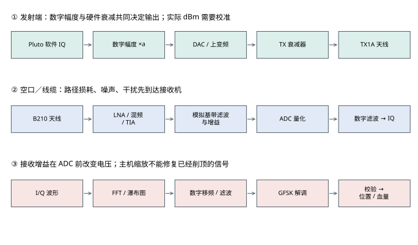
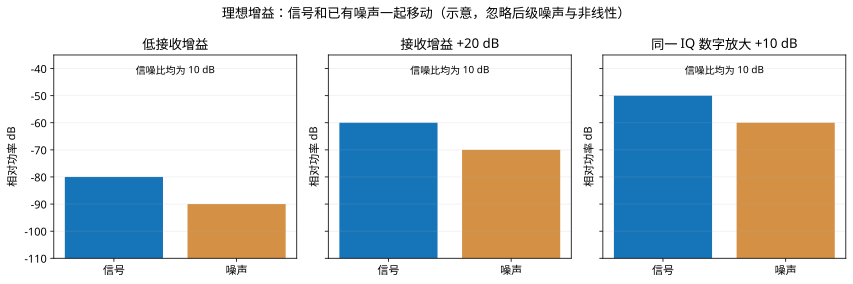
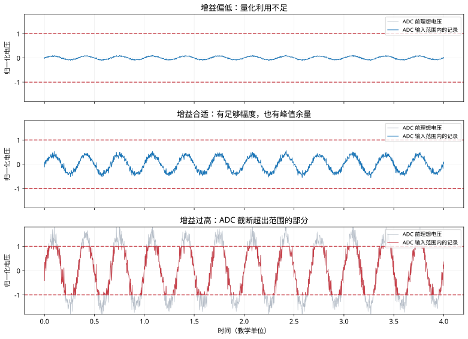
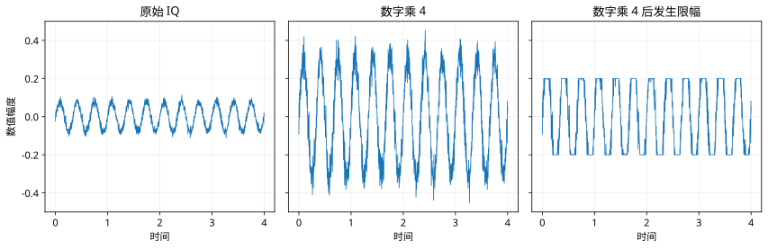
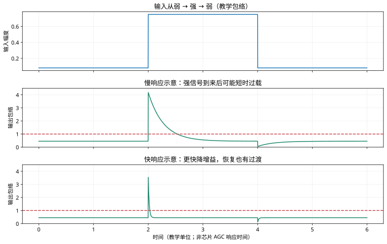

# PlutoSDR 与 B210：增益怎样影响收发链路

调高接收增益，屏幕上的信号通常变高；但解码不一定变好。要判断增益是否合适，需要沿着“发射数字采样 → 射频输出 → 空口 → 接收模拟电路 → ADC → 数字解码”看清楚每个控制改变了什么。

本文以当前工程的 **Pluto TX1A 发射、B210 通道 0 接收、主机解析 RM 信息波**为例。图中数值用于教学，均不冒充仪器测量。

## 1. 先看完整链路



发送程序先把协议字节调制成复数采样 `I + jQ`。数字幅度决定交给 DAC 的波形大小，Pluto 发射衰减决定后续射频输出的强弱。信号经过天线、空气或线缆后，才进入 B210。

接收端的模拟增益位于 ADC 前。ADC 把模拟电压变成数字数值，之后 UHD 输出 I/Q，播放器再显示 FFT、瀑布图并解码。

这里有四个容易混淆的控制：

| 控制 | 位置 | 直接改变什么 | 当前程序中的入口 |
|---|---|---|---|
| 发射 IQ 幅度 | Pluto DAC 前的数字域 | 送往 DAC 的采样幅度 | 模拟发射器“IQ 幅度” |
| Pluto TX hardwaregain | 发射模拟链路 | 射频发射衰减设置 | 模拟发射器“硬件增益” |
| B210 RX gain | 接收模拟链路 | ADC 前的信号与噪声电平 | 实时接收“B210 增益” |
| 主机 I/Q 缩放、瀑布色阶 | ADC 后／显示端 | 数值尺度或颜色映射 | 幅度格式、瀑布色阶 |

调接收增益不会增加 Pluto 的发射功率；调瀑布颜色不会提高接收灵敏度。

## 2. dB、dBm、dBFS 各表示什么

**dB 表示比例。** 对相同阻抗下的电压幅度，增益为 `20 × log10(输出幅度 / 输入幅度)`；对功率，使用 `10 × log10(输出功率 / 输入功率)`。

| 变化 | 幅度比 | 功率比 |
|---|---:|---:|
| +6.02 dB | 约 2 倍 | 约 4 倍 |
| +10 dB | 约 3.16 倍 | 10 倍 |
| +20 dB | 10 倍 | 100 倍 |
| −20 dB | 0.1 倍 | 0.01 倍 |

**dBm 表示以 1 mW 为参考的绝对功率。** 例如 −30 dBm 是 1 μW。芯片增益设成 −30 dB，不表示天线输出就是 −30 dBm。

**dBFS 表示相对数字满量程的电平。** 必须先明确峰值、RMS、实分量还是复采样，以及满量程参考。当前播放器 FFT 标注 `dB relative FS`，不能直接读成天线输入 dBm；一条 FFT 谱线也不等于整个信号的积分功率。

0 dB 表示某个明确参考下比例为 1，不是“0 倍”。驱动界面的 0 dB 还取决于接口定义，不能一律解释为无插入损耗、无放大、最小档位或最大档位。

## 3. B210 内部怎样调接收增益

### 3.1 模拟增益分布在多个电路中

AD9361 接收通路可以按功能理解为：

```text
天线／板级匹配网络
  → 射频低噪声放大与混频
  → TIA、模拟基带滤波及增益
  → I/Q ADC
  → 数字滤波、抽取和接口
  → UHD 复采样
```

这是一张功能示意图，不应据此把芯片内部机械地理解成三个可以任意独立设置的旋钮。增益控制涉及 RF、混频、TIA、模拟滤波和可选数字增益等节点。完整增益表将控制索引映射到多个硬件设置；分立增益表则提供不同的控制组织方式。[ADI AD936x 接收结构说明](https://wiki.analog.com/resources/eval/user-guides/ad9361)

LNA 靠近输入端，其噪声和增益会影响整机噪声系数。前端增益足够时，后级电路引入的噪声折算回输入端的影响变小；但前端也必须容纳强信号和阻塞干扰，不能只追求最大增益。

**零中频接收机的混频输出是模拟基带 I/Q。** 因而这里不宜将混频器、TIA 后的全部电路都称为传统非零中频级。正交下变频的数学过程见[信息波接收讲义](receiver.md)。

### 3.2 以 UHD 实际报告的范围为准

Ettus 官方手册给 B2x0 的接收前端标称可用增益范围为 76 dB。具体设备、驱动、控制名字和频率下的取值，应通过 UHD 查询，设置后再读回。[Ettus 前端增益说明](https://files.ettus.com/manual/page_usrp_b200.html#b200_fe_gain)

```python
# UHD Python：连接设备后执行；本节不要求读者为看文档而启动设备。
import uhd

usrp = uhd.usrp.MultiUSRP("type=b200")
usrp.set_rx_freq(uhd.types.TuneRequest(433.2e6), 0)
print(usrp.get_rx_gain_names(0))
print(usrp.get_rx_gain_range(0))
usrp.set_rx_agc(False, 0)
usrp.set_rx_gain(40.0, 0)
print(usrp.get_rx_gain(0))
```

这里最后一个 `0` 是接收通道编号。C++ 的简洁写法是 `usrp->set_rx_gain(40.0, 0)`；字符串重载中的名字是增益元件名称，不能把 `"RX1"` 随意当成接收通道编号。

不能把“433 MHz 一定 74.5 dB”“默认 1 dB、精细 0.25 dB”当成所有 B210 的统一接口承诺；也不能把 50 dB 档位直接解释为整块板从天线到 ADC 精确放大 316 倍电压。增益表、板级损耗和校准都会影响实际转换关系。

### 3.3 芯片的数字增益不等于 UHD 的额外通用旋钮

AD9361 有可选数字增益与完整／分立增益表机制，但这不意味着当前 UHD 界面就直接开放“再加 31 dB”。寄存器索引也不能简单当成总增益 dB 相加。本工程使用 UHD 总接收增益，没有独立控制 LNA、TIA 或芯片数字增益。[ADI AD9361 参考手册，Gain Control](https://www.analog.com/media/en/technical-documentation/user-guides/ad9361.pdf)

## 4. Pluto 接收增益与发射衰减必须分开

### 4.1 接收：`rx_hardwaregain_chan0`

接收时，先选择手动模式，再设置 RX 增益：

```python
import adi

sdr = adi.Pluto("ip:192.168.30.1")
sdr.gain_control_mode_chan0 = "manual"
sdr.rx_hardwaregain_chan0 = 40
print(sdr.rx_hardwaregain_chan0)
```

RX 可用范围随器件、频段和增益表变化。此前这台设备的 IIO 输出曾报告 `[-3 1 71]`，含义为最小 −3 dB、步进 1 dB、最大 71 dB；这是一份设备配置实例，不是全部 Pluto 永久固定的范围。

原厂 Pluto 采用 AD9363；当前设备固件报告 AD9361 型号与扩展配置。不能把原厂规格、扩展固件报告和实际板级射频性能混成同一保证。

### 4.2 发射：`tx_hardwaregain_chan0`

```python
sdr.tx_enabled_channels = [0]
sdr.tx_hardwaregain_chan0 = -30
```

这里的 `−89.75～0 dB` 对应 TX 衰减控制，0 表示该控制的衰减最小，数值越负衰减越大。它**不是 Pluto RX 增益的另一种显示口径，也不是 dBFS**。接收与发射设置分别写向 IIO 的输入／输出通道属性。[ADI pyadi-iio AD936x 接口源码](https://github.com/analogdevicesinc/pyadi-iio/blob/main/adi/ad936x.py)

在当前发射程序中，TX 从 −30 改到 −20 dB，预期输出提高约 10 dB；IQ 幅度从 0.25 改到 0.5，在线性区域内预期再提高约 6 dB。实际天线功率还取决于频率、DAC 尺度、模拟滤波、负载与硬件，必须测量确认。

## 5. 为什么调高增益，信号和噪底都变高



第一幅图的信号为 −80、噪声为 −90，相差 10 dB。理想放大 20 dB 后，两者变成 −60 和 −70，仍差 10 dB。数字再放大 10 dB，也不会凭空增加这 10 dB 的间隔。

模拟增益仍然有价值：当接收机后级噪声或 ADC 量化影响明显时，在前面适当地放大能提高数字端的有效接收表现。一旦天线输入噪声已经占主导，继续加增益通常只是让信号和噪底一起升高。

因此，**“模拟增益必然提高信噪比”“增益越大灵敏度越高”都需要条件**。遇到强干扰，前端压缩或互调还会使可用信号更差。窄化后端数字滤波不能修复此前已经发生的模拟过载。

## 6. ADC 饱和为什么会破坏解码



图中两条虚线表示 ADC 允许的归一化输入范围。前两幅仍能保留波形的起伏；第三幅超过范围的部分被截平，原始峰值信息已经丢失。

GFSK 解码依赖复采样的相位变化。削顶和模拟非线性会改变波形，并可能制造频谱展宽和杂散；只把屏幕纵轴拉大，无法恢复被截掉的内容。

观察时应同时看 I、Q、峰值分布、异常点比例和有效包率。`|I+jQ|` 可能大于单个 I/Q 分量范围，不能看到复幅度超过 1 就直接判定 ADC 削顶。UHD 归一化 fc32 也经过数字滤波和缩放，主机阈值只是线索，不能替代硬件过载证据。

“峰值占满量程 50%～70%”可作某些波形的观察起点，不能作为所有调制与干扰条件下的硬性指标。还要为噪声峰、瞬态和更强的邻道信号留余量。

## 7. 数字放大能做什么，不能做什么



数字乘 4 后，信号和噪声都变大。理想且不溢出时，二者比例保持不变；若再触发数字限幅，波形还会增加失真。

它适合统一处理尺度、适配算法输入和显示。它无法补回 ADC 前已经丢掉的弱信号细节，也无法解除 LNA 饱和，更不应被当成“模拟增益开满后继续提升灵敏度”的补救方法。

当前播放器的幅度选项用于解释文件中的数值尺度。把同一文件从 `/2048` 改成“已归一化”，只是在改变数值解释，不能当成一次新的硬件接收实验。

## 8. 手动与自动增益控制

### 8.1 手动控制适合先把链路调明白

手动模式下保持增益固定，便于对比发射参数、距离和有效包率。当前 B210 实时接收器调用 `set_rx_gain` 设置固定增益，界面默认 40 dB；没有 AGC 模式选择。修改需要停止接收后重新启动。

### 8.2 AGC 是带目标和响应过程的控制环



AGC 检测电平并调整增益，目标是把输出保持在合适范围。突发强信号出现后，它需要检测和调整时间；包头可能在稳定前已经过去。快速响应也可能改变包内幅度，实际效果取决于信号、阈值和时序配置，不能只凭“突发信号”就断定某一种模式必然最好。

ADI IIO 接口可提供 `manual`、`slow_attack`、`fast_attack`、`hybrid` 等模式，是否可用以设备的 `gain_control_mode_available` 为准。UHD 的通用 API 则是 `set_rx_agc(True, channel)` 开关，不能直接把这些字符串套进 UHD 接口。[UHD AGC 接口定义](https://github.com/EttusResearch/uhd/blob/master/host/include/uhd/usrp/multi_usrp.hpp)

上述快慢曲线只是控制响应示意，没有实现 AD9361 的完整状态机，也不表示芯片真实响应时间。需要深入设置时，应查阅 [ADI AGC 调试说明](https://wiki.analog.com/resources/eval/user-guides/ad9361_agc_tuning)。

## 9. 当前 433 MHz 信息波链路怎样调


先固定一种信息波、发射幅度、发射衰减、接收中心频率和天线连接。red 信息波对应 433.200 MHz，blue 对应 433.920 MHz。比较时尽量保持采样率、FFT 长度和分析时长一致。

1. 近距离先用较弱发射和较低 RX 增益，确认频谱落在预期频率；弱信号测试再逐步增加接收增益。
2. 每次只改一个控制，例如 RX 每次增加 5 dB，等待稳定后记录有效帧数量、修复情况、噪底和分量峰值。
3. 若峰值频繁接近上限，或者强峰更高但有效包更少，先降低 RX 增益，也检查 TX 是否过强。
4. 若信号与噪底一起上升而解码不改善，继续加增益通常没有明显收益；检查频率、采样率、目标信道和干扰。
5. 若出现 USB overflow、队列缺料或网络中断，优先处理吞吐与缓冲。增益不能修复样本缺失。

不预设“B210 必须 50～60 dB”“Pluto RX 不可超过 65 dB”。远距离弱信号和近距离回环的合适设置可能相差很大，应以实际输入与解码结果确定。

若使用线缆直接连接发射口与 B210 接收口，须配置足够的射频衰减。Ettus 官方要求 B2x0 回环至少使用 30 dB 衰减，并给出 RF 输入上限 −15 dBm；实际布线还应核对该板卡规格与发射功率。[Ettus 设备连接要求](https://files.ettus.com/manual/page_usrp_b200.html#b200_care)

## 10. 监看图上哪些变化应该出现

| 操作 | 发送前波形预览 | B210 接收幅度与频谱 | 解析结果 |
|---|---|---|---|
| 增大发射 IQ 幅度 | 通常变大 | 在线性范围内通常变大 | 可能改善，也可能过载 |
| 减小 Pluto TX 衰减 | 不变 | 通常变大 | 需要接收实测 |
| 增大 B210 RX 增益 | 不变 | 信号与噪底通常同时变大 | 不保证改善 |
| 改变瀑布色阶 | 波形数值不变 | 数据不变、颜色改变 | 不变 |
| 软件数字缩放 | 相应数值改变 | 原始接收硬件不变 | 可能影响阈值算法，不能恢复硬件损失 |

判断链路是否稳定，应把模拟电平问题和数据连续性问题分开。当前发射器显示的缓存批数、缺料次数只能反映软件队列；它们不是已测得的硬件 underflow 计数，也不是空口连续性证明。

## 11. 对原始知识点的校正

| 容易误解的说法 | 更准确的理解 |
|---|---|
| Pluto 的 −89.75～0 是 RX 的另一种口径 | 这是 TX 衰减设置，与 RX 增益分开 |
| 接收 0 dB 必然是几倍电压放大 | 必须明确参考和驱动定义，不能从数值单独推导 |
| 任何 50 dB 档位都等于天线到 ADC 放大 316 倍 | 316 是理想幅度比；驱动档位和板级绝对增益需要校准 |
| 模拟增益越大，信噪比越好 | 只在后级噪声／量化受限等条件下可能改善，过载会变坏 |
| 优先把所有模拟增益开满 | 需为强信号、阻塞和峰值保留动态范围 |
| UHD 可直接选 slow/fast/hybrid 字符串 | 芯片能力和 IIO/UHD 公共接口不同 |
| 单通道 ADC、单路 I/Q 即可解释全部 | 每条复接收链都需要 I/Q 两个分量；B210 有两条复接收通道 |

本节核对了公开文档和当前工程调用，图示为可重复教学仿真。文中的代码示例没有在本次编写时连接硬件逐项执行；具体增益范围与读回值仍需由当前设备确认。
