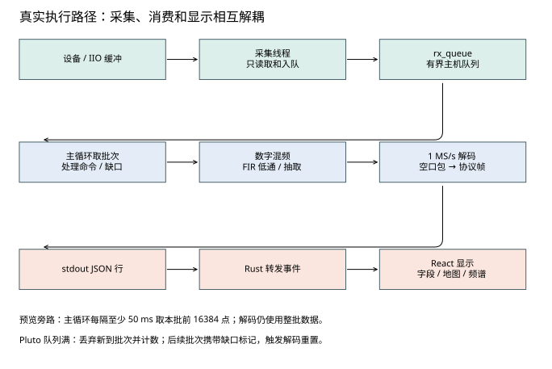
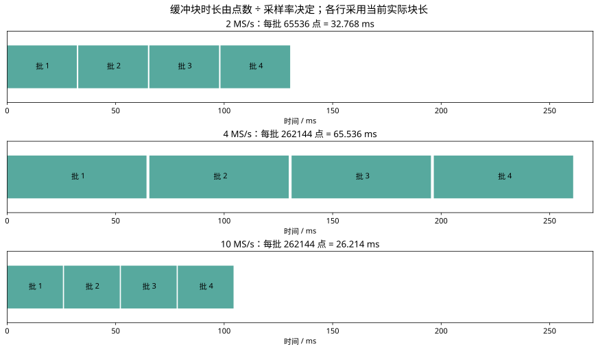
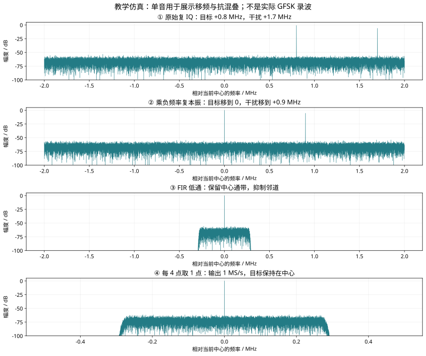
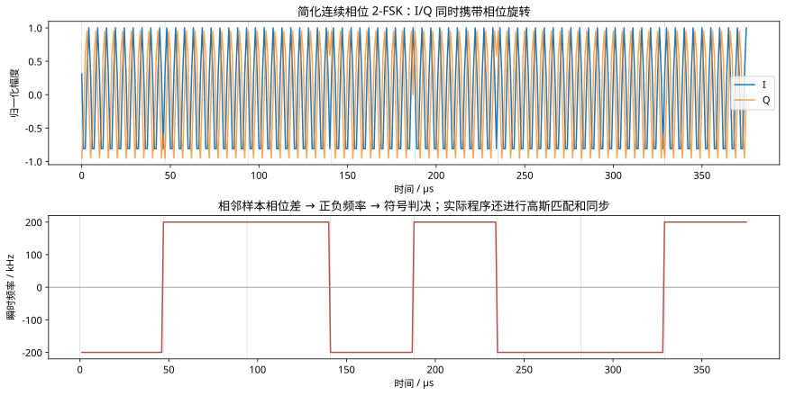

# 实时接收与解码：沿着代码读懂整条数据链

本文对应 **2026-10-23 的实时接收实现**，从启动脚本一直读到业务字段进入网页。重点是程序怎样逐批读取 IQ、跨批保存状态、处理积压和缺口，以及怎样从波形恢复协议帧。这里讲的是实时路径；录波文件的读取、拖动和离线扫描不属于同一个入口。

先记住三个不同的对象：**IQ 批次是一段采样，空口包是一组经过调制的比特，协议帧是业务字节串中的完整消息。** 三者边界通常不重合。

## 1. 从哪里开始读代码

以下路径均相对 SDR 工程根目录。路径中的历史名称不代表功能边界，例如 `b210_live.py` 同时支持 B210 和 Pluto。

| 文件 | 主要职责 | 建议查找的函数 / 类 |
|---|---|---|
| `SDR分析工作台/src/App.tsx` | 启动、控制、事件消费、字段和地图显示 | `startReceiver`、`parseInfoFrame`、`receiver-event` |
| `SDR分析工作台/src-tauri/src/main.rs` | 启动 Python 子进程、转发标准输入输出 | `start_receiver`、`update_receiver`、`stop_receiver` |
| `录波分析播放器/b210_live.py` | 实时设备初始化、采集线程、主循环 | `main`、`commands`、`pluto_receive_loop`、`receive_loop` |
| `Pluto接收控制台/tests/run_live_receiver.py` | 共享工厂、频率表、干扰帧检查 | `make_channelizer`、`create_info_decoder`、`evaluate_jam_candidate_row` |
| `SDR/WMJRadar-main/radio/src/wave_solver/wave_solver/stream_filter.py` | 有状态 FIR 滤波和整数抽取 | `StreamChannelizer.process` |
| `SDR/TCR-RM2026-Radar-OpenSource-1.1.0/radar/CombatRadarSdr/parser/info_wave_fast_decoder.py` | Fast / TCR 共用的信息波解码核心 | `FastInformationWaveDecoder`、`_CoordinateReassembler` |
| `SDR/WMJRadar-main/radio/src/wave_solver/wave_solver/info_dsp.py` | WMJ 的 GNU Radio 解调链 | `InfoGfskReceiver` |
| `录波分析播放器/fast_jam_decoder.py` | 干扰波向量化同步搜索 | `slice_jam_candidates` |

阅读时从主循环追到调用函数，不必先通读第三方目录。`tests/run_live_receiver.py` 虽位于 tests 下，当前实时程序确实导入了其中的运行函数。

## 2. 三条执行路径与两层进程



前端点击启动后调用 Tauri 的 `start_receiver`，Rust 创建 Python 子进程，并传入 `--backend`、`--uri`、`--rate`、`--center`、`--gain`、`--team`、`--mode` 和 `--method`。Windows 使用工程内置 Python 和 DLL，Linux 路径默认调用 `python3`。环境变量只设置在子进程上。

Python 内部至少有三个工作角色：

1. **命令线程**阻塞读取 stdin，收到 `stop` 设置停止事件，收到 JSON 把命令放进 `updates`。
2. **采集线程**阻塞等待设备数据，复制或转换成拥有独立存储的复数数组，送入 `rx_queue`。
3. **主线程**消费队列，处理控制命令、移频、滤波、解码、统计和预览输出。

Rust 另有线程读取 stdout 和 stderr。stdout 中可解析的 JSON 行通过 `receiver-event` 发给前端，日志走 `receiver-log`。React 再把用于绘图的 IQ 交给分析 Web Worker。CPU 解码没有放在 React 渲染线程里。

这些线程仍共享 Python 进程，线程并不自动让所有计算并行；NumPy、SciPy 和驱动调用是否释放 GIL，也会影响实际吞吐。独立采集的核心收益是让设备读取不再主动等待每一轮协议解析完成。

## 3. 启动阶段：先确定数据的物理含义

### 3.1 Pluto 初始化

关键代码节选：

```python
radio = adi.Pluto(args.uri)
radio._ctx.set_timeout(2000)
radio.sample_rate = args.rate
radio.rx_lo = int(args.center)
radio.rx_enabled_channels = [0]
radio.rx_buffer_size = 65536 if args.rate <= 2000000 else 262144
radio._rxadc.set_kernel_buffers_count(8)
radio.rx_rf_bandwidth = min(args.rate, 18000000)
radio.gain_control_mode_chan0 = 'manual'
radio.rx_hardwaregain_chan0 = float(np.clip(args.gain, -3, 71))
```

`args.uri` 可以是物理网口或 USB 网络地址，也可以由其他界面传入 libiio 支持的 USB URI。工作台当前分别提供物理网口和 USB 虚拟网卡输入。

`rx_enabled_channels=[0]` 表示一路**复数接收通道**，其中已经同时包含 I 和 Q。`rx_buffer_size` 是每次返回的复样本数，不能再除以二。[ADI 的缓冲接口说明](https://analogdevicesinc.github.io/pyadi-iio/buffers/index.html)明确了单通道数组和样本数的含义。

读回 `radio.sample_rate` 和 `radio.rx_lo` 后，程序核对实际采样率是否与请求值相差超过 1 Hz；超出就报错，避免用错误时间尺度继续解码。增益被限制在固定的 −3～71 dB 区间，具体射频频段的可用范围仍以驱动/设备为准。

`_ctx` 和 `_rxadc` 是库内部对象，当前内置运行时支持这些调用。未来升级 pyadi-iio 时要重新验证，不能把私有成员视为永远稳定的公共 API。

### 3.2 B210 初始化

B210 通过 UHD 创建 `MultiUSRP`，设置接收采样率、频率、增益、天线和模拟带宽。主机格式 `fc32` 为 complex64；线上 `sc16` 为 I/Q 各 16 bit。程序申请连续接收流 `start_cont`，并让 `stream_now=True`。

Windows 上会尝试读取 B210 协商 USB 速度；检测为 USB 2.0 且请求超过 2 MS/s 时，当前代码会降到 2 MS/s 并输出警告。这个检测失败时不会自动降速。Pluto 分支没有这项自动限速策略。

### 3.3 ADC 数值与归一化

Pluto 采集代码是：

```python
raw = np.asarray(radio.rx(), dtype=np.complex64) / 2048.0
```

I、Q 每一路按约 ±2048 的 ADC 码值归一化。`complex64` 一个复样本占 8 字节，I 和 Q 各为 float32。这个缩放不等于功率校准，也不是模拟 AGC；归一化后复数模长可能超过 1，因为 I 和 Q 可以同时非零。判断削顶应分别观察 I/Q 分量与满量程，不能只用 `abs(I+jQ)>1` 判定。

## 4. 缓冲区：每一层都保存不同的内容



块长时间关系是 `T_block = N / Fs`。当前默认值如下：

| 输入采样率 | 每批复样本数 | 每批时长 | Pluto 32 批队列最多覆盖时长 |
|---:|---:|---:|---:|
| 2 MS/s | 65,536 | 32.768 ms | 约 1.049 s |
| 4 MS/s | 262,144 | 65.536 ms | 约 2.097 s |
| 10 MS/s | 262,144 | 26.2144 ms | 约 0.839 s |

队列覆盖时长是容量上限，空队列不产生这段延迟。10 MS/s 时，32 个 complex64 数组约占 **64 MiB**，不包含内核缓冲、滤波临时数组、预览编码和解码器内部存储。

| 缓冲 / 状态 | 保存什么 | 为什么需要 | 如何更新 |
|---|---|---|---|
| Pluto 内核缓冲，数量 8 | 驱动管理的采样块 | 吸收传输和主机读取时序波动 | IIO refill 消费；并非 Python 队列 |
| `rx_queue` | 原始复 IQ 与元数据 | 隔离采集与 DSP 的短时耗时差 | Pluto 32 批，B210 8 批 |
| `updates` | 增益和模式控制命令 | stdin 不直接操作设备 | 主循环取出执行；当前没有容量上限 |
| FIR `_history` | 上一块末尾 L−1 个复样本 | 下一块前面的滤波需要前文 | 每次 process 替换为最新尾部 |
| `_decimation_phase` | 下一块从哪个点开始抽取 | 原始块长未必能整除抽取倍数 | 模 D 递推 |
| 信息分支 `tail` | 不足 128 点的 1 MS/s 样本 | 按 128 点整数倍喂解码器 | 最多 127 点，下轮拼接 |
| Fast 内部 `_tail` | 最近一段 1 MS/s IQ | 找到跨输入块的完整空口包 | Fast 24,000 点，TCR 12,000 点 |
| 协议重组 `buffer` | 空口包的 15 字节载荷 | 一个业务帧跨多个空口包 | 最多保留 16,384 字节 |
| `jam_tail` | 干扰分支的 1 MS/s IQ | 用重叠窗口搜索干扰包 | 窗口 131,072，步长 65,536 |
| `prev_payload` | 上一个干扰包载荷 | 密钥帧可能跨两个载荷 | 按选中的候选结果更新 |
| 去重状态 | 已处理的包起点或帧内容 | 重叠扫描会重复找到同一对象 | Fast 起点队列；干扰帧 hex |

缓冲只吸收短时变慢。若平均每秒到达 10M 点、实际只能处理 8M 点，任何有限队列最终都会填满。队列变大提高容忍度，也增加最坏延迟，不能代替算法优化。

## 5. Pluto 采集线程逐步执行

循环的核心结构可以从源码缩写为：

```python
while not stop.is_set():
    with pluto_lock:
        generation = pluto_generation
        raw = np.asarray(radio.rx(), dtype=np.complex64) / 2048.0
    received_at = time.monotonic()
    # 计算与上次读取完成的时间差 gap_ms
    item = (raw, received_at, gap_ms, generation, pluto_dropped, None)
    try:
        rx_queue.put_nowait(item)
    except queue.Full:
        pluto_dropped += 1
```

按执行顺序理解：先拿设备锁，再记录频道代号，接着阻塞读取一整批数据。离开锁后计算时间并尝试立即入队。队列满时**丢弃当前新到批次**，保留队列里原来的顺序，采集线程继续读取设备。

这里的 `generation` 是频道代号。切频后代号加一，主循环遇到旧代号的批次直接跳过，从而处理切频时“旧数据刚读完、尚未入队”的竞争情况。

`pluto_dropped` 是累计主机丢块数。丢块之前已经入队的数据仍连续，仍可正常处理；之后第一个携带新计数的成功入队批次才暴露缺口，主循环在这个边界重置 DSP 和重组器。这样可以利用缺口前的完整数据，同时避免把缺口两侧当成连续流。

读取异常则放入带错误字符串的特殊队列项，主循环收到后抛出异常并走清理流程。错误项入队使用带超时重试，避免因为队列暂满而丢失错误原因。

B210 的采集线程略有不同：`recv` 返回样本数和 UHD 元数据，样本从可复用 buffer 复制出来再入队；队列满时循环等待。等待过久可能进一步引起硬件溢出，后续由 UHD 元数据报告。因此两种设备的 `overflows` 统计不能直接比较。

## 6. 大循环：每次迭代究竟做什么

入口位于 `b210_live.py: main`，外层循环为 `while not stop.is_set()`。下面是忠实于当前顺序的阅读提纲，省略异常处理细节，不是可以直接替换的完整代码：

```python
while not stop.is_set():
    # 1. 消费 updates：执行改增益或切频
    # 2. 从 rx_queue 取一批；超时则 continue
    # 3. 检查频道代号、丢块 / UHD 错误，必要时重建 DSP 状态
    # 4. n = len(raw)，空批次 continue
    # 5. 约每秒输出统计；每隔至少 50 ms 输出一小段预览 IQ
    # 6. mixed = 原始 IQ × 数字本振
    # 7. iq = channelizer.process(mixed).iq   # 输出 1 MS/s
    if args.mode != 'info':
        # 8a. jam_tail 重叠搜索 → 验证 0x0A06 → 输出事件
        cursor += n
        continue
    # 8b. 拼接 tail → 128 点对齐 → decoder.process → 输出业务帧
    cursor += n
```

主循环中的几个 `continue` 很重要：等待队列超时不产生数据；旧频道数据不解码；遇到已知溢出会清状态并跳过受影响的批次；干扰分支完成后跳过信息解码分支。

**当前每次只选择一个目标信号与一条解码分支。** 加大采样率能看见更宽频谱，不意味着程序自动并行解码所有频道。模式切换来自用户命令，目标中心由频率表决定；当前没有在整段带宽内自动寻找所有功率峰并逐一解码的流程。

## 7. 数字混频：把选中的信号移到零频

实际代码：

```python
offset = target - center
mixed = raw * np.exp(
    -2j * np.pi * offset * (np.arange(n, dtype=np.float64) + cursor) / rate
) if abs(offset) > 0.1 else raw
```

`center` 是硬件实际 LO，`target` 是所选信息/干扰频道的绝对频率。相对硬件中心偏移 Δf 的信号，在基带以 Δf 旋转；乘以相反方向的复指数后，目标变成零频附近。

例如硬件中心 432.4 MHz、目标 433.2 MHz，则 offset=+800 kHz，数字本振为 −800 kHz。目标从 +800 kHz 移到 0，原先 +1.7 MHz 的邻道会移到 +900 kHz。

`cursor` 让本振相位跨批次延续。如果每一批都从 `arange(n)` 的零点开始，块长与频率不匹配时会产生边界相位跳变。`cursor` 当前累计的是**被主循环正常处理的原始样本数**，不是硬件时间戳；丢弃的数据不会完整反映在这个时间轴里。



图为固定随机种子的教学单音仿真，幅度参考为归一化复单音 1。它解释频率位置，不模拟完整赛场 GFSK 或射频非线性。

## 8. FIR 低通与整数抽取：逐行读 StreamChannelizer

### 8.1 先确定通带

`make_channelizer` 按 level 选择参数：

| 模式 | 传入 level | 低通 cutoff | transition 参数 | 设计衰减参数 |
|---|---:|---:|---:|---:|
| 信息波 | 3 | 280 kHz | 35 kHz | 80 dB |
| 干扰一级 | 1 | 480 kHz | 15 kHz | 80 dB |
| 干扰二级 | 2 | 440 kHz | 25 kHz | 80 dB |
| 干扰三级 | 3 | 280 kHz | 35 kHz | 80 dB |

信息波使用 level=3 是借用这组滤波参数，不代表在运行干扰三级协议。这里的 cutoff 是**基带单侧截止频率参数**，不能当成总射频占用带宽。transition 参与估算 FIR 长度，也不是对某个实际器件滚降的测量。

滤波器通过 `kaiserord(attenuation_db, transition_hz/(input_rate/2))` 估算长度和 Kaiser 窗 β，再用 `firwin` 设计奇数长度 FIR。过渡带越窄，通常需要越长的滤波器。系数由缓存复用。

### 8.2 初始化保存哪些状态

构造器检查 `input_rate % output_rate == 0`，然后令 `D=input_rate//output_rate`。所以当前实现支持 2→1、4→1、10→1 MS/s 等整数关系，**不支持任意 2.5→1 MS/s 重采样**。

`_history` 初始为 L−1 个零；`_phase` 保存内部移频器相位；`_decimation_phase` 保存抽样位置；`_first` 用来处理首次 FIR 群延迟。当前调用把 channelizer 的 `center_hz` 设为 0，真正的目标移频已经在主循环做完，内部振荡器此时等价于乘 1。

### 8.3 拼接历史样本，再做卷积

核心步骤：

```python
overlap = self._history.size
work = np.concatenate((self._history, shifted))
filtered = _overlap_save_fir(work, self.taps)[overlap:]
self._history[:] = work[-overlap:]
```

FIR 的每个输出取决于当前及过去 L−1 个输入。把历史放到前面，卷积后丢掉历史对应的输出，就保留了本批每个点的正确前文；再把最新尾部存下来，供下批使用。正常情况下不会在每一块边界重新填零。

辅助函数名为 `_overlap_save_fir`，实现却是：

```python
signal.oaconvolve(samples, taps, mode='full')[:samples.size]
```

SciPy 的 `oaconvolve` 使用 **overlap-add** 计算线性卷积。因此准确说法是“手动维护流式历史，再用 overlap-add 卷积计算 FIR”，不能仅依据函数名宣称它内部实现了 overlap-save。[SciPy 官方说明](https://docs.scipy.org/doc/scipy/reference/generated/scipy.signal.oaconvolve.html)可用于核对算法名称。

### 8.4 先低通，再每 D 点取一点

```python
first = self._decimation_phase
output = filtered[first::self.decimation]
self._decimation_phase = (first - samples.size) % self.decimation
```

例如 10 MS/s 输入抽取到 1 MS/s，D=10。先把通带外频率压下去，再取每十个点中的一个，避免宽带邻道折叠进目标通带。直接写 `raw[::10]` 没有抗混叠滤波。

原始块长 262144 除以 10 余 4，下一块抽取位置必须补偿。上面的模运算确保抽样网格跨块连续，否则每块开始都会漂移采样位置。

首次处理时，线性相位 FIR 的延迟约为 `(L-1)/2` 个输入点。代码从不早于该延迟且与抽样网格对齐的位置输出，避免把启动填零瞬态送入解码器。此后持续维护历史，不在每块重复扣延迟。

## 9. 信息波：从 1 MS/s IQ 到 15 字节载荷

### 9.1 主循环的 128 点对齐

```python
iq = np.concatenate((tail, iq))
usable = len(iq) // 128 * 128
tail = iq[usable:].copy()
if usable:
    result = decoder.process(iq[:usable], cursor, time.time())
```

`tail` 不是空口包缓存，它只保存不足 128 点的余数。真正跨包边界的缓存由解码器内部负责。**128 也不是每符号点数**；符号间隔仍是 47 点。

### 9.2 Fast 与 TCR 的工厂参数

`create_info_decoder` 中，`wmj` 创建 WMJ 包装器，`tcr` 调用 `make_tcr_info_decoder`，其他名称走 `make_info_decoder`。Fast 和 TCR 都实例化 `FastInformationWaveDecoder`：

| 参数 | Fast | TCR |
|---|---:|---:|
| 解码采样率 / SPS / BT | 1 MS/s / 47 / 0.35 | 相同 |
| 相关阈值 | 0.34 | 0.45 |
| access 最大位差 | 32 | 24 |
| 长度头最大位差 | 3 | 2 |
| 内部 IQ 低通 | 320 kHz | 270 kHz |
| IQ 尾部 | 24,000 点 | 12,000 点 |
| 同包软合并候选上限 | 5 | 3 |
| 坐标 CRC 修复 | 最多 2 位 | 关闭 |

这些是当前工厂配置，不是协议允许的误码数。外层信息通道已经低通到约 280 kHz，Fast 内部 320 kHz 低通不会恢复此前被滤掉的频率。Fast 的宽松搜索提高找到候选的机会，也更依赖后续 CRC 和质量标签约束。

### 9.3 相位差解调

Fast 先把内部 `_tail` 与新 IQ 拼起来，再对拼接结果做 129 taps 的 Blackman-windowed-sinc IQ 低通。随后执行：

```python
phase_delta = np.angle(demod_iq[1:] * np.conj(demod_iq[:-1]))
instantaneous_hz = phase_delta * (self.sample_rate / (2.0 * np.pi))
instantaneous_hz -= instantaneous_hz.mean().item()
matched = np.convolve(instantaneous_hz, self.matched_taps, mode='same')
```

复数 `z[n]` 的相位旋转速度对应频率。`z[n]·conj(z[n-1])` 保留相邻相位差，取 angle 后乘 `Fs/(2π)`，得到 Hz。去均值是对这段数据的整体频偏作简化补偿，**不等于在整个接收带宽里搜索未知频道**。突发占空比、符号不平衡或强干扰也可能影响这个均值。



图中的硬频率跳变是简化连续相位 2-FSK，真实 GFSK 还包含高斯整形。高斯匹配滤波让软判决更平滑，但不能恢复已经丢掉的采样。

### 9.4 47 个采样相位与 96 位同步模板

符号率约为 `1,000,000/47 = 21,276.6 symbol/s`。未知符号中心落在 47 个采样位置中的哪一个，代码就对 `phase=0..46` 分别取 `matched[phase::47]`。

每个相位的软符号与一个 **96 位模板**做归一化相关：64 位信息同步码，加上两份大端长度 `0x000F`，共 32 位。相关强度超过阈值的位置进入候选检查。代码允许相关符号反向，用 polarity 修正整体极性。

候选使用已知模板估计软值阈值和尺度，再检查 access 位差、信息与干扰同步码的相对距离、长度头位差。通过后把第 96～215 位打包为 15 字节载荷。

相邻采样相位常会发现同一个包，代码按起点相差不超过一个符号聚类，选取并软合并候选。软合并权重与相关强度平方有关；它合并的是**同一个包的不同判决候选**，不是发送端的重传合并。

最后用最近包起点队列去重，避免内部重叠尾部再次输出同一空口包。一个 216 位包持续约 `216×47 / 1e6 = 10.152 ms`，因此内部 12 或 24 ms 的 IQ 尾部足以覆盖这类跨块包，但不能补偿数据缺口。

## 10. 字节重组与 CRC：一个包不等于一帧

每个空口包结构是：

```text
64 位同步码 | 16 位长度 | 16 位重复长度 | 120 位载荷
     8 B          2 B            2 B           15 B
```

同步码和长度以空口位序解释；业务协议内部使用小端字段。不能把两层字节序合并成一个规则。

重组器把连续空口包的载荷追加到 bytearray。信息命令的数据长度表为：

| 命令 | 业务数据长度 | 协议帧总长（数据 + 9） | 常见内容 |
|---|---:|---:|---|
| 0x0A01 | 24 B | 33 B | 机器人坐标 |
| 0x0A02 | 12 B | 21 B | 血量 |
| 0x0A03 | 10 B | 19 B | 允许发弹量 |
| 0x0A04 | 8 B | 17 B | 金币及场地位字段 |
| 0x0A05 | 41 B | 50 B | 增益、状态和姿态 |

33 字节坐标帧可能落在三个甚至四个载荷片段中，取决于它在首包内的起点。处理步骤：

1. 搜索 `SOF=0xA5`，丢掉前面的无关字节。
2. 不足 5 字节就等下一批；达到 5 字节后验证前 4 字节的 CRC8。
3. 不足 7 字节继续等待；够长后读取命令和数据长度，对照允许表。
4. 计算 `frame_length=5+2+data_length+2`，不足就保留等待。
5. 对完整候选验证 CRC16，成功则取 `frame[7:-2]`，输出带 seq、cmd_id、quality 的对象。

头错误或非法命令时通常只向前丢一个字节，再寻找同步。这样避免把错误候选内部真正的帧头一起扔掉。

Fast 对 0x0A01 有额外的 1～2 位 CRC 一致性修复，候选选择还会参考坐标范围和历史连续性。CRC 一致性不证明修复值就是真值。`quality` 会标为 `repaired_1bit` 等；未修复成功的原始坐标可标为 `raw_invalid_crc16`，**实时主循环会过滤这种帧，但不会过滤所有 repaired 帧**。因此最终 frame_count 不能直接称为“原始 CRC 全通过帧数”。

字段的完整布局、单位和含义见 [信息波接收与逐步解析](receiver.md)。本章专注代码执行，不把代码中的字段解释扩大为未经核对的新规则结论。

## 11. WMJ 信息分支：GNU Radio 在内部调度

WMJ 包装器创建 `InfoGfskReceiver`，参数包括 1 MS/s、SPS 47、BT 0.35、信息带宽 540 kHz 和 access 位错容忍 12。该路径使用排队复数源把数组送入 GNU Radio flowgraph，由内部调度执行滤波、AGC、正交解调、符号恢复、判决和同步码标记。

内部 tagged sink 等待同步码后剩余的 **32 位长度头 + 120 位载荷**到齐，形成空口包。包装器仅接受 `kind=INFO`、`valid=True`、载荷恰为 15 字节的包，再交给 `ProtocolStreamReassembler(max_buffer=16384)` 恢复业务帧。

这里额外存在 GNU Radio 自己的队列与调度缓冲，不能把主机 `rx_queue` 的深度当成整个 WMJ 路径的全部延迟。Fast/TCR 的“穷举 47 相位、相关聚类、软合并”也不能原封不动套到 WMJ 上。

## 12. 干扰波：重叠窗口、位差搜索与六字节密钥

干扰分支不调用信息解码器的 process，而执行：

```python
jam_tail = np.concatenate((jam_tail, iq))
while len(jam_tail) >= 131072:
    block = jam_tail[:131072]
    jam_tail = jam_tail[65536:]
    rows = slice_jam_candidates(fm_demod(block, 1000000), 47, .35, sensitivity)
```

在 1 MS/s 下窗口约 131.072 ms，每次前进 65.536 ms，重叠 50%。搜索窗口是为了解码，与界面瀑布图的历史行数无关。

`slice_jam_candidates` 先把 Hz 频偏按 sensitivity 归一化，再做高斯匹配；比较 47 个候选相位的平均软值绝对幅度，找出最佳相位，并搜索它前后 3 个相位。每个相位硬判决成比特后，通过 `sliding_window_view(bits,64)` 同时计算所有位置与信息/干扰同步码的位差。

只把位差不超过 1 的位置送给原始 `parse_air_packets`。向量化优化了同步搜索，仍复用原来的包提取、双长度和载荷检查，没有取消验证。候选行排序后最多保留 5 行。

主循环进一步筛选干扰包，要求 kind 为 JAM、两个长度均为 15、载荷恰为 15 字节。对于每一行，将上一份载荷与当前载荷组成 30 字节候选流，然后扫描：

```text
A5 | 数据长度 6 | seq | CRC8 | 命令 0x0A06 | 6 字节数据 | CRC16
```

`extract_jam_0a06_frames` 检查固定长度、CRC8、命令和 CRC16。`is_plausible_jam_key` 再要求六字节都在大小写英文字母或数字集合内。这是当前实现的额外筛选，不能据此宣称任意六字节内容均会显示。

多个候选行按“提取到的协议帧数、有效空口包数、同步码距离”排序，选一行更新 `prev_payload` 和 `last_jam`。帧内容去重限制重叠窗口重复输出，但空口包统计仍可能受重复扫描影响，不适合直接拿 packet_count 推算发射端包率。

## 13. 控制命令、切频与缺口恢复

### 13.1 修改增益

命令线程只排队。主循环验证 gain 为有限数，再对 Pluto 持有 `pluto_lock` 设置硬件增益。采集线程也用同一把锁读设备，避免同时操作这些 IIO 对象。改增益没有清空所有历史，改变幅度的边界仍可能经过滤波器。

### 13.2 修改模式或队伍

主循环校验模式和队伍，查表算出新 target。Pluto 在锁内销毁旧缓冲、设置 LO、递增 generation；然后重建解码器和 channelizer，清空 `tail`、`jam_tail`、上一干扰载荷和去重状态，并尽量排空主机队列。

排队清理与 generation 检查共同工作：即使旧批次晚到，也因代号过期被丢弃。切频本身会产生有意的采样中断，不能把它视为“完全无缝接收”。B210 路径清理队列但当前没有同样的代号标记机制，切频附近的严格时间边界仍值得进一步验证。

### 13.3 已知数据缺口

Pluto 看见新的累计丢块计数，或 B210 看见 overflow 元数据后，程序重新创建 FIR 和解码器，并清除跨块载荷状态。缺口两侧不能继续做相邻相位差，也不能继续拼字节，否则会产生假的瞬时频率和不可靠协议帧。

`cursor` 没有依据硬件丢失点数补回，输出的 `raw_seconds` 应理解为处理时间轴近似值。Fast 接口的 start_sample 语义是解码 IQ 点位，但当前调用传入的是原始输入 cursor；内部多数跨块搜索依赖自身尾部递推，不能据此认为高倍率抽取后的包绝对点位已经精确校准。本文按现状说明这一限制，不修改该行为。

## 14. 预览、统计和字段如何到达界面

每隔至少 50 ms，主循环发送本批前 16,384 点，转换为小端 complex64，再 Base64 编码为 `live_iq` JSON。它是**间歇预览片段**，不是完整连续录波；被预览跳过的样本仍然参与解码。

每秒左右输出一次 `rx_stats`：

| 字段 | 当前代码实际统计含义 | 不应推导出的结论 |
|---|---|---|
| sampleRate | 主线程在该时间段消费的样本数 / 墙钟时间 | 不直接等于 ADC 时钟精度 |
| queueDepth | 发统计瞬间的主机队列积压 | 不包含驱动、GNU Radio、前端缓存 |
| gaps | 相邻读取完成间隔超过阈值的次数 | 不是确证丢了多少 ADC 样本 |
| maxGapMs | 该统计窗口最大的读取完成间隔 | 含调度和传输抖动 |
| Pluto overflows | 主循环获知的累计主机丢批数 | 不是完整的 FPGA / DMA 溢出计数 |
| B210 overflows | 检测到的 UHD overflow 事件数 | 不是精确丢失点数 |

异常间隔门限为 `max(8 ms, 2.5×本批时长)`。10 MS/s、262144 点时约为 65.536 ms。操作系统调度、切频和缓存批量交付都可能改变完成间隔。

`info_frame` 事件包含 signal、command、seq、data 的 hex 字符串及 quality。React 的 `parseInfoFrame` 按命令拆出小端数值和位字段，更新最新值；地图进一步做坐标合法性和轨迹处理。**解码协议、字段解释和地图过滤是三个阶段**。地图不显示某点不一定意味着无线端没解到帧。

输出 JSON、Base64 和 stdout 写入仍位于消费路径，如果前端或 IPC 长时间阻塞，也可能把压力传回主机队列。独立采集提高了余量，不能让整个显示路径无限快。

## 15. 停止过程：从事件到缓冲释放

收到 stdin 的 `stop` 后，停止事件置位。主循环结束，输出 stopped 汇总；finally 再次置位停止事件，等待采集线程最多 3 秒。Pluto 调用 `rx_destroy_buffer`；B210 发送 `stop_cont`；随后关闭解码器，清理设备对象并触发垃圾回收。

读取超时配置对停止响应也重要：Pluto 上下文超时为 2 秒，UHD recv 单次超时为 0.25 秒。线程 join 是有上限的等待，不是形式化证明所有底层驱动调用一定能在期限内返回。异常停止需结合子进程退出和设备再次连接测试。

## 16. 一次 10 MS/s 批次走完的数值例子

1. Pluto 获得 262144 个复样本，对应 26.2144 ms，驱动在线上传输约 1 MiB 原始 I/Q；转成 complex64 后数组约 2 MiB。
2. 采集线程将数组与 generation、gap、累计丢块计数入队。
3. 主循环接收后移频；目标已在硬件中心时直接复用 raw。
4. FIR 使用上一批 L−1 点历史完成滤波；D=10 抽取后通常得到约 26214 或 26215 点，首次还要扣除群延迟。
5. 信息分支与上轮余数拼接，取 128 整数倍输入 Fast；剩余不足 128 点保存到下轮。
6. Fast 与内部 24 ms 尾部一起搜索完整空口包，去重后把每个 15 字节载荷交给协议重组器。
7. 重组器可在这次调用中输出零帧、一帧或多帧。输出数量与“每批只收一包”没有固定关系。
8. 结果变成 JSON，前端字段和地图更新。相同批次还可能产生一段预览 IQ，但预览与协议结果分别通过不同事件传输。

## 17. 为什么超过 2 MS/s 曾经解不出包

此前 Pluto 分支在同一线程里交替做 `radio.rx()`、滤波、解码和预览，且始终使用 65536 点缓冲。10 MS/s 时一批只覆盖 6.5536 ms，一次解码耗时稍长就会推迟下一次读取。网口吞吐测试通过只说明纯读取能跟上，不能保证加入解码后仍然连续。

当前改进是分离采集线程、扩大高采样率块长和主机队列、增加丢块标记和 DSP 重置。它提高了流水线对短时积压的容忍度，没有消除射频过载、弱信号量化、发射欠载或持续算力不足。

2026-10-23 已有日志记录的验证范围如下，本文编写没有重新发射：

| 测试 | 结果 | 结论边界 |
|---|---|---|
| 2 / 4 / 10 MS/s 短时接收 | 分别输出 186 / 146 / 161 个协议帧 | 各档时长略不同，不能直接比较帧率 |
| 初始 8 批队列、10 MS/s、30 秒含切频 | 捕获到 4 个主机丢块 | 能定位问题，但不足以声称修复 |
| 最终 32 批队列、10 MS/s、30 秒含增益与切频 | 2380 个包、1036 个协议帧；主机丢块 0；峰值队列 12 | 仍有 2 次异常读取间隔，末尾有积压，不能据此证明无限时长稳定 |

最终记录中有 1024 帧标为 strict，其余不能自动视为原始 CRC 严格通过。协议帧数、空口包数、采样连续性是不同指标。

## 18. 按顺序定位故障

先观察原始 I/Q 是否削顶，再检查目标频率是否落在当前硬件带宽内。随后看 sampleRate 是否长期跟得上、queueDepth 是否持续上涨，以及有没有主机丢块或 UHD overflow。最后检查同步、协议 CRC 和质量标签。

频谱有峰只证明相应频率存在能量；看见颜色条不保证符号边界完整；找到同步码也不保证载荷正确。定位时沿着 **采样 → 连续性 → 选频滤波 → 符号同步 → 空口包 → 业务 CRC → 字段显示**逐层核对。

## 19. 依据与配套阅读

- 本文的具体阈值、队列大小、分支和清理顺序以本章开头列出的本地代码快照为依据。图示由 `tools/figures/generate-live-receiver.py` 生成，可复现且不访问硬件。
- [ADI pyadi-iio 缓冲文档](https://analogdevicesinc.github.io/pyadi-iio/buffers/index.html)：rx 数组、复数通道与缓冲长度。
- [SciPy oaconvolve 文档](https://docs.scipy.org/doc/scipy/reference/generated/scipy.signal.oaconvolve.html)：overlap-add 线性卷积。
- [信息波接收与逐步解析](receiver.md)：调制基础、业务协议字段与已有规则依据。
- [增益与收发链路](gain-link.md)：硬件增益、ADC 满量程与射频功率的区别。
- [AD936x 官方介绍中文翻译](ad936x-translation.md)：模拟收发、ADC 和数字滤波的硬件位置。
