# 信息波接收与逐步解析说明

芯片结构参考：[AD936x 官方介绍中文翻译与中文框图](ad936x-translation.md)。

本文说明当前 Windows 工程怎样把 PlutoSDR 实时 IQ 或 `.c64/.fc32` 录波逐步转换成 `0x0A01`～`0x0A05` 信息帧，并解释 `wmj`、`tcr`、`fast/ours` 三种信息波解码器的具体差别。

> 本文描述的是当前工程实际执行的代码，不是泛化的 GFSK 教程。主入口为 `tests/run_live_receiver.py`。

## 1. 总体数据流

本文从波形和采样的基本含义开始，覆盖信息波完整接收链；干扰波只用于说明同步码区分。第一次阅读可以先看下面的五组波形，再进入代码步骤。

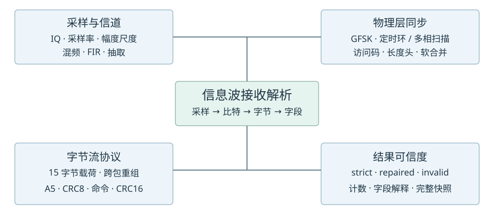

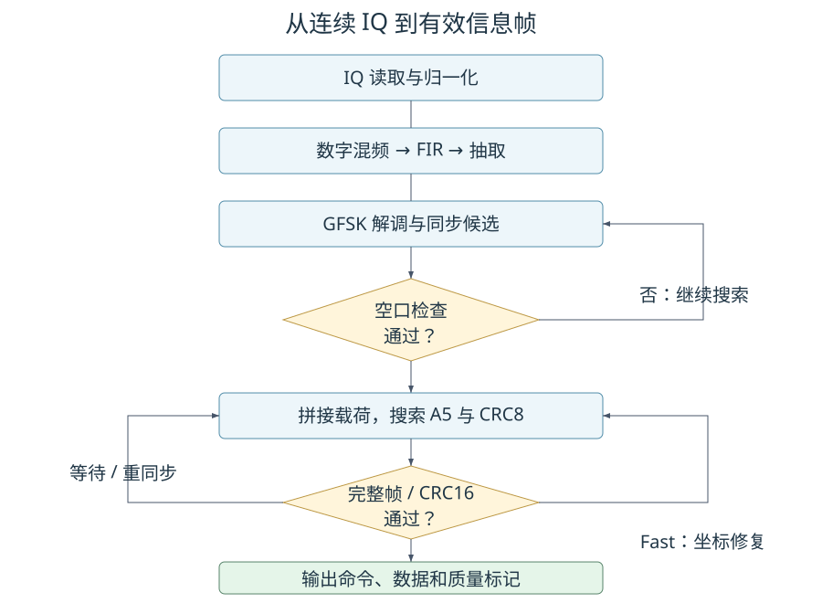

```text
PlutoSDR 或 complex64 录波
        |
        v
分块读取复数 IQ
        |
        v
幅度归一化和输入质量统计
        |
        v
数字混频，将目标信道搬移到 0 Hz
        |
        v
FIR 低通 + 必要时抽取到 1 MS/s
        |
        +-----------------------+------------------------+
        |                       |                        |
        v                       v                        v
  WMJ/GNU Radio            TCR 严格快速链路       Fast/Ours 增强链路
        |                       |                        |
        +-----------------------+------------------------+
                                |
                                v
                      GFSK 符号和同步码检测
                                |
                                v
                 216 bit 空口包（其中载荷 15 byte）
                                |
                                v
                    连续拼接多个 15 byte 载荷
                                |
                                v
                  搜索 A5 帧头、CRC8、命令和 CRC16
                                |
                                v
              0x0A01～0x0A05 信息帧、坐标和状态数据
```

无线空口包与上层协议帧不是一一对应关系。一个空口包固定携带 15 字节，但一个上层帧可能短于、等于或长于 15 字节，因此必须连续拼接空口载荷后再寻找协议帧。

### 1.0 硬件怎样从射频产生 I/Q：先于录波文件的过程

天线端首先是一条实数电压波形。AD9361 的接收器通过直接变频，把射频变成模拟 I/Q，再经过 ADC 和数字滤波形成数字输出。B210 的主机数据还经过设备数字处理及 UHD 传输；Pluto 的数据经其设备数字链和 IIO 传输。本文接收程序处理录波或设备给出的数字 IQ，处于这条链的后半段。

```text
天线实数射频 → 接收前端/LNA → 模拟正交混频
                               ├─ × cos(LO相位)  → 模拟低通 → I ADC
                               └─ × −sin(LO相位) → 模拟低通 → Q ADC
                  → 芯片数字滤波/抽取 → 设备后续数字处理/传输
                  → 主机 I[n]+jQ[n] → 软件信道分路 → 数字混频 → 数字低通
```

AD9361 官方资料描述了 LNA、匹配的 I/Q 混频与滤波、每接收通道两路 ADC 及数字抽取链。[官方接收链说明](https://wiki.analog.com/resources/eval/user-guides/ad9361)、[AD9361 数据手册](https://www.analog.com/media/en/technical-documentation/data-sheets/AD9361.pdf)。下面是理想数学模型；“两路共享同一 RF 输入”不意味着芯片一定采用某种独立功率分路器或外接 90° 移相网络，也不能认为实际硬件完全等幅、严格无误差。

#### 模拟混频的输入、本振和乘积

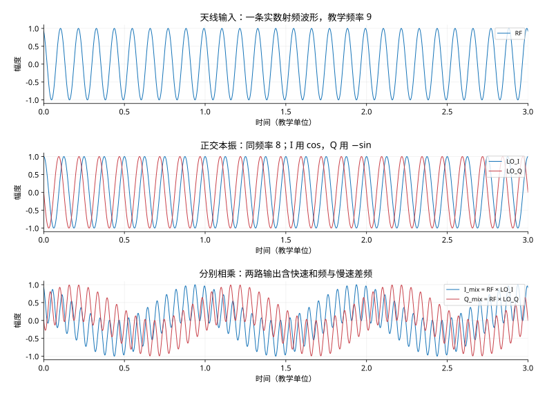

为看清快慢，图中把射频频率设为教学单位 9，本振为 8，初相为 0.4 rad，幅度为 1。它们不代表 433 MHz 实测数据。第一行只有一条 RF 曲线；第二行才有两条本振；第三行是 RF 分别与两条本振相乘得到的两路电压。这里尚未得到可直接低速采样的纯基带，两路都含快速和频。

采用复信号 `I+jQ` 的正频率约定，令：

```text
RF(t) = A cos(ωRF t + φ)
LO_I(t) = cos(ωLO t)
LO_Q(t) = −sin(ωLO t)
θ = (ωRF−ωLO)t + φ

I_mix = A/2 cos(θ) + A/2 cos[(ωRF+ωLO)t+φ]
Q_mix = A/2 sin(θ) − A/2 sin[(ωRF+ωLO)t+φ]
```

这里用到 `cos a cos b = [cos(a−b)+cos(a+b)]/2` 和 `cos a sin b = [sin(a+b)−sin(a−b)]/2`。Q 本振取负正弦，因此低通后的 Q 为正的 `A/2 sin θ`。如果改用正正弦，本例 Q 会反号，频率方向解释也要相应改变。另外 `sin x=cos(x−90°)`，`−sin x=cos(x+90°)`；不能把这两个符号混用。

#### 和频、差频和模拟低通逐条分开看

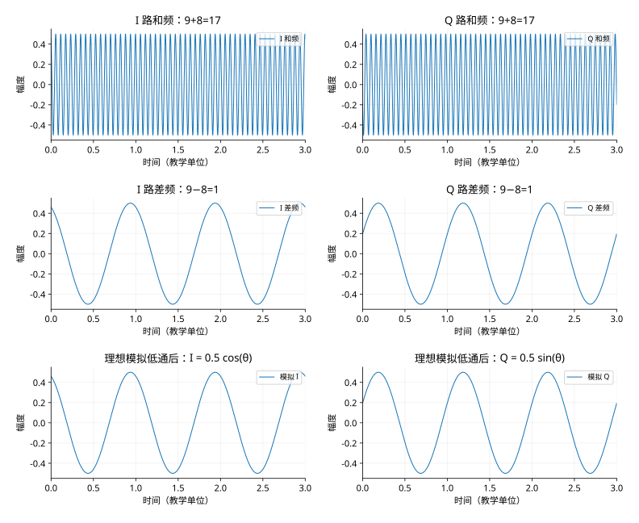

第一行是两路各自的和频，频率为 17；第二行是差频，频率为 1；把同列前两条曲线相加，就得到上一张图的对应混频输出。第三行展示理想低通只保留差频后的结果：I、Q 频率相同，相位相差四分之一周期，幅度均为输入的二分之一。实际混频增益、后续放大和归一化会改变这个幅度系数。

模拟低通位于 ADC 之前，抑制混频高频产物和带外成分，帮助防止后续采样混叠。理想图省略了滤波过渡带、残余和频和延迟；实际滤波只有有限衰减。AD9361 基带接收链包含模拟滤波、ADC 和多级数字抽取滤波。[官方参考手册](https://www.analog.com/media/en/technical-documentation/user-guides/ad9361.pdf)

若接收的是幅度与相位恒定、且恰好等于 LO 的单音，θ 恒定，两路得到直流；若单音高于 LO，向量按本文约定逆时针旋转，低于 LO 则顺时针。对于 GFSK，调制相位随数据变化，即使信号中心等于 LO，I/Q 仍随时间变化。

#### ADC：同时取点，再数字滤波和抽取

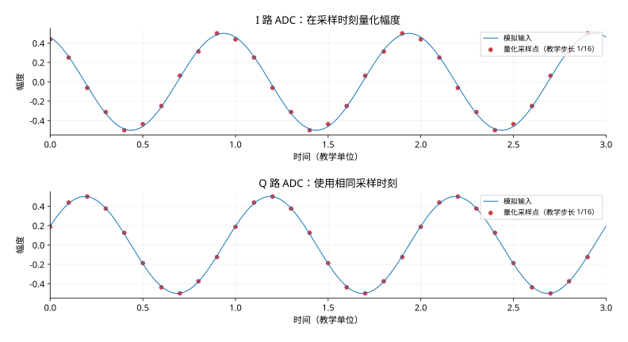

蓝线表示模拟电压，红点表示同一组时刻采到的量化数值。两路每个采样时刻组合成一个复数点；图中量化步长故意设为 1/16，便于看到误差，**不是 AD9361 实际 ADC 分辨率或满量程**。真实 ADC 有噪声、有限分辨率和动态范围；数字 I/Q 由两列有限精度数值表示。

主机配置的 1 MS/s 是最终输出的数据速率，不能直接理解为内部 ADC 时钟就是 1 MHz。内部较高速采样后还可能经过芯片和设备的数字滤波、抽取。一个最终复数点包含 I、Q 两个分量，1 MS/s 表示每秒 100 万对 I/Q。

#### 与本文软件处理图的连接点

模拟正交分路的目的，是从同一条实数射频中取得 I、Q。第 1.7 节的软件分路则发生在已有复数 IQ 之后：多个支路读取相同 IQ，每路通过数字频移和低通选取自己的信道。各个信道支路都仍然有自己的 I 和 Q。

实数序列可以包含幅度和相位信息，但实数频谱的正负两侧互为共轭镜像；复数 IQ 允许正负两侧独立表示。复数频谱不必是单边谱，可以同时存在多个正频率和负频率波源。最终 GFSK 解调中的“相位差正交解调”，又是对已有 IQ 估算瞬时频率的数字步骤，不是重新在芯片中产生 I/Q。

### 1.1 怎样看一张波形图：时间、幅度与 I/Q

**时间波形的横轴是时间，纵轴是某个信号量。** 曲线高低表示幅度，曲线在同样时间内来回振荡的次数表示频率。幅度更大不代表发送的数据更多；振荡更快也不一定代表每秒发送的比特更多。

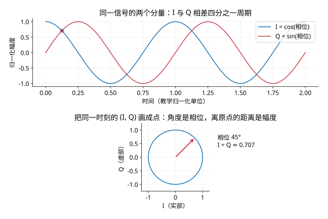

图上半部分把一个信号拆成 I、Q 两条曲线。每个采样时刻同时得到一个 I 和一个 Q，组合为 `x = I + jQ`。下半部分用横坐标 I、纵坐标 Q 表示同一个采样点：点到原点的距离 `sqrt(I²+Q²)` 是幅度，向量的角度 `atan2(Q,I)` 是相位。图中 45° 时 I、Q 都约为 0.707，总幅度仍为 1。

随时间观察这个向量，转得越快，频率绝对值越大；转动方向区分基带正频率和负频率。接收器正是通过相邻采样点的相位变化估算频率。**I/Q 是同一接收通道的两个分量，仅凭两列 I/Q 不能判断同时接收了两个波源。** 多个波源可以叠加在同一份 I/Q 中，需要结合频谱和解码结果判断。

这里的正弦曲线是教学仿真，时间采用归一化单位。实际录波包含调制、噪声和幅度变化，通常不会形成这么整齐的圆。

### 1.2 四个容易混淆的数：载频、采样率、位速率、频偏

| 数量 | 本工程例子 | 读法与意义 |
|---|---|---|
| 射频中心 | 红方 433.200 MHz | 天线接收的信号处于哪个无线频段 |
| IQ 采样率 | 1 MS/s | 每秒记录 100 万个复数点；每点包含 I、Q |
| 位宽和位速率 | 47 µs；约 21,276.6 bit/s | 一位持续多久、每秒承载多少位；当前二进制调制一符号携带一位 |
| 调制频偏 | 约 ±248.723 kHz | 频率围绕中心向两侧偏移，用来区分两种符号 |

在 1 MS/s 下，采样间隔是 1 µs，因此一位有约 47 个采样点。**47 个点共同描述一位的波形，不是 47 位数据。** 射频中心由 SDR 硬件搬到基带附近，所以文件中不需要用 1 MS/s 直接描述 433 MHz 的每个射频周期。

### 1.3 比特怎样变成波形：从 FSK 到 GFSK

二进制 FSK 用两种频率状态表示 0、1。下面采用“正频偏对应 1、负频偏对应 0”的示意约定；工程还需遵循实际解调符号极性，不能看到任意频谱的左右两侧就直接给它贴 0、1 标签。GFSK 在调制之前对符号变化做高斯平滑，使频率过渡更柔和。

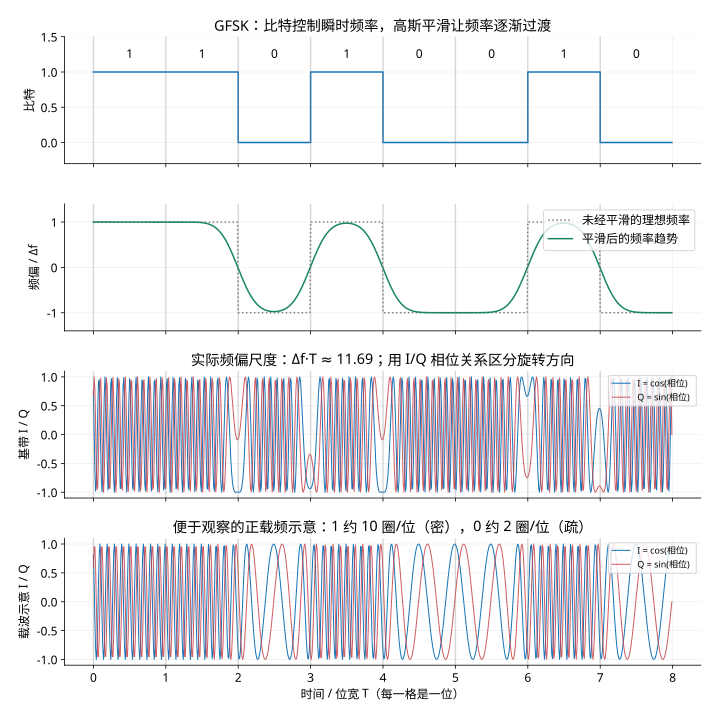

从上到下读这张图：第一行是 `11010010`；第二行灰虚线表示频率立即跳变的理想情况，绿线表示平滑后的趋势；第三行是采用实际频偏尺度生成的基带 I/Q；第四行增加正载频，直接展示高低频率的疏密差异。第三、四行均用蓝线表示 `I=cos(相位)`、红线表示 `Q=sin(相位)`。相邻两位相同的时候，频率维持同一侧；比特翻转时，频率跨过中心。过渡处会受到相邻位影响，因此不能只读任意一个点。

在频率稳定的区间，找到蓝线 I 的一个正峰，再沿时间向右看：正频率时，Q 从零向正值走；负频率时，Q 从零向负值走。这对应复平面向量分别逆时针、顺时针旋转，采用本文 `I+jQ` 的约定。第三行两种方向都存在；第四行的两种频率都为正，因此方向相同，速度不同。密集图可点击放大观察，解调器则直接计算相邻复数采样的相位差。

第二行纵轴 `频偏 / Δf` 是无量纲比例，+1 对应 +Δf，−1 对应 −Δf。第三行使用本工程的频偏尺度：`248723 × 47×10⁻⁶ ≈ 11.69`，频率稳定在一侧时，一个位宽内相位转动约 11.69 圈。**+Δf 与 −Δf 的绝对值相同，因此单看基带 I 的疏密不能区分 0、1；需要结合 Q 判断相位旋转方向，或看第二行的带符号瞬时频率。** 加大频偏会增加振荡圈数，但不会让正负等大频偏的振荡速度变得不同。

第四行为了直观看到“高频密、低频疏”，采用教学载频 `fc·T=6`、频偏 `Δf·T=4`。于是 1 对应 `(fc+Δf)·T=10` 圈/位，0 对应 `(fc−Δf)·T=2` 圈/位，两者均为正频率。先看前两位 1 的密集振荡，再看第六位 0 的稀疏振荡；交界因高斯平滑而逐渐变化，孤立的一位可能尚未完全达到稳态。这个载频专为读图设定，不是 433 MHz 射频，也不是第三行的基带参数。图里的平滑曲线用于理解趋势，不是本工程 BT=0.35 滤波器的精确响应，也不是实际录波。

### 1.4 频谱、下变频和滤波怎样看

**频谱横轴是频率，纵轴是该频率附近的信号强度。** 频谱没有逐位的时间顺序；要看信号随时间如何出现，应看瀑布图。瀑布图的一个轴是时间、另一个轴是频率，颜色表示强弱。持续亮线表示某频率附近长期存在能量，但仅有亮线还不足以证明协议包可以正确解码。

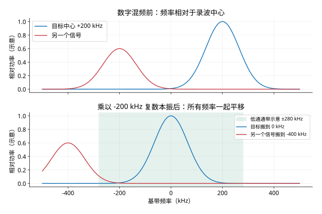

上图假设目标中心比录波中心高 200 kHz，因此位于横轴 +200 kHz。数字混频把整份频谱减去 200 kHz：目标到 0，原先 −200 kHz 的另一信号到 −400 kHz。下图浅绿色表示公共低通的大致保留范围。滤波器保留范围内的目标，同时衰减带外成分；真实 FIR 在边缘逐渐衰减，不会像理想闸门一样立即切断。

这张图中的谱峰是人工画出的窄峰，仅解释平移关系，**不代表本工程信息波的真实占用带宽**。实际 GFSK 的频谱由频偏、位速率、高斯整形和噪声共同决定。相邻信号与目标频带重叠时，普通低通无法把它们完整分开。对应正文第 4、5 节。

### 1.5 从波形得到 0/1：解调、滤波、采样与判决

接收器首先从 I/Q 相位差得到瞬时频率，再进行偏移补偿和滤波，得到连续的“软值”。软值尚未变成比特，仍保留正负和距离门限的程度。

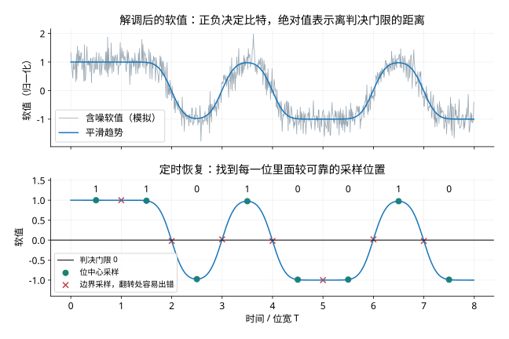

第一行灰线是人工加入噪声的软值，蓝线是平滑趋势示意；第二行绿点位于每位中心，红叉位于位边界。看 1→0 或 0→1 的交界，红叉容易接近门限 0，这时微小噪声就可能改变判决。连续相同比特的边界则不一定有这个问题。

在这里的极性约定下，软值大于 0 判为 1，小于 0 判为 0。例如 +0.9 与 +0.03 都可以判成 1，但后者更容易受噪声影响；软值的绝对值只是直观的可靠程度线索，不能直接当作“正确概率”。

WMJ 使用定时恢复模块跟踪采样时刻；TCR/Fast 扫描一位内的 47 种采样相位，比较哪个位置更像已知同步模板。实际系统还会有滤波延迟、时钟误差、频率误差和符号间影响，图中绿点只是解释为什么要找合适位置。对应第 7.2～7.5、8.2～8.4 节。

### 1.6 已经有 0/1，怎样知道包从哪里开始

一长串 0/1 中，需要先定位已知的访问码。可以把已知模板沿接收数据滑动，每到一个位置就计算相似程度。TCR/Fast 使用的是 64 位访问码加 32 位长度字段，共 96 位模板。

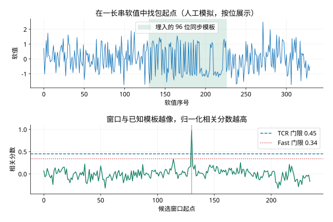

上图在第 130 个位置人工放入真实的 96 位模板，加上随机噪声；下图展示每个候选起点的归一化相关分数。对齐时出现明显峰值，错开后分数降低。横轴是候选序号，**不是频率**。这个简化例子直接在每位一个软值的序列上计算相关，省略了前面的 IQ 解调和 47 相位扫描。

两条水平线标出工程 TCR 的 0.45 门限和 Fast 的 0.34 门限。门限低可以接纳较弱或失真的候选，同时更容易接纳错误候选。因此超过门限之后仍要检查访问码错误数、重复长度字段、包完整性以及上层 CRC。**相关峰说明“这里像包起点”，CRC 和后续结构检查才进一步支持“解出的帧可接受”。** 本图不能用于比较实际两种接收器的成功率。对应第 8.5～8.7、9、11 节。

把这五组图连起来：I/Q 记录相位与幅度；混频、低通选取目标频带；相位差解调得到软值；定时和判决得到比特；同步定位空口包；载荷重组与 CRC 检查最终得到坐标、血量等协议内容。

### 1.7 原始信号 → 分路 → 混频相乘 → 低通：逐条曲线对照

下面用同一组可计算的信号，完整走一遍前端处理。假设采样率为 1 MS/s，原始 IQ 中叠加两个纯复数单音：A 在 +100 kHz、幅度 1；B 在 −180 kHz、幅度 0.55。时间图只显示稳态中的 80 个点，也就是 80 µs；频谱使用更长的稳态数据计算，横轴始终是相对于当前中心的基带频率。

**这是教学仿真，不是外部录波实测，也不是信息波的完整 GFSK 调制。** 选纯单音是为了让每次频移和相乘都能直接看清。这里使用 60 kHz 的教学低通；工程信息波公共低通是 280 kHz，不能把本例参数直接用于信息波接收。

#### 第一步：两个波源叠加成一份原始 I/Q

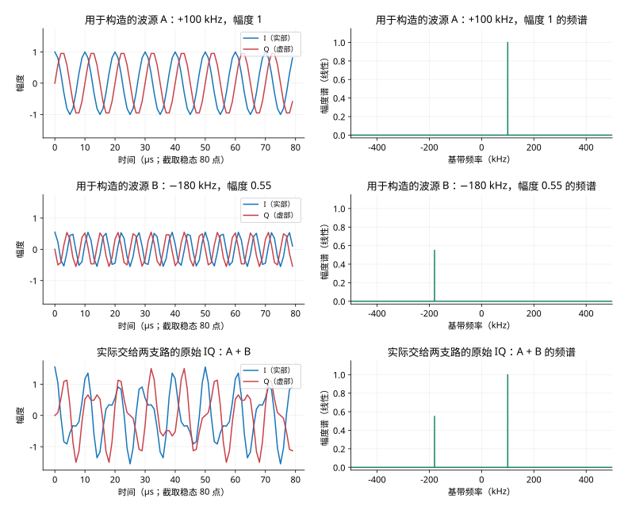

逐行看：第一行是 A，第二行是 B，第三行是 `x=A+B`。左列蓝线为 I、红线为 Q；右列是复数 IQ 的双边幅度谱。原始波形变得复杂，是因为两个旋转向量相加。原始频谱仍有两个峰，所以频谱通常比原始时间曲线更容易看清有哪些中心频率。

前两行是仿真构造时已知的波源，接收器实际拿到的是第三行。只画 I 的实数频谱会出现正负频率镜像；这里对复数 I/Q 整体做 FFT，保留了正负频率的方向信息。频谱纵轴是线性幅度，A 峰为 1，B 峰为 0.55；不是 dB 功率。

#### 第二步：分成两个处理支路，各自产生本振

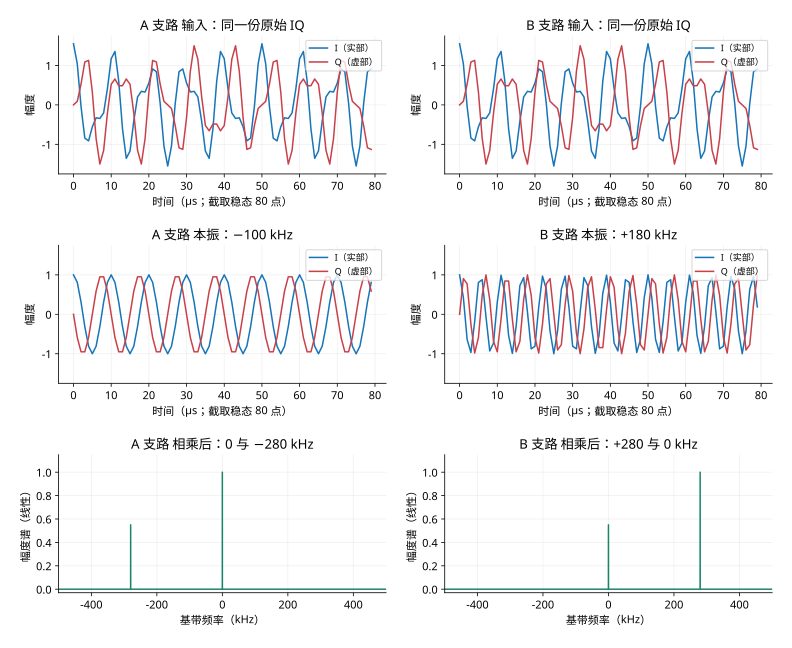

左列是 A 支路，右列是 B 支路。第一行两幅曲线完全相同：软件分路是让不同处理链读取同一份输入数据，各路此时都包含 A 和 B；分路本身还没有完成波源分离。

第二行是各路的复数本振。为了把 +100 kHz 搬到 0，A 路乘以 −100 kHz 的本振；为了把 −180 kHz 搬到 0，B 路乘以 +180 kHz 的本振。复数本振幅度为 1，包含余弦实部与带符号的正弦虚部。

第三行是相乘后的频谱：A 路把两个峰一起减去 100 kHz，得到 0 和 −280 kHz；B 路把两个峰一起加上 180 kHz，得到 +280 和 0 kHz。**混频会搬动整份频谱，尚未删除另一个波源。** 当前入口的对应顺序为 `mix_frequency(raw_iq, ...)`，再调用各支路的 `channelizer.process(...)`；是否启用多个支路由接收配置决定。

#### 第三步：把复数乘法拆成四条乘积曲线

设输入为 `I+jQ`，本振为 `C+jS`。其中 `C=cos(2πf_mix t)`、`S=−sin(2πf_mix t)`；`f_mix` 是目标相对输入中心的偏移。展开得到：

```text
(I+jQ)(C+jS)
    = I×C + jI×S + jQ×C − Q×S
    = (I×C − Q×S) + j(I×S + Q×C)

输出 I′ = I×C − Q×S
输出 Q′ = I×S + Q×C
```

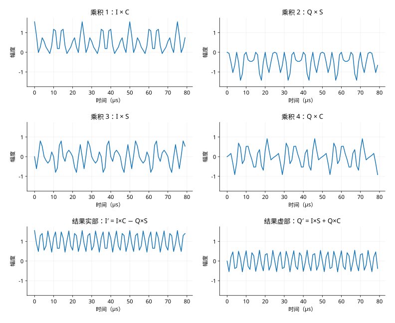

第一行分别是 `I×C`、`Q×S`；第二行是 `I×S`、`Q×C`；第三行才是两两加减得到的输出 I′、Q′。所有曲线使用相同时间窗口和幅度范围，可以逐点比较。

只把输入 I 乘余弦、输入 Q 乘正弦，尚未完成复数混频：必须按上面的关系交叉相乘并加减。目标 A 搬到零频后，贡献一个恒定的实部 1；另一波源 B 仍以 −280 kHz 振荡。因此最后一行的 I′ 围绕 1 起伏，Q′ 围绕 0 起伏。

单项实数乘法可以产生和频、差频；复数乘法把这些项按符号组合，抵消不需要的镜像，得到统一的频率平移。图中的四个乘积是为了展开理解，NumPy 的复数乘法直接完成同样的运算。

#### 第四步：用低通保留搬到中心的目标

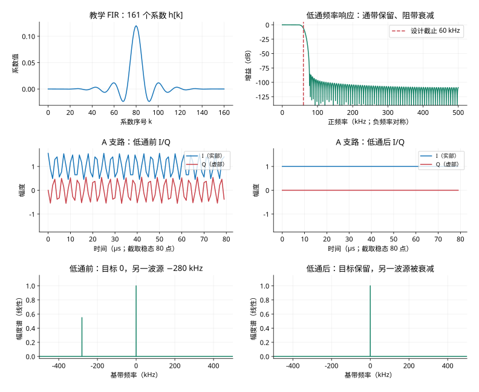

第一行左侧是本例 FIR 的 161 个系数 `h[k]`，右侧是其频率响应。频率响应纵轴为 dB 增益：0 dB 表示基本保留，−80 dB 表示幅度约缩小到原来的万分之一。右侧仅画正频率，实系数低通的幅频响应在负频率一侧对称。

对每个输出时刻，滤波器取一段相邻输入数据，与系数逐项相乘后求和；对 I、Q 分别做相同运算：

```text
yI[n] = Σ h[k] × I′[n−k]
yQ[n] = Σ h[k] × Q′[n−k]
```

这些系数共同形成“保留低频、衰减高频”的效果，并非每个系数对应一个独立频率。第二行左侧是含有两个波源的混频结果，右侧是低通后的结果；第三行对照它们的频谱。A 已位于 0 Hz，获得保留；B 位于 −280 kHz，落入本例 60 kHz 低通的阻带，明显衰减。

本例用对称 FIR 的居中卷积绘图，并仅显示远离文件边界的稳态部分，方便前后按时间对照。实际因果 FIR 有群延迟和启动瞬态；本例有 161 个系数（161 taps），滤波器阶数为 160，因果实现的群延迟为 80 个采样，也就是 80 µs。工程另有历史缓存和延迟处理，不能把图理解成滤波没有延迟。

#### 第五步：查看两个支路各自的最终输出

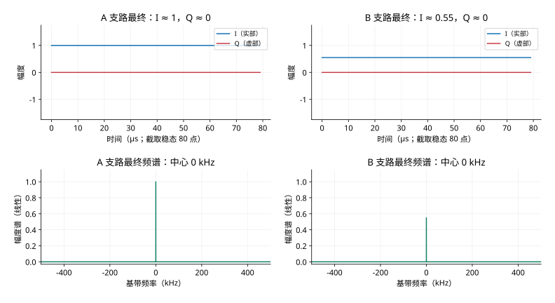

左列只剩目标 A，右列只剩目标 B。两路的目标都搬到各自的 0 Hz；A 路实部约为 1，B 路约为 0.55，虚部都约为 0。**零频后的常数是本例无调制纯单音的结果。** 实际 GFSK 的瞬时频率随符号变化，搬移中心后仍会旋转、过渡，低通输出也仍然是变化的 I/Q，随后才能通过相位差解调数据。

这组图完整显示了原始 I/Q、每路输入、本振 I/Q、四个乘积项、合成 I/Q、FIR 系数与响应、滤波后 I/Q，以及各阶段频谱。读图时始终区分三个动作：分路让多条链处理相同输入；混频把目标搬到中心；低通按频率范围衰减其他成分。

## 2. 输入参数和文件格式

### 2.1 频率配置

| 队伍 | 信息波中心频率 | 射频带宽 | 推荐解调采样率 |
|---|---:|---:|---:|
| 红方 | 433.200 MHz | 540 kHz | 1 MS/s |
| 蓝方 | 433.920 MHz | 540 kHz | 1 MS/s |

程序用 `--rx-lo` 表示接收或录制时的中心频率。目标信号与 `rx-lo` 不相等时，后续数字混频会补偿这一频差。

### 2.2 `.c64/.fc32` 录波

当前读取方式为 NumPy `complex64`：

```text
每个复数采样点 = float32 I + float32 Q = 8 byte
字节序           = Windows/x86 小端序
排列             = I0,Q0,I1,Q1,I2,Q2,...
```

文件时长可由下式估算：

```text
采样点数 = 文件字节数 / 8
时长（秒） = 采样点数 / raw_sample_rate
```

程序使用 `np.memmap` 映射文件，再按 `rx_buffer_size` 分块处理。因此整段解析大文件时不需要把整个文件一次加载到内存，也不会生成新的 IQ 文件。

### 2.3 幅度归一化

Pluto 原始 ADC 录波通常保留约 12 bit 数值尺度。未指定 `--recording-normalized` 时执行：

```text
normalized_iq = raw_iq / 2048.0
```

只有确认文件已经处于约 `-1.0～+1.0` 范围时才使用 `--recording-normalized`。误用此选项会让不同解码器看到错误的幅度尺度，尤其影响 WMJ 链路中的 AGC 和信号质量判断。

## 3. 分块读取与连续状态

接收器逐块读取数据，但不能把每块当成互不相关的独立信号。工程为此保存以下状态：

1. 信道器保存内部数字本振相位。不过当前入口的 `mix_frequency` 每块从零相位开始，信道器内部 `center_hz=0`；非零频移时不能宣称整个入口混频严格连续。
2. FIR 历史采样，避免块边界处滤波瞬态。
3. 抽取相位，保证抽取后的采样时间轴连续。
4. 解码器尾部 IQ，避免同步码或空口包跨块时被截断。
5. 已发现包的位置，用于消除前后块重叠造成的重复包。
6. 15 字节载荷重组缓冲区，使协议帧可以跨多个空口包。

这就是为什么不能简单地逐块执行“解调后立刻清空所有状态”。否则每个块边界都可能丢失一个空口包或上层帧。

## 4. 数字下变频

目标信号相对录波中心的偏移为：

```text
mix_hz = target_center_frequency - rx_lo
```

程序将输入 IQ 乘以复数本振：

```text
y[n] = x[n] * exp(-j * 2*pi*mix_hz*n / sample_rate)
```

效果是把位于 `mix_hz` 的目标信道搬移到基带 0 Hz。例如录波中心为 `433.000 MHz`，红方信息波在 `433.200 MHz`，则数字混频偏移为 `+200 kHz`。

如果 `rx-lo` 填错，信号不会落在后续低通通带中心，可能被衰减或完全滤掉。这是分析外部录波时首先要核对的参数。

## 5. 信道滤波和抽取

`StreamChannelizer` 执行频移、Kaiser FIR 低通和整数倍抽取：

- 默认输出采样率：`1 MS/s`
- 信息波实际通带截止：`280 kHz`
- 信息波实际过渡带：`35 kHz`
- 入口指定阻带衰减：`80 dB`

这些参数来自入口 `make_channelizer(level=3)`，已经覆盖类默认参数。Fast 内部 320 kHz 低通位于公共 FIR 之后，不能恢复公共 FIR 已滤掉的分量。

如果原始采样率为 `2 MS/s`，抽取因子是 2；如果录波本身为 `1 MS/s`，不抽取。FIR 用 overlap-save 方式保存历史，并补偿首块群时延。

这一步的目的不是解析比特，而是尽量只保留目标信息波、压制邻近干扰波和带外噪声。

## 6. 信息波的物理层结构

当前代码按 GFSK 信息波处理，基本参数为：

```text
解调采样率       1,000,000 sample/s
每符号采样数     47 sample/symbol
估算符号率       1,000,000 / 47 = 21,276.6 symbol/s
Gaussian BT      0.35
```

一个空口包固定为 216 bit：

| 位范围 | 长度 | 含义 |
|---|---:|---|
| 0～63 | 64 bit | 信息波访问码 `0x2F6F4C74B914492E` |
| 64～79 | 16 bit | 长度字段 1，应为 15 |
| 80～95 | 16 bit | 长度字段 2，应为 15 |
| 96～215 | 120 bit | 15 字节空口载荷 |

访问码负责检测包起点。两个长度字段既参与同步模板，也用于排除偶然出现的相似比特序列。

## 7. WMJ 解码器的每一步

命令行选择：

```powershell
--info-decoder wmj
```

其接收链为常驻 GNU Radio 流图：

```text
QueuedComplexSource
 -> AGC
 -> Quadrature Demod
 -> Gaussian FIR
 -> Mueller and Muller Symbol Sync
 -> 零门限硬判决
 -> 64 bit Access Code Correlator
 -> Tagged Packet Sink
 -> ProtocolStreamReassembler
```

### 7.1 AGC

AGC 将输入幅度拉到相对稳定的范围。当前参数包括较慢的增益调整率、参考幅度 1.0 和最大增益 100。它有利于实时连续信号，但需要流图持续运行并保留内部状态。

### 7.2 正交解调

GFSK 用瞬时频率表示 0/1。正交解调器计算相邻复数采样的相位变化，并按预期频偏换算成正负实数序列。

概念公式为：

```text
phase_delta[n] = angle(x[n] * conj(x[n-1]))
frequency[n]   = phase_delta[n] * sample_rate / (2*pi)
```

### 7.3 Gaussian 匹配滤波

使用与发射端 `BT=0.35` 对应的 Gaussian 滤波器降低噪声并集中符号能量。

### 7.4 符号定时恢复

WMJ 使用 Mueller and Müller 定时误差检测器，让采样点逐步靠近符号中心。这与 Fast/TCR 的“扫描全部 47 个相位”是根本区别。

### 7.5 硬判决与访问码相关

滤波后的值大于 0 判为 1，否则判为 0。随后 GNU Radio 访问码相关器搜索 64 bit 信息访问码，当前允许最多 12 bit 不同。

### 7.6 截取空口包

访问码命中后，截取紧随其后的 32 bit 长度头和 120 bit 载荷。只有两个长度都等于 15 才保留。

### 7.7 WMJ 的限制

- 硬判决后丢失了每个 bit 的置信度，不能执行多候选软合并。
- 只要 CRC16 错误，上层帧就丢弃，不修复坐标帧。
- 依赖 GNU Radio 和其定时环参数，对不同设备时钟误差、离线块边界和特殊录制条件可能较敏感。
- 优点是结构标准、实时流状态完整、对其原始目标录波兼容性好。

## 8. TCR 解码器的每一步

命令行选择：

```powershell
--info-decoder tcr
```

TCR 和 Fast 使用相同的 `FastInformationWaveDecoder` 类，但 TCR 使用严格参数。

### 8.1 IQ 低通

先用 129 taps Blackman 窗 sinc FIR 对复数 IQ 低通，截止频率为 `270 kHz`。

### 8.2 瞬时频率解调

直接计算：

```text
phase_delta = angle(iq[1:] * conj(iq[:-1]))
instantaneous_hz = phase_delta * sample_rate / (2*pi)
```

随后减去整块瞬时频率的均值，用于消除残余载波频偏产生的直流偏置。

### 8.3 Gaussian 匹配滤波

瞬时频率序列经过 `BT=0.35` Gaussian 匹配滤波，得到适合按符号抽样的软值。

### 8.4 扫描全部 47 个采样相位

接收器分别取：

```text
phase 0: matched[0], matched[47], matched[94], ...
phase 1: matched[1], matched[48], matched[95], ...
...
phase 46
```

因此不需要先锁定一个唯一的符号相位。每个相位都与 96 bit 同步模板做归一化相关。

### 8.5 96 bit 同步模板

同步模板不是只有访问码，而是：

```text
64 bit 信息访问码 + 16 bit 长度15 + 16 bit 长度15
```

TCR 相关门限为 `0.45`。超过门限的局部峰成为候选起点。

### 8.6 候选验证

每个候选重新估算软值中心和尺度，再得到 216 bit：

```text
bit = soft_value >= adaptive_threshold
```

然后检查：

- 信息访问码错误数不超过 24。
- 长度头错误数不超过 2。
- 信息访问码与干扰波访问码相比至少有 2 bit 优势，避免误认干扰波。

### 8.7 聚类和软合并

同一个真实包可能在多个相位产生相关峰。程序把起点相差不超过一个符号的候选归为一组，按同步错误数和相关强度排序，最多使用 3 个候选的软值加权合并。

软合并后再以 0 为门限产生最终 120 bit 载荷。它相当于让多个相邻采样相位共同投票，但权重随相关强度变化。

### 8.8 TCR 的严格策略

TCR 不修复 CRC 错误帧。任何上层 CRC16 错误都会被跳过，因此假帧少，但弱信号下可能漏帧。

## 9. Fast/Ours 解码器的每一步

命令行选择：

```powershell
--info-decoder fast
```

或者：

```powershell
--info-decoder ours
```

当前代码中 `fast` 和 `ours` 是同一实现、同一参数，不是两套不同算法。

其基本步骤与 TCR 相同，但为了外部录波和弱信号做了如下调整：

| 参数 | TCR | Fast/Ours | 影响 |
|---|---:|---:|---|
| IQ 低通截止 | 270 kHz | 320 kHz | Fast 容纳更宽的频偏和信号边带 |
| 相关门限 | 0.45 | 0.34 | Fast 接收较弱相关峰 |
| 最大访问码错误 | 24 bit | 32 bit | Fast 候选更宽松 |
| 最大长度头错误 | 2 bit | 3 bit | Fast 对头部误码更宽松 |
| IQ 尾部 | 12000 sample | 24000 sample | Fast 更不容易在块边界丢包 |
| 软合并候选 | 3 | 5 | Fast 使用更多相位信息 |
| 坐标帧修复 | 关闭 | 最多 2 bit | Fast 可恢复少量 `0x0A01` |

### 9.1 坐标帧 CRC 修复

修复只用于 `0x0A01`，不会对所有命令盲目纠错：

1. 帧头、长度、序号、CRC8 和命令号不允许修改。
2. 只尝试坐标数据区和接收 CRC16 字段中的 1 bit 或 2 bit 翻转。
3. 修改后的整帧必须通过 CRC16/IBM。
4. 用场地范围 `0 <= x <= 2800`、`0 <= y <= 1500` 给候选评分；当前代码没有强制六个坐标全部在范围内。
5. 多个 CRC 合法候选存在时，优先保留更多合法坐标、使用更少修复 bit，并用上一帧位置连续性作最终选择。

输出质量分为：

| `quality` | 含义 | 是否计入有效帧 |
|---|---|---|
| `strict` | 原始帧直接通过 CRC16 | 是 |
| `repaired_1bit` | 翻转 1 bit 后通过 CRC16 | 是，需单独统计 |
| `repaired_2bit` | 翻转 2 bit 后通过 CRC16 | 是，需单独统计 |
| `raw_invalid_crc16` | 找到疑似坐标帧但无法修复 | 否 |

Fast 提高了检出率，但不能把修复帧与原始严格帧视为完全相同的证据。分析结果时应同时报告严格帧、修复帧和无效帧数量。

## 10. 从 15 字节空口载荷重组上层帧

修复结果的边界：当前实现会在修复坐标越界而原始坐标合法时回退到原始坐标。候选修复帧通过 CRC 后，最终混合数据不会再次以原始 CRC 校验，故 `repaired` 应单独作为算法恢复结果统计。

三个接收器得到空口载荷后，都要执行协议流重组。假设连续收到：

```text
packet 1 payload: [15 byte]
packet 2 payload: [15 byte]
packet 3 payload: [15 byte]
...
```

重组器将其直接连接为连续字节流：

```text
stream = payload1 || payload2 || payload3 || ...
```

协议帧可能从任意一个 15 字节载荷的中间开始，也可能跨两个、三个或更多空口包。重组器不能假设每个载荷的第一个字节就是 `0xA5`。

## 11. 上层协议帧逐字节解析

上层帧结构为：

| 偏移 | 长度 | 内容 | 字节序/检查 |
|---:|---:|---|---|
| 0 | 1 | `SOF = 0xA5` | 固定值 |
| 1 | 2 | `data_length` | 小端 |
| 3 | 1 | `seq` | 0～255 循环 |
| 4 | 1 | `header_crc8` | 对偏移 0～3 做 CRC8/MAXIM |
| 5 | 2 | `cmd_id` | 小端，如 `01 0A` = `0x0A01` |
| 7 | N | 命令数据 | N 等于 `data_length` |
| 7+N | 2 | `frame_crc16` | 对前面所有字节做 CRC16/IBM，小端存放 |

总帧长为：

```text
frame_length = 5 + 2 + data_length + 2
             = data_length + 9 byte
```

解析顺序必须是：

1. 在连续字节流中搜索 `0xA5`。
2. 至少收齐前 5 字节。
3. 检查前 4 字节的 CRC8。
4. 读取小端 `data_length`。
5. 读取小端 `cmd_id`，并检查命令对应的固定数据长度。
6. 等待收齐 `data_length + 9` 字节。
7. 检查整帧 CRC16。
8. 通过后才输出 `seq`、`cmd_id` 和数据。
9. CRC8 错误时向后移动 1 字节重新搜索，不能丢掉整个缓存。

## 12. 各命令数据格式

### 12.0 官方版本、发送方向与业务概览

本章依据 RoboMaster 官方资料中心截至 2026-10-12 列出的 2026 赛季文件核对：

- [通信协议 V2.0.0（2026-06-26），官方 PDF](https://bbs-web-static.robomaster.com/2568625171b44e49a44541ec0dbdd2d51782458406243/RoboMaster%202026%20%E6%9C%BA%E7%94%B2%E5%A4%A7%E5%B8%88%E9%AB%98%E6%A0%A1%E7%B3%BB%E5%88%97%E8%B5%9B%E9%80%9A%E4%BF%A1%E5%8D%8F%E8%AE%AE%20V2.0.0%EF%BC%8820260626%EF%BC%89.pdf)：第 1.6 节，印刷页 39～43（PDF 第 40～44 页），表 1-44～1-49。
- [比赛规则 V2.2.0（2026-08-07），官方 PDF](https://bbs-web-static.robomaster.com/e354d2750e17485e8f67e5b5a9d1a2891786094242879/RoboMaster%202026%20%E6%9C%BA%E7%94%B2%E5%A4%A7%E5%B8%88%E8%B6%85%E7%BA%A7%E5%AF%B9%E6%8A%97%E8%B5%9B%E6%AF%94%E8%B5%9B%E8%A7%84%E5%88%99%E6%89%8B%E5%86%8CV2.2.0%EF%BC%8820260807%EF%BC%89.pdf)：无线链路附录，印刷页 152～153（PDF 第 153～154 页）。
- [官方通信协议版本索引](https://bbs.robomaster.com/wiki/20204847/811363) 与 [官方比赛规则版本索引](https://bbs.robomaster.com/wiki/20204847/809871?source=7)。

信息来自裁判系统信号发射源，发给雷达。这里“对方”以该信号服务的雷达队伍为参照：红方雷达收到的是蓝方业务数据，蓝方雷达收到的是红方业务数据。两队使用相同访问码，不能靠访问码区分红蓝，需要结合频点和录制配置。

| 命令 | 数据长度 | 官方业务内容 | 更新频率 |
|---|---:|---|---|
| `0x0A01` | 24 byte | 对方六个目标的位置 | 10 Hz |
| `0x0A02` | 12 byte | 对方地面机器人血量与保留字段 | 10 Hz |
| `0x0A03` | 10 byte | 对方五类机器人剩余允许发弹量 | 10 Hz |
| `0x0A04` | 8 byte | 对方经济与场地状态 | 10 Hz |
| `0x0A05` | 41 byte | 对方增益、哨兵姿态、主要状态 | 10 Hz |
| `0x0A06` | 6 byte | 对方干扰波密钥，出现在干扰波链路 | 10 Hz |

官方新版信息流为 1400 byte/s。五类信息帧连同各自 9 字节封装共 140 字节，10 Hz 对应 1400 byte/s；空口继续按每组 15 字节切片，切片边界不要求与上层帧或快照边界重合。

正式射频参数中的每 bit 时长为 47 微秒，每个 216 bit 空口包约 10.152 毫秒，红方广播源正负频偏约 248723 Hz。与前文 1 MS/s 下 47 sample/bit 的工程配置一致。早期规则曾使用 52 微秒及 1350 byte/s 信息流，不应混用版本。

较早通信协议的命令概览曾把 `0x0A05` 列为 36 字节；V2.0.0 明确为 41 字节，与当前工程固定长度一致。外部录波若来自旧版本，应根据实际帧头长度核实；“未收到 0x0A05”本身不能证明整段录波没有该命令。

下面所有字节偏移均从 `data` 的首字节开始，多字节数值按当前工程小端解析。表中的字段中文含义是对官方表格的归纳说明。

### 12.1 `0x0A01`：六个目标坐标

官方单位为 **cm**。例如 `79 00` 得到 121，表示 x=121 cm=1.21 m；`47 01` 得到 327，表示 y=327 cm=3.27 m。不能把这两个整数直接当米。

| 对方目标 | x 偏移 | y 偏移 | 每个数宽度 |
|---|---:|---:|---:|
| 英雄 | 0 | 2 | 2 byte |
| 工程 | 4 | 6 | 2 byte |
| 3 号步兵 | 8 | 10 | 2 byte |
| 4 号步兵 | 12 | 14 | 2 byte |
| 空中机器人 | 16 | 18 | 2 byte |
| 哨兵 | 20 | 22 | 2 byte |

官方同文档的位置坐标说明以红方补给站附近场地围挡交点为原点，长边向蓝方为 X 正向，短边向红方停机坪为 Y 正向（表 1-21 附近，印刷页 20）。`0x0A01` 表自身说明了 cm 单位，没有重复该原点注释；将其绘制到自定义地图时仍应核对坐标约定，不能仅因选择蓝方接收就自动镜像。工程中的 2800/1500 上限是恢复算法的范围约束。

数据长度为 24 字节，由 6 组坐标组成，每组 4 字节：

```text
uint16_le x
uint16_le y
```

顺序为：

1. enemy_hero
2. enemy_engineer
3. enemy_infantry3
4. enemy_infantry4
5. enemy_air
6. enemy_sentinel

例如成功录波中的数据：

```text
790047010202CE030C0296027003CF0369008903E4009403
```

按每 4 字节拆分并按小端解释：

| 目标 | 原始 4 字节 | x | y |
|---|---|---:|---:|
| enemy_hero | `79 00 47 01` | 121 | 327 |
| enemy_engineer | `02 02 CE 03` | 514 | 974 |
| enemy_infantry3 | `0C 02 96 02` | 524 | 662 |
| enemy_infantry4 | `70 03 CF 03` | 880 | 975 |
| enemy_air | `69 00 89 03` | 105 | 905 |
| enemy_sentinel | `E4 00 94 03` | 228 | 916 |

注意：日志中的 `data` 只包含命令数据，不包含 `A5`、长度、序号、CRC8、命令号和 CRC16。

### 12.2 `0x0A02`

这是对方机器人当前血量。未上场或被罚下的机器人，官方规定对应血量为 0；仅看 0 值不能区分战亡、未上场及罚下。

| 偏移 | 工程字段 | 业务内容 | 示例值 |
|---:|---|---|---:|
| 0 | `enemy_hero_hp` | 对方英雄血量 | 153 |
| 2 | `enemy_engineer_hp` | 对方工程血量 | 159 |
| 4 | `enemy_infantry3_hp` | 对方 3 号步兵血量 | 142 |
| 6 | `enemy_infantry4_hp` | 对方 4 号步兵血量 | 107 |
| 8 | `reserved` | 保留，不解释为无人机血量 | 原始值 200 |
| 10 | `enemy_sentinel_hp` | 对方哨兵血量 | 146 |

数据长度 12 字节，当前解析器按 6 个小端 `uint16` 输出，字段顺序为：

```text
enemy_hero_hp
enemy_engineer_hp
enemy_infantry3_hp
enemy_infantry4_hp
reserved
enemy_sentinel_hp
```

示例 `99009F008E006B00C8009200` 对应十进制：

```text
153, 159, 142, 107, 200, 146
```

### 12.3 `0x0A03`

这里的“弹量”是裁判系统允许发射的剩余额度，不能直接推断机器人实际装了多少弹丸。官方对步兵说明该值包含堡垒提供的储备允许发弹量。

| 偏移 | 对方目标 | 类型 | 示例额度 |
|---:|---|---|---:|
| 0 | 英雄 | `uint16_le` | 70 |
| 2 | 3 号步兵 | `uint16_le` | 93 |
| 4 | 4 号步兵 | `uint16_le` | 99 |
| 6 | 空中机器人 | `uint16_le` | 98 |
| 8 | 哨兵 | `uint16_le` | 62 |

本命令没有工程字段，不能沿用 `0x0A02` 的六机器人排列。

数据长度 10 字节，按 5 个小端 `uint16` 输出，字段依次为 `enemy_hero_ammo`、`enemy_infantry3_ammo`、`enemy_infantry4_ammo`、`enemy_air_ammo`、`enemy_sentinel_ammo`。示例：

```text
46005D00630062003E00 -> 70, 93, 99, 98, 62
```

### 12.4 `0x0A04`

前两个整数分别是对方剩余金币数和对方累计总金币数。后面的 32 bit 是多个状态的位打包，不是单一分数。bit 0 是这个小端整数的最低位。

| 状态位 | 业务含义 | 官方值的解释 |
|---|---|---|
| 0 | 对方补给区占领 | 1 表示占领 |
| 1～2 | 对方中央高地归属 | 1=对方，2=己方；3 未定义 |
| 3 | 对方梯形高地占领 | 1 表示占领 |
| 4～5 | 对方堡垒归属 | 0=无人，1=对方，2=己方，3=双方 |
| 6～7 | 对方前哨站增益点归属 | 0=无人，1=对方，2=己方；3 未定义 |
| 8 | 对方基地增益点占领 | 1 表示占领 |
| 9 | 对方一侧飞坡前隧道中心交互卡 | 1=检测到对方机器人交互模块 |
| 10 | 对方一侧飞坡后隧道中心交互卡 | 同上 |
| 11 | 己方一侧飞坡前隧道中心交互卡 | 同上 |
| 12 | 己方一侧飞坡后隧道中心交互卡 | 同上 |
| 13 | 对方高地跨越点上部交互卡 | 同上 |
| 14 | 对方飞坡跨越点后部交互卡 | 同上 |
| 15 | 对方公路跨越点上部交互卡 | 同上 |
| 16～31 | 该版本表格未说明 | 保留原值，不赋予业务意义 |

提取公式：单 bit 用 `(value >> bit) & 1`，双 bit 用 `(value >> start_bit) & 3`。例如堡垒归属为 `(occupation_status >> 4) & 3`。

示例状态 `0x96263AE6` 的堡垒字段为 2，按本版本含义是己方占领；交互卡 bit 9/11/12/13 为 1。中央高地字段和前哨站字段都为 3，官方没有定义这种取值，高 16 bit 也非零。CRC 正确只能说明传输字节一致，不能证明这些值符合真实规则；录制源可能是测试数据或不同版本。

数据长度 8 字节，解析为：

| 偏移 | 类型 | 字段 |
|---:|---|---|
| 0 | `uint16_le` | `left_coins` |
| 2 | `uint16_le` | `total_coins` |
| 4 | `uint32_le` | `occupation_status` |

示例：

```text
01 03 -> left_coins = 769
17 03 -> total_coins = 791
E6 3A 26 96 -> occupation_status = 0x96263AE6
```

### 12.5 `0x0A05`

官方含义是对方机器人增益及状态，41 字节可以分为：

```text
0..34   五个目标各 7 byte 增益 = 35 byte
35      哨兵姿态               = 1 byte
36..40  五个目标主要状态        = 5 byte
总计                           = 41 byte
```

五个目标的顺序为英雄、工程、3 号步兵、4 号步兵、哨兵，不含空中机器人。

| 目标 | 回血偏移 | 冷却偏移 | 防御偏移 | 负防御偏移 | 攻击偏移 |
|---|---:|---:|---:|---:|---:|
| 英雄 | 0 | 1 | 3 | 4 | 5 |
| 工程 | 7 | 8 | 10 | 11 | 12 |
| 3 号步兵 | 14 | 15 | 17 | 18 | 19 |
| 4 号步兵 | 21 | 22 | 24 | 25 | 26 |
| 哨兵 | 28 | 29 | 31 | 32 | 33 |

| 字段 | 字节宽度 | 单位与意义 |
|---|---:|---|
| 回血 | 1 | 百分数，10 表示每秒恢复血量上限的 10% |
| 射击热量冷却 | 2，小端 | 热量冷却的额外直接值，x 表示增加 x/s |
| 防御 | 1 | 百分数，50 表示 50% 防御增益 |
| 负防御 | 1 | 无符号百分数，30 表示负 30% 防御增益 |
| 攻击 | 2，小端 | 百分数，50 表示 50% 攻击增益 |

例如一组教学数据 `0A 14 00 32 1E 64 00` 表示：回血 10%/s、额外冷却 20/s、防御 50%、负防御 30%、攻击 100%。该例用于演示字节转换，不代表这些增益在正式比赛中一定可同时生效。

| 偏移 35 的姿态值 | 含义 |
|---:|---|
| 1 / 2 / 3 | 进攻 / 防御 / 移动 |
| 4 / 5 / 6 | 强化进攻 / 强化防御 / 强化移动 |
| 其他 | 此版本未定义 |

偏移 36～40 依次对应五个目标，各占 1 字节：0=存活，1=战亡，2=无敌且不虚弱，3=无敌且虚弱。官方说明异常离线不会改变该主要状态判断，不能把这一字节当在线状态位。

工程现状：WMJ 的 `frame_parser.decode_cmd_0a05` 已能拆解上述字段；TCR/Fast 主要输出原始数据及质量标记，接收入口的 `info_frame` 日志也只输出十六进制。字段有正式定义与日志是否展开字段是两件事。本次录波没有恢复 `0x0A05`，因此这里给的是官方解读及教学例，不冒充该录波的实测增益。

数据长度为 41 字节；完整协议帧为 50 字节。当前接收入口把它作为一轮信息快照的最后一部分。

当前接收器会按以下完整帧长度积累一次信息快照：

| 命令 | 数据长度 | 完整帧长度 |
|---|---:|---:|
| `0x0A01` | 24 | 33 |
| `0x0A02` | 12 | 21 |
| `0x0A03` | 10 | 19 |
| `0x0A04` | 8 | 17 |
| `0x0A05` | 41 | 50 |
| 合计 | 95 | 140 |

当连续收到从 `0x0A01` 开始、到 `0x0A05` 结束且总长度正好为 140 字节时，程序输出 `info_snapshot_140`。

## 13. 日志事件如何理解

WMJ 解析器已实现 `0x0A05` 字段解读；TCR 解析器及当前接收日志仍主要保留原始十六进制。快照流程使用此命令作为结束标志。

### `0x0A06` 与信息波的区别

官方定义 6 个 ASCII 字母或数字组成的干扰波密钥，例如 `6A 5A 58 42 61 62` 是 `jZXBab`。它不包含坐标、血量或机器人增益，不属于前述五类信息快照。工程干扰波日志中的 `jam_key` 对应这一字段。规则定义干扰流为 1350 byte/s，密钥帧之外的字节为随机填充。

### `info_packet`

表示物理层成功检测到一个 216 bit 空口包，并取得 15 字节载荷。它不代表已经获得 CRC 正确的上层信息帧。

### `info_frame`

表示载荷字节流中找到完整上层帧，并完成 CRC/修复判定：

```json
{
  "kind": "info_frame",
  "signal": "red_info",
  "command": "0x0A01",
  "seq": 0,
  "data": "79004701...",
  "quality": "strict"
}
```

### `info_snapshot_140`

表示组成一轮信息快照的五类帧累计为完整 140 字节。它比单独一个 `info_packet` 提供更完整的上层证据。

### `status` 和最终汇总

用于查看：

- 已处理原始采样数和秒数
- 空口包计数
- 有效上层帧计数
- 各命令数量
- 修复帧和无效帧数量
- 当前信号功率、峰值和削顶情况

## 14. 三种解码器的本质区别

| 项目 | WMJ | TCR | Fast/Ours |
|---|---|---|---|
| 核心框架 | GNU Radio | NumPy 快速解码器 | NumPy 快速解码器 |
| 幅度处理 | AGC | 公共 IQ 归一化，无独立 AGC | 公共 IQ 归一化，无独立 AGC |
| 定时方法 | M&M 定时环 | 扫描全部 47 相位 | 扫描全部 47 相位 |
| 判决方式 | 硬判决 | 软值、多相合并 | 软值、更多候选合并 |
| 同步模板 | 64 bit 访问码 | 96 bit 访问码+长度头 | 96 bit 访问码+长度头 |
| 接收门限 | 中等 | 最严格 | 最宽松 |
| 坐标 CRC 修复 | 无 | 无 | 最多 2 bit |
| 检测策略 | 定时环与硬判决 | 保守门限、严格 CRC | 宽松门限、软合并及坐标修复 |
| 弱信号检出 | 取决于录制条件 | 严格门限可能漏包 | 更容易接受弱相关候选 |
| 外部录波适应性 | 需要实际比较 | 需要实际比较 | 本次已验证，不能推广为所有录波最好 |
| 外部依赖 | GNU Radio | NumPy/SciPy | NumPy/SciPy |

## 15. 本次成功录波的解析结果

文件：

```text
E:\KAIFABAN\SDR\RADAR_RADIO\radio_logs\aux_info_usb_20260804_163115_942372.c64
```

使用参数：

```text
队伍             red
录波/接收中心     433.200 MHz
原始采样率        1 MS/s
解调采样率        1 MS/s
射频带宽          540 kHz
录制增益          50 dB
解析策略          info_only
解码器            fast
```

整段约 91.49 秒解析结果：

| 项目 | 数量 |
|---|---:|
| 空口包 | 10119 |
| 有效上层帧 | 2752 |
| `0x0A01` | 861 |
| `0x0A02` | 674 |
| `0x0A03` | 397 |
| `0x0A04` | 820 |
| `0x0A05` | 0 |
| 1 bit 修复帧 | 42 |
| 无效帧 | 6 |

该结果说明录波中确实存在可重复恢复的信息波；同时不同命令计数不相等、`0x0A05` 未恢复，说明并不是每轮信息快照都完整接收。

## 16. 推荐的整段解析命令

在 PowerShell 中执行：

```powershell
& "E:\KAIFABAN\SDR\pluto-sdr-win11\runtime\python.exe" `
  "E:\KAIFABAN\SDR\pluto-sdr-win11\SDR\sdr_console\tests\run_live_receiver.py" `
  --recording "E:\KAIFABAN\SDR\RADAR_RADIO\radio_logs\aux_info_usb_20260804_163115_942372.c64" `
  --team red `
  --initial-level 3 `
  --parse-policy info_only `
  --info-decoder fast `
  --raw-sample-rate 1000000 `
  --demod-sample-rate 1000000 `
  --rx-lo 433200000 `
  --rx-rf-bandwidth 540000 `
  --rx-gain-db 50 `
  --rx-buffer-size 65536 `
  --status-interval 99999
```

该命令直接读取原文件，不截取、不复制、不生成新录波。接收日志写入工程的 `SDR/sdr_console/logs` 目录。

## 17. 排查“有波形但解不出信息码”的顺序

1. 核对录波格式是否真的是小端 `complex64`。
2. 核对采样率；错误采样率会同时破坏频率换算和 47 点符号间隔。
3. 核对 `rx-lo` 与目标中心频率，确认数字混频方向和偏移。
4. 核对录波是否已归一化，避免错误使用 `--recording-normalized`。
5. 查看信号是否落入低通通带，有无严重削顶或幅度过低。
6. 查看是否出现相关候选和 `info_packet`。
7. 有 `info_packet` 但无 `info_frame` 时，重点检查长度头、空口误码、载荷连续性和 CRC16。
8. 依次比较 `tcr` 与 `fast`；只有 WMJ 需要额外考虑 GNU Radio 定时环和 AGC 状态。
9. 对外部录波优先使用 `fast`，但必须分别报告 `strict` 与 `repaired` 数量。

