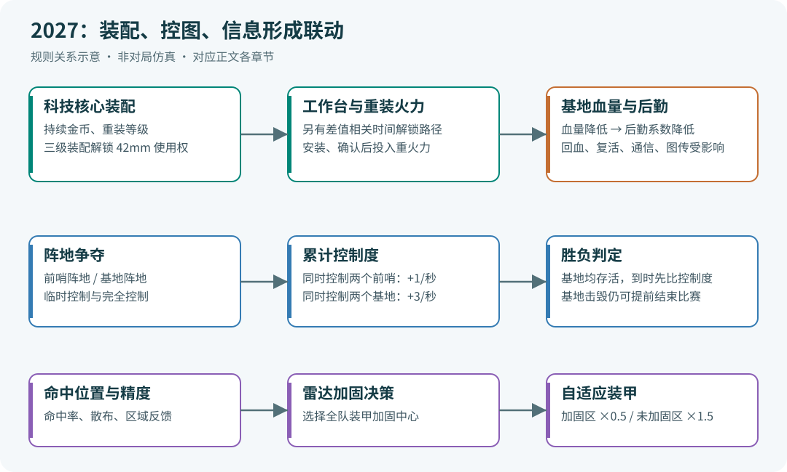

# RoboMaster 2027 超级对抗赛规则变化详解

> 对比版本：2027 V1.0.0（2026-10-15）与本地留存的 2026 V2.2.0（2026-08-07）。本文按规则机制、关键参数、工程影响和备赛任务整理，不上传、不发布。章节中的页码均为手册**印刷页码**；这两份文件的 PDF 阅读器页码均为印刷页码 + 1。

## 1. 对比口径与阅读方法

这里的“今年”指 **2027 赛季**，“去年”指 **2026 赛季**，不是按文件发布日期的自然年分类。2027 首版在 2026 年发布，属于正常赛季命名。

| 标识 | 本次实际使用的文件 | 版本、日期 | PDF 总页数 |
|---|---|---|---:|
| R27 | RoboMaster 2027 机甲大师超级对抗赛比赛规则手册V1.0.0（20261015）.pdf | V1.0.0，2026-10-15 | 144 |
| R26 | RoboMaster 2026 机甲大师超级对抗赛比赛规则手册V2.2.0（20260807）.pdf | V2.2.0，2026-08-07 | 159 |

选择 R26 的较晚版本，是为了回答“从上一赛季实际后期规则转向新赛季，需要改什么”。本地还有 2026 V1.0.0 至 V1.5.0 等版本，但不混用其中数值。**本次不是两个赛季首发版本的对比**；而且 R26 面向全国赛阶段，R27 为新赛季区域赛首版，技术暂停等赛事阶段安排不能直接判为同阶段增减。

R27 §1.2（p.13）给出了官方主要变更摘要。本文在该摘要之外核对了两份手册的正文、参数表和相关图页，补充旧值、新值以及直接影响。文中的“工程影响”“建议”是据规则作出的分析，不是组委会额外要求。

范围边界：本文对比的是**比赛规则手册**，不等于已经完成机器人制作规范、参赛手册和通信协议的跨年合规审计。涉及机械尺寸、公差、裁判系统安装、电源与通信字段时，仍须查对应 2027 专项文件。场地图纸仅列出已核实的关键变化，不声称穷尽全部尺寸标注和绘图差异。

## 2. 先看全局：新赛季改变了什么

| 方向 | 2026 后期规则 | 2027 首版规则 | 对备赛的直接影响 |
|---|---|---|---|
| 地面阵容 | 英雄、工程、两台步兵、哨兵 | 重装、两台步兵、哨兵 | 英雄和工程不再各自独立上场 |
| 42mm 战力 | 英雄直接携带发射机构，受性能体系与部署模式约束 | 重装先解锁，再到工作台安装模块化发射机构 | 装配、经济和重火力进度相互耦合 |
| 比赛胜负 | 到时优先比较基地剩余血量，再看前哨等条件 | 基地未被击毁时优先比较累计控制度 | 控图和占点成为直接胜负指标 |
| 前哨站 | 击毁与己方重建 | 阵地控制、反复击毁、转换归属 | 前哨从防守门槛变成可争夺资源 |
| 基地 | 5000 血量，初始 150 虚拟护盾 | 10000 血量，引入后勤能力衰减 | 打基地还能削弱回血、复活、通信与图传 |
| 装甲 | 固定原始伤害，基地/前哨有中心暴击区 | 全队可选自适应加固区 | 自瞄、命中统计、雷达和防守策略联动 |
| 空中 | 一台空中机器人、空中支援时间、飞手/云台手 | 机库与四台空中机器人组成空中系统，全自动飞行 | 研发重点转向自主飞行、机库与冲击检测适配 |
| 经济 | 初始 400，基础定期收入合计 800 | 初始 800，基础定期收入合计 1600 | 更高基础收入，装配持续收益同时下调 |
| 雷达 | 识别、易伤、信息波、干扰波解码、空中反制 | 保留识别与信息波对抗，加入装甲受击信息和加固指令职责 | 旧射频参数不能直接当作 2027 参数 |
| 操作设备 | 自定义控制器和自定义客户端分别列项 | 合并为自定义终端 | 终端网络、界面、设备登记与指令入口统一规划 |



图中箭头表示本手册明确关联的机制，便于理解研发任务之间的依赖；它不是比赛过程仿真，也不表示任意一条路线必然获胜。

## 3. 机器人阵容、操作手与备用设备

依据：R26 §3、§6.1（p.22–31、124–126）；R27 §3、§6.1（p.20–28、117–118）。

### 3.1 英雄与工程合并为 1 号重装机器人

2026 的 1 号英雄承担 42mm 输出，2 号工程承担能量单元装配。2027 改为 **1 号重装机器人**承担两类任务；阵容表不再有独立的 2 号工程。主力地面机器人从五台变为四台：重装一台、步兵两台、哨兵一台。

重装不是给旧工程简单加一套炮。其底盘功率、升级路径、发射机构安装方式和装配无敌时间均有变化，需要整体重做任务分配与能量预算。

### 3.2 最低阵容与注册数量

| 项目 | 2026 | 2027 |
|---|---|---|
| 每场首局最低阵容 | 除雷达、飞镖外至少 4 台机器人 | 至少 3 台地面机器人 |
| 独立赛事阶段注册总数 | 至多 10 台机器人 | 9；备用飞镖镖体、备用空中机器人不占该总数 |
| 主力重装 | 无该类别，原为英雄与工程各 1 | 1，最多备用 1 |
| 主力步兵 | 2 | 2；表 3-1 中步兵/哨兵对应的“最多备用数量”以合并单元格列为 2 |
| 主力哨兵 | 1 | 1；不能把上述合并单元格解释为步兵、哨兵各有 2 台备用 |
| 空中系统 | 单台空中机器人 | 机库 1、空中机器人 4；机库备用 0，空中机器人 BO2/3 备用 4、BO5 备用 8 |
| 飞镖系统 | 发射架及 4 枚飞镖，另有备用镖体安排 | 发射架 1、镖体 4；发射架备用 0，镖体 BO2/3 备用 4、BO5 备用 8 |
| 雷达系统 | 1 套 | 运算平台端 1、传感器端 1，均无备用 |

2026 还有“每场最多携带 2 台备用机器人、10 个自定义控制器、10 个自定义客户端、2 个无线充电发射端”的统一表述。2027 改为按表 3-1 的类别与系统单元限制携带，不能继续套用旧版总量清单。

2027 每个重装/步兵操作位置最多配置 1 个自定义终端并后备 1 个；空中/飞镖系统的终端数量按表中合并项管理；哨兵、雷达无独立终端配额。备用设备也必须预检录登记，不能把“备用镖体不占注册总数”理解为免检录。

### 3.3 操作手从六人配置转为五人配置

| 职责 | 2026 全阵容 | 2027 全阵容 |
|---|---|---|
| 地面操作 | 英雄 1、工程 1、步兵 2 | 重装 1、步兵 2 |
| 统筹空中/飞镖等 | 云台手 1 | 指挥手 1 |
| 空中机体控制 | 飞手 1 | 安全员 1，仅在规定的紧急安全情形操作急停遥控器 |
| 哨兵独立操作手 | 0 | 0 |

2027 的安全员不是常规飞行操作手。R27 R30 明确：安全员操作紧急停桨遥控器后，空中系统收到红牌警告。训练时应按“急停后该局空中系统退出”的逻辑设计处置流程，而不是将急停当作可重复使用的正常操控手段。

## 4. 重装机器人：装配能力决定重火力节奏

依据：R26 §3.1–3.2、§5.4.2、§5.6.1–5.6.2（p.24–26、93–94、111–112）；R27 §3.1.1、表 5-16、§5.7.1（p.22–23、91–92、108）。

### 4.1 基础属性与升级方式重构

2026 工程固定为 250 血、120W；英雄按近战/远程类型与经验等级变化。2027 重装不使用旧英雄的经验成长和近战/远程选择，初始等级为 1，靠装配升至 5、7、10 级。

| 重装比赛阶段 | 上限血量 | 底盘功率上限 | 热量上限 | 每秒冷却 | 初速度上限 |
|---|---:|---:|---:|---:|---:|
| 开局 | 400 | 50W | 不适用 | 不适用 | 不适用 |
| 完成一级装配 | 450 | 50W | 不适用 | 不适用 | 不适用 |
| 完成二级装配 | 500 | 50W | 不适用 | 不适用 | 不适用 |
| 完成三级装配后，或成功安装模块化发射机构后 | 600 | 50W | 300 | 100 | 16.5m/s |

**注意“或”条件**：通过后备时间路径解锁并成功安装发射机构，也对应表中的最后一档属性，不能只按三级装配事件更新属性。

开局前 3 分钟且尚未成功安装发射机构时，重装拥有 50%防御增益。旧工程为前 3 分钟存活即拥有该增益；新版增加了“未成功安装”的约束。

### 4.2 发射机构必须先解锁，再到工作台安装

解锁有两条路径，满足任意一条即可：

1. 完成三级装配。
2. 比赛已进行时间达到 `300 - M/50 - 2N/3` 秒。其中 M 为本局“对方基地血量减己方基地血量”的差值最高值，N 为本局“对方控制度减己方控制度”的差值最高值。

M、N 是**本局历史最高差值**，不能用当前瞬时差值替代。双方这些指标一直相同时，该时间路径为 300 秒，即比赛开始 5 分钟后。举例：若 M=1000、N=60，阈值为 `300-20-40=240` 秒。此例是公式演算，不是对实际对局时机的预测。

解锁不等于已安装。重装需前往补给区工作台拾取、安装模块化 42mm 发射机构，并成功发射一发被裁判系统检测到的 42mm 弹丸，才视为“成功安装”。用于安装确认的这一发不计热量、初速度和伤害；未解锁前发射机构不会上电。

重装可在工作台分解为子机器人或以柔性电缆连接的子系统，再合并；也可安装或拆除发射机构。这些操作**仅限工作台**，R46 要求分解出的子系统或单体不得离开工作台，不代表可以派出多个独立作战单元。

### 4.3 原英雄部署模式取消

2026 远程优先英雄在部署模式下底盘断电、图传中断，获得 25%防御增益，初速度提升为 16.5m/s，对基地的 42mm 攻击具有 150%攻击增益，退出后有 8 秒再进入间隔。

2027 不再保留这套英雄部署模式。不能将旧部署模式的增伤、底盘锁定或界面逻辑移植成重装默认行为。新重火力的前提变为模块化安装与解锁状态。

### 4.4 新增模块通信可靠性与伤害结算关联

R27 §5.4.2（p.76–77）增加：模块化发射机构与裁判系统主控模块通信丢包率 **≥5%** 时，对方相关装甲将屏蔽 42mm 伤害。旧版已有的战亡/异常离线、超发、连续 4 秒未发射等屏蔽逻辑仍需保留。

工程影响：结构快拆成功、测速通过、实际发出弹丸，都不能单独证明该发伤害能结算。需同时观察安装确认、允许发弹量、机构锁定原因、模块通信和对方伤害回报。通信恢复后的具体屏蔽解除边界按裁判系统实现与官方说明核对，不自行推断为“重连立即全部恢复”。

## 5. 科技核心装配：持续经济下调，关键解锁增加

依据：R26 §5.3.3（p.83–90）；R27 §5.4.3（p.82–89）。

### 5.1 主要几何任务保留

四档难度仍沿用由简单放入、平移、旋转至双核心装配的递进结构。一级至四级分别在开局、1、2、3 分钟后开放，并须完成上一档才能选择下一档。已核对的位姿范围、100mm 平移、旋转至指定角度的 5°精度，以及四级到位后 45 秒完成要求，没有因英雄/工程合并而变成全新装配任务。

### 5.2 装配收入统一降为原来的 80%

下表均为“此后每 10 秒获得/额外获得”的持续收入，不是一次性金币奖励。

| 难度 | 2026 首次成功 | 2027 首次成功 | 2026 重复成功 | 2027 重复成功 |
|---|---:|---:|---:|---:|
| 一级 | 50 | 40 | +5 | +4 |
| 二级 | +25 | +20 | +10 | +8 |
| 三级 | +25 | +20 | +15 | +12 |
| 四级 | +50 | +40 | 仅一次 | 仅一次 |

例如装配顺序一、二、三、二、一，旧版最终每 10 秒 115 金币，新版为 92。首次依次完成一至四级，最终持续收入从每 10 秒 150 降为 120。

新增/保留收益如下：

| 首次完成难度 | 2027 关键收益 | 相对 2026 的变化 |
|---|---|---|
| 一级 | 重装升至 5 级 | 新增重装等级绑定 |
| 二级 | 重装升至 7 级；全队机器人等级上限由 5 提高到 7 | 等级上限解锁保留，新增重装等级绑定 |
| 三级 | 重装升至 10 级；等级上限提高到 10；团队 25%防御；解锁模块化 42mm 发射机构 | 重火力使用权成为装配收益 |
| 四级 | 团队 50%防御；持续经济提高 | 不再列出旧版基地恢复 2000 血及溢出虚拟护盾收益 |

同类防御增益按手册规则取最高效果，三级 25%和四级 50%不能简单相加成 75%。

### 5.3 四级装配的抢占规则改变

2026：另一方正在进行非四级装配时，可以选择四级，给正在装配一方 15 秒缓冲后移动核心；此情形四级失败会导致本局无法再尝试四级，并削减每 10 秒金币。普通四级失败还有 90 秒不能再尝试的描述。

2027：

- 一方正在装配一、二、三级，另一方**不可选择四级**。
- 一方正在装配四级，另一方**不可进入装配流程**。
- 上述旧版 15 秒抢占缓冲、抢占失败经济惩罚和普通失败 90 秒限制，在新版该段已删除。

这改变了装配排队与阻止对手进入四级的时间关系。不能继续按旧版“对方装配中也能强开四级”的流程训练。

### 5.4 装配保护与战亡退出

| 项目 | 2026 | 2027 |
|---|---|---|
| 装配区无敌 | 工程占领即无敌，最长累计 180 秒 | 重装须激活装配区且处于装配流程；无敌且发射机构断电，最长累计 45 秒 |
| 保护计时刷新 | 旧条文没有新版这项刷新条件 | 最高已成功装配等级每增加一次，累计计时归零 |
| 装配中战亡 | 原文在对方选择四级等情形描述临时激活退出 | 重装仅 42mm 发射机构断电，云台/底盘保持上电；操作手须在 15 秒内脱离科技核心，之后核心执行能量单元回收 |

完整退出动作、成功确认与回收步骤仍应以原条款为准。这里的带电退出是装配异常处理，不能当作战亡后继续作战的许可。

## 6. 胜负判定与战场控制：不能只盯基地剩余血量

依据：R26 §5.5.1、§5.8（p.97–100、122–123）；R27 §5.6.1–5.6.2、§5.8（p.94–97、114–115）。

### 6.1 到时胜负优先级彻底改变

| 判定情形 | 2026 | 2027 |
|---|---|---|
| 基地被击毁 | 基地剩余血量较高方胜 | 保留基地被击毁时的基地血量判定 |
| 到时，双方基地均存活 | 先比基地剩余血量；同血再按前哨剩余血量/是否被击毁等条件比较 | **先比累计控制度** |
| 前项相同 | 再比全队攻击伤害、全队总剩余血量 | 控制度相同后比全队攻击伤害，再比全队总剩余血量 |
| 仍无法分胜负 | 平局；BO3/BO5 加赛 | 保留 |

**示例**：比赛结束时，红方基地 9000 血、蓝方基地 6000 血，但红方控制度 80、蓝方 100，且双方基地均未被击毁。2027 按控制度判蓝方胜，不按基地血量判红方胜。

这不意味着可以放弃基地防守：基地归零仍可提前输掉比赛，而且基地损血会削弱后勤。

### 6.2 阵地、临时控制与完全控制

全场有双方各一处前哨阵地、基地阵地，共四处阵地。

| 阵地类型 | 构成增益点 | 临时控制 | 完全控制 |
|---|---|---|---|
| 前哨阵地 | 前哨站增益点 + 中央高地增益点 | 支持 | 支持转换拥有方 |
| 基地阵地 | 基地增益点 + 堡垒增益点 | 支持 | 只有初始拥有方可完全控制 |

开局双方完全控制各自的两处阵地。主要状态转换：

1. 将对方完全控制的阵地转为己方临时控制：己方连续激活该阵地任一组成增益点 5 秒。
2. 连续激活不足 5 秒后离开，占领进度按相同速度倒退，不是立刻清零。
3. 双方均激活同一阵地内的增益点时，进度暂停，直到该阵地仅有一方激活。
4. 对方临时控制己方阵地后，对方连续 5 秒不激活其组成增益点，可恢复己方完全控制。
5. 击毁对方完全控制的前哨阵地上的前哨站，会将其转为对方临时控制；在己方临时控制前哨阵地时再击毁站体，则转为己方完全控制。

因此，击毁一次前哨不等于从初始状态直接永久获得前哨阵地；必须结合阵地当前状态理解转换表。

计分：控制全部两个前哨阵地时，控制度 **+1/秒**；控制全部两个基地阵地时，**+3/秒**。手册计分段使用“控制”，没有限定必须完全控制；实现占点策略时不要自行加上“只有完全控制才计分”的条件。

### 6.3 前哨站重建与基地保护机制

| 项目 | 2026 | 2027 |
|---|---|---|
| 基地初始血量 | 5000，另有初始 150 虚拟护盾 | 10000，未保留旧初始护盾条款 |
| 前哨初始血量 | 1500 | 1000 |
| 基地保护 | 己方前哨站存活时，基地无敌 | 己方前哨阵地被己方完全控制时，基地获得 100%防御增益，否则失去该项增益 |
| 前哨重建 | 每损失 1000 基地血量得一次机会；工程读 5 秒，英雄/步兵/哨兵读 10 秒；重建后 750 血，5 分钟后不能重建 | 通过击毁促成完全控制拥有方转换时，前哨为新的拥有方重建，500 血 |
| 飞镖引导灯 | 根据前哨存活/被击毁切换前哨与基地灯 | 比赛阶段内前哨和基地引导灯常亮 |

“100%防御增益”与“无敌”不同：R27 防御增益不适用于飞镖、判罚、模块离线等扣血，且还需结合易伤规则。不能把前哨阵地完全控制理解为基地对所有伤害绝对免疫。

## 7. 基地受损会削弱全队后勤

依据：R27 §5.6.1、表 5-19（p.94–95）；R26 对应章节未设这套后勤系数。

定义基地已损失血量为 Δ，`λ = 1 - Δ/20000`。设未衰减参数为 x：

| 项目 | 衰减后参数 | 影响 |
|---|---|---|
| 复活所需读条 | `x/λ` | 基地越残，所需进度越长 |
| 补给区回血速率 | `x×λ` | 后方恢复速度下降 |
| 远程回血比例 | `x×λ` | 同次购买的治疗收益下降 |
| 机器人交互数据带宽 | `x×λ` | 多机信息发送需考虑更紧的带宽 |
| 图传分辨率，按画面面积 | `x×λ²` | 平均降采样后双线性放大，清晰度下降 |

| 基地剩余血量 | λ | 复活读条相对值 | 回血/带宽相对值 | 有效画面面积相对值 |
|---:|---:|---:|---:|---:|
| 10000 | 1 | 1 倍 | 100% | 100% |
| 7500 | 0.875 | 约 1.143 倍 | 87.5% | 76.56% |
| 5000 | 0.75 | 约 1.333 倍 | 75% | 56.25% |
| 2500 | 0.625 | 1.6 倍 | 62.5% | 39.06% |

上述为公式演算。原始图传为 1920×1080，**不是把宽与高各乘 λ²**；λ²是画面面积的倍率。官方选手端和自定义终端均受图传降清晰度影响，原选手端 UI 清晰度不受影响。

工程影响：自瞄/识别算法需要用低清晰度输入做鲁棒性验证；多机通信应优先保留目标、任务和关键状态，降低低优先级数据频率。这里是研发建议，手册未在本表直接给出所有链路的绝对带宽。

## 8. 自适应装甲：精度、雷达与伤害结算的新联动

依据：R26 §5.5.1（p.97）；R27 §5.2（p.72–73）、§5.7.4（p.113–114）。

### 8.1 从固定暴击点转向可选择加固区域

2026 基地和前哨装甲中心有 10mm×10mm 矩形区域，命中可获得 150%攻击增益。2027 对应段不再保留这项固定中心暴击机制，新增全队自适应装甲机制。

开局所有装甲均为默认状态。每经过 1 分钟获得 1 次可累计加固机会；本方累计命中弹丸至少 10 发后，雷达可发指令消耗一次机会，选择或改变一个中心点。该点用于己方机器人、前哨站和基地的所有装甲模块，在统一装甲坐标系中确定圆形加固区域。

| 命中区域 | 对弹丸原始伤害的倍率 |
|---|---:|
| 默认 | 1 |
| 已加固 | 0.5 |
| 未加固 | 1.5 |

选择加固不是无条件获得全装甲减伤：加固之外的区域反而更脆弱。以上倍率与攻击、防御增益乘算，不应当作普通防御增益放进“取最大值”的列表。

例如无其他增益时，17mm 原始伤害 20，命中加固区为 10，命中未加固区为 30；42mm 对应 200→100 或 300。这里只演算区域倍率，实战仍需加上其他有效增益。

### 8.2 可加固面积由双方相对准确率决定

手册公式整理为便于阅读的写法：

```text
命中率 η = 对方被命中的所有弹丸数 / 己方发射的所有弹丸数
中心统计量 = 命中点 x 坐标的中位数、y 坐标的中位数
散布半径 σ = 各命中点到该中心统计量距离的中位数
准确率 Λ = η / σ
相对准确率 ρ = Λ己方 / Λ对方
可加固面积 A = 装甲板面积 × ρ² / (2 + ρ²)
```

**注意分母是 `2+ρ²`，不是 `2²+ρ²`。** 这一公式已对照原 PDF 公式图页核验。双方准确率相等时，ρ=1，可加固面积为装甲面积的 1/3；ρ=2 时为 2/3；ρ=0.5 时约为 1/9。相同命中率下，散布越集中通常越有利。

装甲坐标原点为检测面左下角，向右为 x 正方向、向上为 y 正方向。不能直接把图像像素坐标或世界坐标当作装甲坐标发送。

R27 首版在该段未明确 σ=0、对方准确率为零等边界的全部实现规则，也未在此完整给出圆超出检测面的处理方式；这些需要配套协议/官方答疑，不应自行补成正式规则。

### 8.3 命中信息进入双向反馈链路

每发命中位置 `(x,y,区域类别)` 通过常规裁判链路发送给受击方，同时通过雷达无线链路发送给攻击方。信息波内容也新增“装甲受击信息”。

工程影响：雷达不再只做“报坐标和触发易伤”，还需要维护命中分布与加固决策；自瞄应区分目标几何中心、加固中心和期望伤害最佳瞄点。实际能否获得对方完整区域状态及更新频率，仍以 2027 协议字段为准。

## 9. 经济、回血、复活与底盘能量

依据：R26 §5.2–5.3、§5.6.7（p.74–79、121–122）；R27 §5.3–5.4（p.73–77）。

### 9.1 基础金币翻倍，弹量单价未变

| 倒计时 | 2026 每方获得 | 2027 每方获得 |
|---|---:|---:|
| 06:59，初始 | 400 | 800 |
| 05:59、04:59、03:59、02:59、01:59，每次 | 50 | 100 |
| 00:59 | 150 | 300 |
| 全局基础定期收入合计 | 800 | 1600 |

以上不含装配、其他支出与结算边界影响。装配收入虽降低 20%，基础收入却翻倍，不能据前者直接判断整队经济变少。

弹量兑换维持：17mm 非远程 10 金币/10 发、远程 150 金币/100 发；42mm 非远程 10 金币/1 发、远程 150 金币/10 发。全队金币兑换上限仍为 17mm 1000 发、42mm 100 发。远程兑换仍要求脱战，6 秒后生效，最小单位分别为 100 发和 10 发。

2026 的“1 金币/1 秒空中支援”兑换项目在新版表中删除。哨兵初始 300 发、每分钟补给区领取 100 发且可累积的机制保留，不能当成新赛季新增福利。

### 9.2 前哨站新增回血，复活加速血线随基地血量调整

| 项目 | 2026 | 2027 |
|---|---|---|
| 补给区普通回血 | 每秒上限血量 10% | 基准不变，额外乘后勤系数 λ |
| 开始 4 分钟后脱战补给回血 | 每秒上限血量 25% | 基准不变，额外乘 λ |
| 前哨站回血 | 对应增益点主要是弹量、25%防御和解除虚弱 | 在己方完全控制前哨阵地对应增益点，可获得当前补给区回血速率的 50% |
| 远程回血 | 英雄/步兵/哨兵，6 秒后回复上限血量 60% | 对地面机器人适用，基准 60%再乘 λ |
| 非补给区复活读条加速触发 | 基地血量低于 2000 | 基地血量低于 4000 |
| 虚弱状态 | 不能占领增益点、不能重建前哨 | 新表述为激活增益点不会获得任何效果；不应仅凭措辞推断虚弱对全部阵地计时的实现细节 |

读条复活原始公式仍为 `10 + (420-剩余秒数)/10 + 20×累计立即复活次数`，按规则取整；2027 再受后勤系数影响。立即复活与远程回血的金币计算公式没有改为“所有价格翻倍”。

低血量加速门槛从 2000→4000，与基地总血量 5000→10000 对应，均为 40%血线；不能只看绝对值就说触发比例更宽松。

### 9.3 旧“底盘能量”体系退出本版

2026 §5.6.7 设每台英雄/步兵/哨兵初始底盘能量 20000、上限 40000；耗尽后基础功率降为 35W，达到 25000 时基础功率升为 125%，并通过无线充电补充。

2027 不再保留该独立章节，场地取消无线充电装置放置区，附属设备中也移除无线充电发射端。旧能量计数器、回充调度和对应节能/高能状态不能当作新版规则继续使用。

**仍保留的另一套机制**是底盘功率缓冲：缓冲能量上限 60J、10Hz 检测，耗尽且继续超功率时底盘断电 5 秒。这与被删除的“20000/40000 底盘能量”不同，不能一并删除限功率保护。

## 10. 空中系统：机库、全自动飞行与冲击伤害

依据：R26 §3.4、§4.5、§5.6.3、R48–R55（p.28–29、63、112–113、140–141）；R27 §3.2.1、§5.1.1、R30、R47–R49（p.27、64–65、129、131）。

2027 空中系统由 1 个机库与 4 台空中机器人构成。空中机器人初始位于机库，全自动运行，必须配置急停遥控器；多机通信仅能通过机库间接进行。机库初始位于机库平台，可多机通信，运行方式不限，最多一个遥控器。

旧版的停机坪、飞行区、安全绳回收系统描述、空中支援免费时间/金币购买时间、750 发初始弹量、空中机器人发射机构性能体系及雷达激光反制链路，不再作为新版对应机制保留。对制作规范里的飞行、电池、防护和急停要求，不能仅从本手册删文推断为“没有限制”。

R27 新增空中机器人冲击检测：

- 对基地装甲、前哨站中部装甲的原始冲击伤害均为 **200**。
- 机器人装甲模块对应表格为“不适用”，不能把 200 冲击伤害扩展成对任意地面机器人有效。
- 检测依据包含接触时间和面累积冲量，而不是仅凭“碰到了”认定命中；具体接触时间范围、面累积冲量范围在首版仍标为**待定**。
- 其他机器人主动冲撞限制仍然存在；空中冲击成为特定伤害类型，不代表普遍放开碰撞规则。

空中系统训练应覆盖自动离库、任务执行、失稳与急停退出、机库间接通信等流程。接触检测参数未定前，不能承诺某一冲击速度或接触结构一定被裁判系统识别。

## 11. 飞镖系统：更高伤害，更灵活的目标选择

依据：R26 表 5-2、§5.6.5（p.68、115–117）；R27 表 5-2、§5.7.3（p.65、110–111）。

### 11.1 伤害与全队扣血效果提高

| 目标或效果 | 2026 | 2027 |
|---|---:|---:|
| 基地固定目标 | 200 | 200 |
| 基地随机固定目标 | 300 | 300 |
| 基地随机移动目标 | 625 | 800 |
| 基地末端移动目标 | 1000 | 1250 |
| 前哨站飞镖检测模块 | 750 | 1000 |
| 随机移动目标命中引发敌方存活地面机器人扣血 | 各自上限血量 10% | 20% |
| 末端移动目标命中引发敌方存活地面机器人扣血 | 各自上限血量 25% | 50% |

注意：基地总血量也从 5000 增至 10000。因此随机移动目标的单发伤害虽从 625 增至 800，占满血基地比例却从 12.5%降到 8%；末端移动目标从 20%降到 12.5%。“单发绝对伤害提高”不等于“满血基地更容易被一发打掉相同比例”。与此同时，对全队地面机器人的扣血比例明确翻倍，团队作用需要分开评估。

### 11.2 可以主动选择前哨或基地目标

旧版在前哨被击毁后选择基地四种目标。新版开闸前可选择前哨站或基地四种目标；若选择前哨站，同次开闸中在一发命中后，有一次机会从前哨切到基地目标。

新版明确：随机固定、随机移动、末端移动目标，须在检测模块完成移动并静止后命中才有效；移动完成信息会在选手端显示。目标预测应同步处理这一有效命中条件。

飞镖命中带来的 200/600/2500 经验改由己方存活步兵分配，不再分给旧英雄、空中机器人。遮挡操作界面、使地形/能量机关增益失效、达到条件展开基地护甲等机制仍需结合目标类型使用。

### 11.3 不变的时序不要误报成新增

仍为每局 4 枚，开始 30 秒后和 4 分钟后各一次开闸机会且可累计；完全开闸约 7 秒；发射时长 30 秒、检测窗口 40 秒；首次关闸后冷却 15 秒。末端移动目标的 1.2 秒延迟、600ms 移动等核心运动描述也已有旧版依据。

## 12. 雷达系统：新增装甲信息职责，保留信息波对抗主线

依据：R26 §3.7、§5.6.3、§5.6.6、附录 1（p.31、112–113、117–121、148–150）；R27 §3.2.3、§5.2、§5.7.4（p.28、72–73、112–114）。

### 12.1 实质变化

| 项目 | 2026 | 2027 |
|---|---|---|
| 位置识别对象 | 双方地面与空中机器人 | 该条改为双方地面机器人 |
| 空中反制 | 激光/反制流程与空中支援相连 | 原反制机制删除 |
| 命中反馈 | 信息波清单未列装甲受击信息 | 新增装甲受击信息及命中坐标反馈 |
| 自适应装甲 | 无 | 雷达负责发送选点/改变中心点指令 |
| 射频参数 | 正文表 5-23 与附录列中心频率、带宽、功率、GFSK 参数及空口结构 | 干扰波三个难度的具体参数写明后续发布，原详细参数表与信息波特性附录不再保留 |

2027 首版不能据此确认仍使用 2026 的 433.2/433.92MHz、SPS=47、BT=0.35、原 AccessCode、原分片长度等参数，也不能反过来断言这些数值全部已经改成另一套确定参数。准确表述是：**该版手册未给出可用于确认它们的新版参数**。

### 12.2 这些并非 2027 新增

- 误差分档仍为准确 `<0.8m`、半准确 `[0.8,1.6)m`、错误 `≥1.6m`。
- 标记进度 P 范围 0–150，连续准确/半准确增加、错误/中断衰减的主要计算逻辑保留。
- 对方 P 达到 100/120 后分别产生 15%/20%易伤；己方 P 达到 50 后获得定位真值显示。
- 累计对方易伤 1 分钟解锁一次双倍易伤，持续 30 秒，每局至多 2 次，旧版已有。
- 干扰波的 6 位数字字母密钥、解码后提升对应干扰波难度，以及难度领先压制对方易伤/双倍易伤积累，**在 2026 V2.2.0 已存在**。

因此，把“2027 新增无线解码、密钥破解或干扰难度对抗”作为跨年结论是不准确的。真正需要增加的工作是装甲受击数据接入、加固策略，以及等待新版射频与通信协议后更新接收参数。

## 13. 场地、增益点与操作间

依据：R26 §4、§5.5.3（p.32–66、105–111）；R27 §4、§5.6.4（p.29–63、102–107）。

### 13.1 场地结构变化

| 项目 | 2026 | 2027 |
|---|---|---|
| 战场外形 | 28m×15m | 保留 |
| 公路飞坡 | 用于飞跃沟壑 | 替换为可穿越或跨越的隧道 |
| 额外高位结构 | 原停机坪等配置 | 新增制高点，与梯形高地经三级台阶连接 |
| 空中设施 | 飞行区、停机坪、安全绳设施 | 取消对应旧设施，新增中央机库平台 |
| 补给区功能 | 含无线充电放置区、旧飞镖传递窗口描述 | 增加工作台，移除上述旧描述 |
| 雷达平台高度 | 约 2.5m | 约 2.4m；平台 3.4m×1.16m 的描述保留 |
| 梯形高地高度 | 相对地面 200–400mm | 200mm |
| 中央高地部分坡面标注 | 图中 45°、15°等标注 | 对应图更新为 46°、12°等，应重建地图核对 |
| 地胶说明 | 指定部分位置为 PVC 夹线地胶 | 改为场地表面 PVC 地胶或 PVC 夹线地胶的表述 |

上述坡角为对应中央高地示意图中已核实的标注差异，不表示全场全部坡面都统一改成该角度。模型与训练地图应以新版整套图纸为准。

### 13.2 隧道增益分成“跨越”和“穿越”

| 类型 | 2026 | 2027 |
|---|---|---|
| 隧道内穿行 | 依次检测一端、内部、另一端；50%防御 10 秒及 2 倍冷却 120 秒 | 依次检测一端、内部、另一端；1.5 倍冷却 120 秒 |
| 跨越隧道 | 不按新版独立类型列项 | 只依次检测两端；25%防御 30 秒 |
| 飞坡增益 | 25%防御 30 秒 | 删除，地形改为隧道 |
| 公路、高地增益 | 公路 25%防御 5 秒；高地 25%防御 30 秒 | 保留主要效果 |

每方公路区的隧道交互卡由原描述 6 处变为 9 处。公路/隧道触发时限仍为 3 秒，高地仍为 5 秒，途中不能检测其他卡。新版在持有某种跨越增益时获得另一种不同跨越增益，可获得 50%防御，持续时间取原剩余与新初始持续时间较大者；新版明确包含两种隧道增益，不能原样使用旧飞坡类型枚举。

### 13.3 前哨、制高点、堡垒变化

| 项目 | 变化 |
|---|---|
| 梯形高地增益 | 旧专门条目删除；新增制高点增益：50%防御、非远程兑换弹量 |
| 基地增益点可激活方 | 从仅己方改为双方地面机器人；敌方激活还涉及基地阵地临时控制，不代表敌方自动获得己方补给效果 |
| 前哨增益点 | 双方可激活；己方完全控制对应阵地后可兑换弹量、回血、解除虚弱；旧通用 25%防御条款不再照搬 |
| 己方堡垒生效 | 从“己方前哨站首次被击毁后”改为“己方前哨阵地不被己方控制时” |
| 堡垒额外冷却 | `floor(Δ/40)`→`floor(Δ/80)`，上限仍 75 |
| 堡垒储备弹量上限 | `100+floor(2Δ/15)`→`100+floor(Δ/15)`，上限仍 500；取整位置以原表述核对 |
| 敌方堡垒开启护甲 | 3 分钟后的前置条件由对方前哨被击毁改为对方前哨阵地被己方控制；持续激活 20 秒→10 秒 |

由于基地血量翻倍，堡垒冷却与储备弹量公式的损血系数同时减半。按同一“基地已损失比例”比较时，两版的对应收益大体一致；不能只看分母变大就认定同等血线下堡垒收益减半。

### 13.4 自定义终端与操作间重新规划

2027 将自定义控制器、自定义客户端合并为自定义终端。操作间内各自定义终端允许互相有线连接并通信，并通过 RJ45 接入赛事引擎收发信息与指令。

- 旧版官方接口列表含 3 个 USB Type-A、1 个 RS232、1 个 1GbE RJ45；新版该段列 1 个 1GbE RJ45，不再保留旧 USB/RS232 提供承诺。
- 重装操作手、指挥手各额外提供一台仅 HDMI 输入的 1920×1080 官方显示设备及 HDMI 公头线，可显示自定义终端画面。
- 操作间有物理隔离，分开地面操作手与指挥手。
- R32 明确每台操作设备至多提供 1 个 RJ45，仅可连接自定义终端。
- 新版说明机器人自动连接官方图传接收端，自带接收端不能使用；默认摇杆回中、拨杆 C 挡。

因此，已有自定义客户端能力并非从零新增，变化在于统一设备分类、允许终端间互联、接口及布置调整。旧依赖官方 RS232 或 USB 接入口的方案需复核，不应仅替换软件名称。

## 14. 步兵、哨兵、能量机关与扣血细项

### 14.1 步兵多数参数沿用，但有一项热量变化

依据：R26 表 5-14、表 5-15（p.94–96）；R27 表 5-17、表 5-18（p.92–94）。

步兵功率优先/血量优先底盘表及大部分发射机构数值保留，17mm 初速度上限仍为 25m/s。已核实的细项变化：**9 级“冷却优先”射击热量上限从 114 改为 104**，冷却速率仍为每秒 28。这个差异已查看旧版 PDF 表格确认，并非简单提取错位。

经验成长对象则由英雄、步兵、空中改为步兵；重装按装配升级。原伤害经验的 4、2、1/2 等系数与步兵每发 1 点经验仍在，飞镖、大能量等团队经验改为存活步兵分配。首次跨越地形的 300 经验项目中，飞坡删除、制高点加入。

### 14.2 哨兵姿态与强化姿态并非新赛季新增

依据：R26 §3.5、§5.6.4（p.29–30、114–115）；R27 §3.1.3、§5.7.2（p.25–26、108–110）。

自动哨兵的 400 血/260 热量/30 每秒冷却/100W，半自动哨兵的 200 血/100 热量/10 每秒冷却/60W 均保留。姿态切换 5 秒冷却、累计同姿态超过 3 分钟后效果下降、每种强化姿态至多累计 15 秒，以及强化移动姿态 200W 等内容，在 2026 后期版已有。

新赛季主要改为指挥手承担原云台手的干预职责，并适配新的阵地、自定义终端和后勤体系。对于自动哨兵，指挥手相关人工干预每次花费 50 金币；半自动对应操作不收该项干预费。这也不能误报为全新的 2027 收费机制。

### 14.3 大能量机关的环数收益大体保留

依据：R26 §5.5.2（p.100–104）；R27 §5.6.3（p.97–101）。

按平均环数和灯臂数量决定收益、大能量多次激活后缩小有效检测环数、最高档 300%攻击/50%防御/5 倍冷却等，在 2026 V2.2.0 中已有，不能从较早 2026 首版印象出发当作 2027 新增。

关键适配是经验与增益接收对象调整：大能量 750 经验改由存活步兵平分；小能量增益期间额外经验的受益对象收敛到步兵；能量机关增益与新版重建归属、防御来源分类协同。

### 14.4 伤害检测与超限处罚

依据：R26 §5.1（p.67–74）；R27 §5.1（p.64–71）。

| 项目 | 2026 | 2027 |
|---|---|---|
| 42mm 有效检测法向速度 | 大于 10m/s | 大于 8m/s |
| 17mm 有效检测法向速度 | 大于 12m/s | 保留 |
| 基地上方前装甲受 17mm 原始伤害 | 5，其余五块 20 | 基地装甲统一按 20 列表 |
| 42mm 超速处罚 | 区分英雄非部署/部署，非部署按 V0 比例设置档位 | 以新版 16.5m/s 上限体系：超上限且不超过 18 锁 15 秒；超过 18 当局不再解锁 |
| 空中冲击 | 无独立伤害表项 | 新增对基地/前哨 200 伤害，检测范围待定 |
| 定位模块离线 | 对方标记强制准确、己方强制错误等机制 | 对地面机器人保留 |
| 激光检测模块离线 | 有旧空中反制专用处理 | 对应旧反制机制移除 |

17mm 超速三档、每发 17mm 加热 10/42mm 加热 100、10Hz 冷却、过热断图传并锁发射机构等主要机制保留。两版过热正文与流程图都存在严格大于/大于等于边界表达差异；本文不将此既有差异宣称为跨年新规则，也不替官方解释临界点。

## 15. 比赛流程与判罚的实用变化

依据：R26 §6–§8（p.124–146）；R27 §6–§8（p.116–136）。

### 15.1 人员与赛前流程

| 项目 | 2026 V2.2.0 | 2027 V1.0.0 |
|---|---|---|
| 候场场地人员 | 1 指导老师、2 战队指导、22 正式/梯队队员，其中梯队≤2 | 1 指导老师、2 战队指导、20 正式队员 |
| 准备阶段离开初始区域配合调试 | 每队仅 1 人 | 每队 2 人，可离开基地及其初始区域附近；仍不能越中央高地 |
| 准备工作 | 安全绳、旧空中机器人等流程 | 增加模块化发射机构调试、空中系统安装到机库平台 |
| 自带设备故障暂停表述 | 键盘鼠标等设备 | 自定义终端等设备 |

2027 技术暂停表当前列区域赛：小组赛 2 次两分钟，淘汰赛 1 次三分钟，未用小组赛机会可延续至淘汰赛。2026 本次基线分别列复活赛和全国赛安排。**这属于版本覆盖赛事阶段不同，不能据此认定 2027 全国总决赛的暂停次数已经增减或赛事阶段已被取消。**

### 15.2 新增或改写的重点判罚

| 事项 | 新版规则与影响 |
|---|---|
| 累计黄牌罚下 | R26 工程累计 2 张即红牌、其余每台累计 3 张；R27 删除工程例外，统一按 3 张的表述。新版句子写“所有机器人累计”，结合单台计数上下文理解；若要区分全队/单台存在疑问，应查官方答疑，不擅自改成全队共享 3 张 |
| 重装拆分 | R46：分解出的子系统或单体不得离开工作台，最高红牌 |
| 安全员急停 | R30：仅紧急安全问题才可操作；操作后空中系统红牌 |
| 空中准备调试 | R47：可在机库平台及附近调试，不得启动桨叶 |
| 空中越界 | R48：不得飞出战场，违规系统本场其他局不得上场 |
| 主动携带对方对象 | R55：由旧版禁止主动携带对方飞镖，扩展为对方飞镖与对方空中机器人 |
| 不可主动攻击对象 | R53 的名单不再含旧空中机器人、无线充电装置，仍禁止主动攻击对方飞镖发射架、雷达；其他损坏/冲撞/安全规则继续有效 |
| 禁止击打对象 | R62：42mm 弹丸、飞镖、空中机器人不得击打能量机关和机库 |
| 飞镖发射站禁区 | R64：机器人和空中系统不得违规进入，红牌 |
| 禁区分类 | 统一说明单方/双方禁区及其竖直空间；基地、补给、装配、发射站按新版区域图重建，不继续沿用旧公路/停机坪禁区图 |
| 红牌后的空中系统 | 机库断电；若有空中机器人飞行，安全员立即停桨，不得再次飞行 |
| 判负数据 | 新增控制度处理；准备/自检阶段判负的特定情形，违规方控制度 0、对方 1680，不应只记录基地血量 |

条例编号因删除与重排发生变化，旧 R 编号不能直接对应新版相同编号。手册未保留某个旧条款，并不等于所有相关行为一律允许；专项制作规范与其他通用判罚仍可能适用。

### 15.3 异常情况与资料章节

异常情况中，旧版“装甲模块贴纸损坏”的比赛继续表述改为“装甲模块损坏”等表述，需结合常规战损、官方技术暂停和实际裁判处置阅读，不等于任何程度的损坏都无须检查。

2027 未来规则规划附录写为“待更新”，2026 原未来技术方向表不再列于该附录。旧表不是已经落地的 2027 强制制作规范。2027 答疑入口也已换成新赛季地址，旧赛季答疑仅适用于旧赛季。

## 16. 容易误判的结论与首版待定项

### 16.1 不要误判为新增或取消

| 容易出现的说法 | 本次核对结论 |
|---|---|
| “2027 才引入密钥解码和干扰波难度对抗” | 错，2026 V2.2.0 已有 |
| “2027 才有哨兵强化姿态” | 错，2026 后期已有 |
| “2027 才有按环数决定大能量收益” | 错，基线版本已有 |
| “所有底盘能量限制都取消了” | 错，旧累计底盘能量体系退出，但 60J 功率缓冲仍保留 |
| “只要基地剩余血量更高，拖到结束就赢” | 错，双方基地存活时先比累计控制度 |
| “三级装配是唯一获得 42mm 战力的方法” | 错，还有历史基地/控制度差值影响的时间解锁路径 |
| “解锁就可以直接开火” | 错，还须工作台安装、检测一发确认及满足弹量等条件 |
| “基地获得 100%防御增益就是无敌” | 错，飞镖等扣血不按普通防御增益处理 |
| “旧版 433MHz/GFSK 参数已确认在 2027 原样沿用” | 无法由这份 2027 首版确认 |
| “飞镖绝对伤害上升，所以对满血基地的比例伤害也上升” | 错，基地总血量翻倍，需分别核算 |

### 16.2 需要后续文件补齐的事项

1. 空中冲击的接触时间、面累积冲量等具体检测范围，以及配套结构/防护规范。
2. 2027 信息波与干扰波的实际射频、调制、空口和数据字段参数；首版明确部分参数后续发布。
3. 自适应装甲统计的零分母、零散布、边界裁切、坐标字段、指令确认与更新时序。
4. 拆装模块与裁判主控通信、丢包屏蔽恢复等具体协议和实现边界。
5. 当前首版未覆盖的后续赛事阶段安排，不能从章节删减中推断全部全年政策。

本文没有把这些待定内容用 2026 参数补齐成“2027 正式结论”。

## 17. 按研发分组安排迁移任务

以下是从规则推出的备赛建议，不是官方检查清单，也不包含已完成硬件验证的承诺。

| 分组 | 优先任务 | 建议验证方式 |
|---|---|---|
| 机械/重装 | 50W 底盘下的装配与载荷；工作台对接与模块快拆；装配到火力形态转换 | 完整模拟一级至三级、装配中战亡退出、到工作台安装与离台流程 |
| 电控/嵌入式 | 重装等级/属性状态机；独立锁定原因；模块通信；新卡序列；删除旧底盘能量模式 | 记录裁判状态、装配等级、解锁/安装、弹量、热量、丢包与伤害回报，覆盖事件乱序和离线 |
| 视觉/自瞄 | 装甲命中坐标；加固/未加固区域选择；低清晰度图传；新版前哨归属 | 用固定数据集对比命中精度、散布、区域收益与低分辨率稳定性 |
| 雷达/无线 | 新地面阵容；受击信息；加固决策；移除旧空中反制依赖 | 接口与解调参数分离，保留旧版离线回放，待新协议后更新实际接收链路 |
| 哨兵/决策 | 临时/完全控制状态机；5 秒占点/回退/争夺暂停；前哨归属；后勤衰减 | 构造控制度领先落后、双方同时激活、站体多次击毁与反复争夺场景 |
| 空中 | 机库与自动飞行、急停退出、间接通信、接触检测适配 | 先验证自主飞行和停桨，再按正式检测参数做命中测试 |
| 终端/UI | 合并控制器/客户端；指挥手页面；控制度/后勤/装配状态提示 | 验证单 RJ45、终端互联、遮挡/低清晰度以及关键指令确认 |
| 战术/运营 | 从保血拖时转向累计控制度；重装装配与输出取舍；备用注册和人员数 | 用时间轴复盘占点收益、经济变化、42mm 上线时间和全队资源消耗 |

推荐顺序：先建立新胜负/阵地状态模型，再确定重装架构和空中方案，然后更新雷达与终端接口，最后用全队联调验证多机制叠加。单独完成某台机器人的动作演示，不能证明已适应新版比赛闭环。

## 18. 原文定位与来源说明

本文的直接证据是用户本地两份完整手册，没有混入论坛猜测或未核验的“新赛季爆料”。下表便于离线回查。

| 主题 | R26 原文位置，印刷页 | R27 原文位置，印刷页 |
|---|---|---|
| 官方新赛季摘要 | 无对应跨年摘要 | §1.2，13 |
| 机器人、操作手、终端 | §3，22–31；§5.7，122 | §3，20–28 |
| 重装替代英雄/工程 | §3.1–3.2，24–26；§5.6.1–5.6.2，111–112 | §3.1.1，22–23；表 5-16，91–92；§5.7.1，108 |
| 装配经济与四级优先级 | §5.3.3，83–90 | §5.4.3，82–89 |
| 胜负 | §5.8，122–123 | §5.8，114–115 |
| 前哨、基地、控制、后勤 | §5.5.1，97–100 | §5.6.1–5.6.2，94–97 |
| 自适应装甲 | 原固定暴击区，97 | §5.2，72–73 |
| 经济、回血、复活 | §5.2–5.3，74–79 | §5.3–5.4，73–77 |
| 旧底盘能量 | §5.6.7，121–122 | 独立章节删除；功率缓冲仍见 §5.1.4，67–68 |
| 飞镖 | 表 5-2，68；§5.6.5，115–117 | 表 5-2，65；§5.7.3，110–111 |
| 雷达 | §5.6.6，117–121；附录 1，148–150 | §5.7.4，112–114 |
| 场地与增益 | §4，32–66；§5.5.3，105–111 | §4，29–63；§5.6.4，102–107 |
| 步兵冷却优先 9 级 | 表 5-15，96 | 表 5-18，94 |
| 流程、违规、异常 | §6–§8，124–146 | §6–§8，116–136 |
| 未来规划 | 附录 3，156–157 | 附录 2，142，待更新 |

2027 手册列出的官方答疑入口：[提交问题](https://qingflow.com/f/fpckalpss002?exWsld=1SdM5_PB-NwUtnyPn2b8NA)、[答疑反馈](https://qingflow.com/appView/fpckalpss002/shareView/fpckam8gs001)。这些地址来自手册正文；本文未声称已经同步其中后续答疑内容。规则与答疑存在差异时，按手册所述以最新发布文件或答疑为准。

核对方式：两份 PDF 全文提取、按章节与表格交叉对比；对关键公式、旧步兵热量表及部分场地图页作渲染核验。文本自动差异只用于发现线索，不把页码变化、断行、机器人改名或章节重排自动算成机制变化。原文件指纹与输出检查信息见同目录的[核对与验证记录](robomaster-2027-validation.md)。
